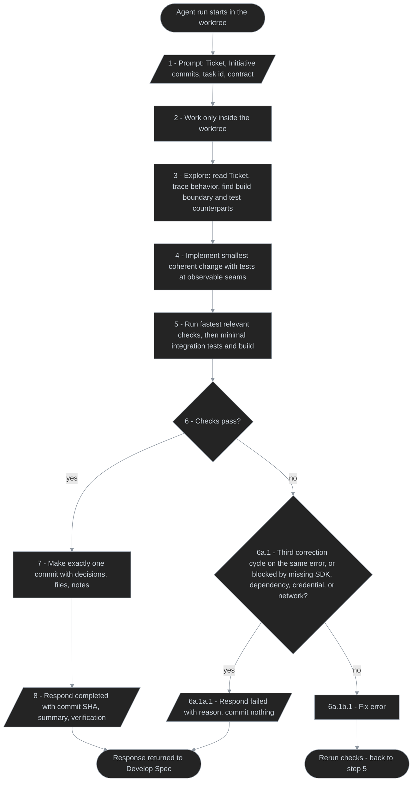
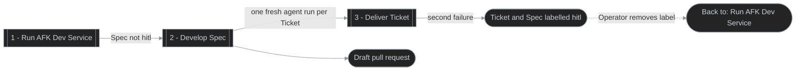

# Autonomous Spec Delivery

## Purpose
Loop delivers the approved Tickets of every open Spec to a draft pull request without an operator in the session and escalates a Ticket to a human once it keeps failing. Each Ticket attempt is one fresh run of the developer role agent.

Specs and Tickets are read as immutable snapshots on the harness tracker and changed only by explicit commands (Comment, label, close, create Ticket, link Ticket), each applied on GitHub at once and in order. A failing command raises, earlier writes stay, and a retry re-reads GitHub and skips what is already applied. Each Spec's target
selects an explicitly configured repository and which of the planner, chore and review Stages run there; Git operations
and the draft PR belong to that target. The Ticket Stage supplies the
selected Ticket and refreshed Initiative history to the developer, and Loop's Workflow runtime
validates its typed reply and exactly one final commit; a rejected attempt is restored to its base and reworked
with a fresh agent session. The Workflow is one factory definition ([Factory Workflow Runtime](str-factory-workflow-runtime.md)).
The process diagrams below describe the Ticket delivery portion; the surrounding default definition is listed next.

## Default definition

`workflows/software_factory/workflows/implement_spec/definition.py` declares the delivery as one definition over the Stages
library, run once per Spec by Loop's Workflow runtime: route the Spec; prepare the checkout; conditional planning and Ticket
creation; publication of earlier work; delivery of each ready Ticket in the feature worktree with bounded rework,
closing it and publishing the draft pull request after it; publication after delivery; announcement; best-effort chore
cleanup; read-only PR review in the checkout; readiness checks. The `hitl` label, hand-off texts, commit subjects and the
Spec work item are values in its `policy.py`.

A Spec with no sub-issues can be planned; closed or held sub-issues prevent replanning. The planner records Ticket blockers as native GitHub blocked-by edges, and a Ticket is actionable only when it is open, carries neither `hitl` nor `spec`, and is READY by those edges. A BLOCKED or UNKNOWN Ticket is held without labelling its Spec `hitl`, and a blocker closed as not planned or duplicate stays unsatisfied until a human decides.
The developer retains its one-commit-per-Ticket contract. The cleanup agent
leaves edits for the harness to validate, commit, and push. Cleanup
is best effort and restores rejected changes.

Review starts after the implementation worktree closes and must cover the final
head with completed bugs, quality, smells, and initiative axes. Blocking findings,
held Tickets, or a moved head keep the PR as a draft.
The harness marks ready only after every readiness check passes; it never merges
or closes the Spec. Business failures end the run failed or handed off; the exit code is 0 for completed, idle or held,
1 for handed off or failed and 130 for interrupted.

Each Ticket's rework budget (the failure cap, 2 by default) is counted in the Execution ledger per work item and release,
not per UTC day. A Spec or Ticket handed to a person carries `hitl`; while it does, a run starts no agent and pushes
nothing for it. When the person removes `hitl`, the next run's intake writes a release, and the Spec starts a fresh scope
with a fresh budget.

The console shows one line per finished span (a Spec, a Ticket scope, a Stage attempt); `--otlp-endpoint` exports the same
spans, with the agent runs nested under them, to one observer. Details stay in telemetry, the Execution ledger or the DEBUG
file. See [Implement Spec phases](../../USAGE.md#implement-spec-phases) for configuration and examples.

## Definition
- **Actors:** Operator; Loop (the example `implement_spec` Workflow); Copilot agent (one fresh headless run per Ticket); GitHub.
- **Business processes:** Run AFK Dev Service; Develop Spec; Deliver Ticket.
- **Starts:** Operator runs the `implement_spec` Workflow script (through their own alias) for a repository board.
- **Ends:** Every open Spec not labelled `hitl` was attempted; each Develop Spec run ends with its validated commits pushed and its draft pull request ensured.

## Business Processes

### Run AFK Dev Service
Actor: Operator; Trigger: the `implement_spec` Workflow script is run for a repository board; Action: Loop lists the open Specs, skips those labelled `hitl`, and runs Develop Spec for each remaining one; Outcome: every remaining Spec was attempted. Notes: `--dry` fakes external dependencies; there is no Spec-level attempt cap; failures are counted per Ticket.

### Develop Spec
Actor: Loop; Trigger: a Spec not labelled `hitl`; Action: resolve the Initiative id from the Spec title prefix and the target repository and base branch, fetch the target repository, and when no Ticket is actionable push and ensure the draft pull request and stop; when the base branch is missing on `origin` label the Spec `hitl` and stop; otherwise push earlier commits and ensure the draft pull request when ahead, create the worktree, and for each actionable Ticket record `previous_head`, render the prompt, run Deliver Ticket, then validate the response and Git; success closes the Ticket with the commit SHA, summary, and verification; any failure restores the worktree to `previous_head` and counts once against the Ticket's rework budget (per work item and release, in the Execution ledger, not per UTC day), retries the same Ticket with a fresh agent session until the failure cap, and at the cap labels the Ticket and the Spec `hitl` with the reason commented on both and stops; finally push and ensure the draft pull request; Outcome: all Tickets delivered — the pull request link is commented on the Spec, which stays open for the human merge — or the Spec stopped on `hitl` with its validated work pushed.

```mermaid
%%{init: {'themeVariables': {'lineColor': '#8b949e'}}}%%
%% diagram-id: develop-spec-swimlane
swimlane-beta TB
  accTitle: Develop Spec responsibility
  accDescr: Shows the whole flow of one Spec run, with Loop validating each Ticket the Copilot agent delivers and publishing results to GitHub.

  subgraph loop [Loop - implement_spec Workflow]
    start([Spec not labelled hitl])
    meta[1 - Resolve Initiative id, target repo, base branch]
    fetch[2 - Fetch target repo]
    actionable{3 - Actionable Tickets?}
    idle[3a.1 - Push branch and ensure draft PR when ahead]
    baseOk{4 - Base branch on origin?}
    noBase[4a.1 - Label Spec hitl, comment reason]
    pre[5 - Push earlier commits and ensure draft PR when ahead]
    wt[6 - Create worktree]
    head[7 - Record previous HEAD]
    prompt[8 - Render prompt with Ticket, Initiative commits, task id, contract]
    parse[10 - Parse response envelope]
    gitCheck[11 - Check commit: HEAD moved, one commit, tagged subject, clean tree, reported SHA is HEAD]
    valid{12 - Response and commit valid?}
    close[12a.1 - Close Ticket with SHA, summary, verification]
    clear[12a.2 - Ticket delivered, no further attempts]
    more{12a.3 - More actionable Tickets?}
    nextTicket([Next Ticket - back to step 7])
    reset[12b.1 - Reset worktree to previous HEAD]
    count[12b.2 - Count failure]
    cap{12b.3 - Failure cap reached?}
    hitl[12b.3a.1 - Label Ticket and Spec hitl, comment reason]
    retry([Retry same Ticket - back to step 7])
    publish[13 - Push branch and ensure draft PR when ahead]
    done{14 - All Tickets delivered?}
    link[14a.1 - Comment PR link on Spec]
    endNode([Spec run ended])
  end

  subgraph agent [Copilot agent - fresh run]
    run[[9 - Deliver Ticket]]
  end

  subgraph ext [External systems - GitHub]
    remote[(Target repo remote and PR)]
    issues[(Spec and Ticket issues)]
  end

  start --> meta --> fetch --> actionable
  actionable -->|none| idle --> endNode
  actionable -->|yes| baseOk
  baseOk -->|no| noBase --> endNode
  baseOk -->|yes| pre --> wt --> head --> prompt
  prompt -->|prompt| run
  run -->|response, one commit| parse --> gitCheck --> valid
  valid -->|yes| close --> clear --> more
  more -->|yes| nextTicket
  more -->|no| publish
  valid -->|no| reset --> count --> cap
  cap -->|yes| hitl --> publish
  cap -->|no| retry
  publish --> done
  done -->|yes| link --> endNode
  done -->|no| endNode
  idle -->|push, PR| remote
  pre -->|push, PR| remote
  publish -->|push, PR| remote
  noBase -->|labels, comments| issues
  close -->|close| issues
  hitl -->|labels, comments| issues
  link -->|PR link| issues

  classDef default fill:#242424,stroke:#8b949e,color:#c9d1d9,stroke-width:1px
```

### Deliver Ticket
Actor: Copilot agent (one fresh headless run per attempt, following the `implement_spec` prompt); Trigger: Develop Spec renders the prompt with the Ticket, the Initiative's `ccode(<initiative-id>|` commits on the branch, the task id `<initiative-id>|<ticket-number>`, and the contract; Action: the agent works only inside the worktree, explores, implements the functional slice, verifies it with the fastest relevant checks, makes exactly one `ccode(<initiative-id>|<ticket-number>): <message>` commit, and ends with the response envelope; Outcome: a `completed` envelope carrying the commit SHA, summary, and verification, or a `failed` envelope carrying the reason with nothing committed. Notes: the agent never pushes, opens a pull request, or comments, labels, or closes a Ticket or Spec; Loop validates the envelope and Git and owns the Ticket state in Develop Spec. A Develop Spec failure is an agent-reported `failed`, a missing or invalid response, an `identifier` other than this Ticket's, HEAD unchanged, a non-matching subject, a dirty tree, a reported SHA other than HEAD, or a crashed or timed-out run.



## Relationships



A solid edge is automatic; a dotted edge is a separately initiated step, labelled with its initiator.

Decisions: [Compose Workflows as declarative definitions](../adr/compose-factory-workflows-as-declarative-definitions-over-a-stages-library-run-by-a-factory-runtime.md) (one definition over a Stages library, run by Loop's Workflow runtime), [Run one fresh agent per Ticket](../adr/run-one-fresh-agent-per-ticket-from-python-and-let-the-agent-commit-it.md) (per-Ticket run, task commit, Git validation, Python owns push, pull request, and Ticket state), [Build agents with an agent builder](../adr/build-agents-with-an-agent-builder-over-profiles-strategies-and-session-stores.md) (the library returns raw output; the `implement_spec` Workflow extracts the response envelope).

## Implementation Map
| Concern | Stable anchor | Semantic locator |
|---|---|---|
| External contract | Operator-run service for one repository board | `workflows/software_factory/workflows/implement_spec/__main__.py`: runnable package (`python -m workflows.software_factory.workflows.implement_spec`) `main(argv, *, services=None)`, options `--spec`, `--log-dir`, `--log-level`, `--otlp-endpoint`, `--no-otel`, `--fake`, `--dry`; run from the harness root |
| Spec and Ticket selection | Open Specs; actionable Tickets | `workflows/software_factory/infrastructure/github/issues/`: `Issues.specs` (complete reads), `SpecGraphSnapshot`, `IssueClassifier`; `workflows/software_factory/workflows/implement_spec/intake.py`: the open, complete Specs not awaiting a person; `workflows/software_factory/stages/tickets.py`: `next_ready_ticket` |
| Execution | Fresh non-interactive Copilot run per Ticket by default | `loop`: `AgentBuilder`, `Worktree.agent`, `AgentClient`; `workflows/software_factory/stages/tickets.py`: `implement_ticket`; `workflows/software_factory/agents/roles/developer/`: the developer role agent, its prompt and its identifier-checking reply decoder |
| Failure bound | Per-Ticket failure count per work item and release, across runs | `workflows/software_factory/workflows/implement_spec/definition.py`: `rework(max_attempts=settings.max_failures, then=handoff(escalate_ticket))`, counted in the Execution ledger (`src/runtime/ledger.py`); `policy.py`: `release_reason` |
| Tests | Workflow scenarios against fakes | `workflows/tests/software_factory/workflows/implement_spec/`: scenarios through `main(argv, services=...)` over `harness.py` (fake tracker, real temporary repository, scripted agent, temporary ledger, recorded spans) |
