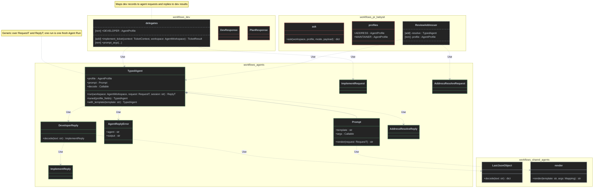
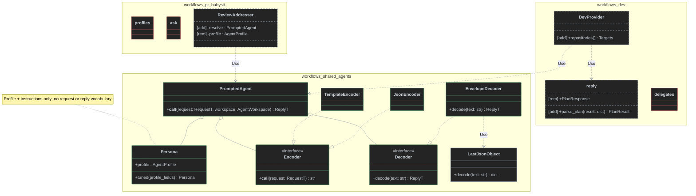
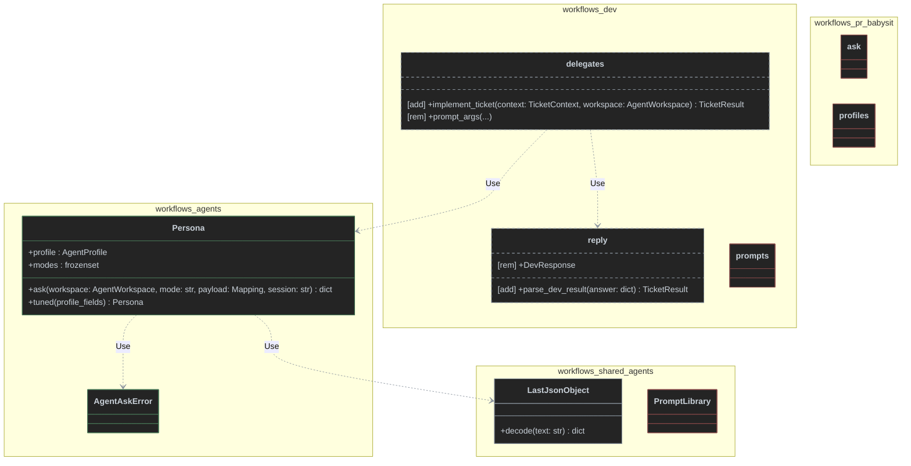
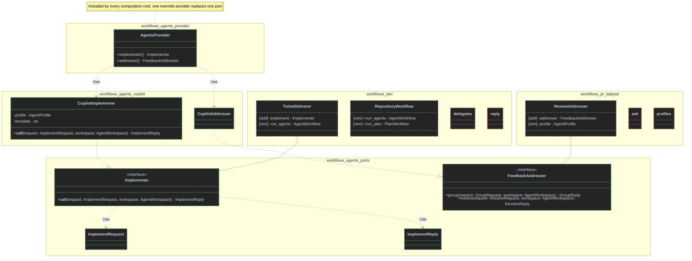

# Design options: cross-Workflow reusable agents

Ticket: [#149 — Design cross-Workflow reusable agents](https://github.com/antshc/loop/issues/149) (Wayfinder `contract-design`, Options phase).

> "Move the agents on the workflows level. Agents must be reusable across workflows."

## Context

Today each Workflow slice owns its agents end to end:

| Piece | `pr_babysit` | `dev` |
|-------|--------------|-------|
| Profile | `ADDRESS`, `MAINTAINER` in [`agents/profiles.py`](../../workflows/pr_babysit/agents/profiles.py): `copilot`, deny `git commit/push`, `gh`, 1800 s | `DEVELOPER`, `PLANNER`, `VERIFIER`, `CHORE`, `REVIEWER` in [`agents/delegates.py`](../../workflows/dev/agents/delegates.py): `replace(DEFAULT, name=...)` |
| Prompt | Instructions files [`address.md`](../../workflows/pr_babysit/agents/address.md), [`maintainer.md`](../../workflows/pr_babysit/agents/maintainer.md) with `mode`s; request is a JSON payload | `{{KEY}}` templates in [`workflows/dev/prompts/`](../../workflows/dev/prompts/), rendered by [`agents/prompts.py`](../../workflows/dev/agents/prompts.py) |
| Request | `ask(workspace, profile, mode, payload: dict)` in [`agents/ask.py`](../../workflows/pr_babysit/agents/ask.py) | `*_args(context) -> dict[str, str]` per delegate |
| Response | Untyped `dict`; non-zero exit or missing JSON → `Blocked` | `DevResponse`, `PlanResponse`, `ChoreResponse`, `VerifyResponse`, `ReviewResponse` in [`model/reply.py`](../../workflows/dev/model/reply.py) → typed `*Result` records |
| Selection | Features import `ADDRESS`/`MAINTAINER` and `replace(..., timeout_sec=settings.timeout)` | [`composition/repositories.py`](../../workflows/dev/composition/repositories.py) binds `partial(delegate, template=load_prompt(name))` into `RepositoryWorkflow` per repository; stages receive `AgentWorkflow`, `PlanWorkflow`, … callables |

Shared glue in [`workflows/shared/agents/`](../../workflows/shared/agents/): `LastJsonObject`/`ContentDecodeError` ([envelope.py](../../workflows/shared/agents/envelope.py)), `render`/`PromptLibrary`/`PromptError` ([prompts.py](../../workflows/shared/agents/prompts.py)), `AgentLauncher` ([launcher.py](../../workflows/shared/agents/launcher.py)).

### Constraints any option must satisfy

- Workflows import only the public `loop` API; every run goes through `AgentWorkspace.agent(profile).run(AgentRequest)` ([Agent Client](../concepts/str-agent-client.md), [Agent Run](../concepts/str-agent-run.md)).
- The library returns raw output; envelope interpretation belongs to Workflow code, which reuses `LastJsonObject` ([Agent Client](../concepts/str-agent-client.md); superseded [output-parser ADR](../adr/stream-agent-output-live-and-parse-it-after-exit-with-a-per-agent-kind-output-parser.md) keeps the generic `status`/`result` envelope idea).
- An Agent Run carries no workflow-specific role in the Run contract ([Agent Run](../concepts/str-agent-run.md)); roles live in profiles and prompts.
- No Workflow imports another; only `composition/` and `workflows/shared/providers.py` import `dishka` ([vertical-slice ADR](../adr/structure-workflows-as-vertical-slices-over-a-shared-package-wired-by-dishka.md), [`pyproject.toml`](../../pyproject.toml)).
- Copying a Workflow to another harness copies its slice plus shared code; the agent home must travel with it.
- Independent of the parallel tickets: no PR model types (pr_babysit-owned) and no scheduled-Job types appear in agent contracts.

### Dependency classification (codebase-design)

| Dependency | Category | Seam treatment |
|------------|----------|----------------|
| Prompt rendering, envelope decoding, request → prompt mapping, reply → typed result | In-process | Merge behind the agent interface; test directly |
| `AgentWorkspace` / `AgentClient` (agent CLI process) | True external, already ported by `loop` (`CliRunner` fake) | Injected per call; tests pass a fake workspace whose `agent(profile).run` returns canned output |
| Prompt/instruction files on disk | Local-substitutable | Read through `Instructions.from_file` / `PromptLibrary`; tests use real files |

The seam under debate is **where the agent's interface lives** (slice, `workflows/shared/agents/`, or a new `workflows/agents/`) and **how much it hides**: profile + prompt + request mapping + envelope decoding.

### Policy currently in the way

1. [Workflow Architecture](../concepts/str-loop-library-workflow-architecture.md) rule: "workflow-specific models, rules, prompts, and orchestration stay inside the slice."
2. Import-linter: "Dev stages run the delegates they are given, never a concrete agent" (`workflows.dev.{backlog,chore,deliver,model,plan,review,tracker,verify}` ↛ `workflows.dev.agents`).
3. Import-linter: "Shared workflow infrastructure imports no workflow slice" (`workflows.shared` ↛ `workflows.dev`, `workflows.pr_babysit`, …).

The design constraints applied (one per option, per *Design It Twice*): **A** minimize the interface; **B** maximize flexibility; **C** make the most common caller trivial; **D** ports & adapters for the cross-seam dependency. **E** is a hybrid that applies A's minimal interface to agents and adds a reusable stages layer, borrowing from D only the stage-owned ports that earn two adapters.

---

## Option A — Typed agent catalog in `workflows/agents/` (minimal interface)

One generic, deep contract — `TypedAgent[RequestT, ReplyT]` with a single `run` — and a catalog of named agents, each a small package owning its profile, prompt, typed request/reply, and decoder. `workflows/agents/` becomes a layer between the slices and `workflows/shared/`.

### Interface

```python
# workflows/agents/contract.py
from __future__ import annotations

from collections.abc import Callable, Mapping
from dataclasses import dataclass, replace
from typing import Any

from loop import AgentProfile, AgentRequest, AgentWorkspace


class AgentReplyError(ValueError):
    """The agent exited non-zero or answered without a valid reply."""

    def __init__(self, message: str, agent: str, output: str) -> None:
        super().__init__(message)
        self.agent = agent
        self.output = output


@dataclass(frozen=True)
class Prompt[RequestT]:
    """A `{{KEY}}` template and the arguments one request fills it with."""

    template: str
    args: Callable[[RequestT], Mapping[str, str]]

    def render(self, request: RequestT) -> str: ...


@dataclass(frozen=True)
class TypedAgent[RequestT, ReplyT]:
    """One reusable agent: profile, prompt, and reply decoder behind a single run."""

    profile: AgentProfile
    prompt: Prompt[RequestT]
    decode: Callable[[str], ReplyT]

    def run(self, workspace: AgentWorkspace, request: RequestT, *, session: str | None = None) -> ReplyT:
        """Renders the prompt, runs one fresh agent in `workspace`, and decodes its reply; raises AgentReplyError."""

    def tuned(self, **profile: Any) -> TypedAgent[RequestT, ReplyT]:
        """The same agent with profile fields (model, timeout_sec, permissions, ...) overridden."""
        return replace(self, profile=replace(self.profile, **profile))

    def with_template(self, template: str) -> TypedAgent[RequestT, ReplyT]:
        """The same agent with a slice- or repository-specific template over the same placeholders."""
        return replace(self, prompt=replace(self.prompt, template=template))
```

```python
# workflows/agents/developer/__init__.py — one catalog entry
@dataclass(frozen=True)
class ImplementRequest:
    """What a developer agent needs to implement one task; Workflow-neutral strings and paths."""

    task_json: str
    prior_commits: tuple[str, ...]
    commit_subject: str
    worktree: Path
    base_branch: str
    feature_branch: str


@dataclass(frozen=True)
class ImplementReply:
    """The developer's `completed` or `failed` answer."""

    status: Literal["completed", "failed"]
    commit: str = ""
    summary: str = ""
    verification: str = ""
    reason: str = ""


DEVELOPER: TypedAgent[ImplementRequest, ImplementReply]
```

Catalog: `developer`, `planner`, `verifier`, `chore`, `reviewer` (from dev), `address`, `maintainer` (from pr_babysit). Babysit's mode-based agents become one `TypedAgent` per mode (`ADDRESS_GROUP`, `ADDRESS_RESOLVE`, `MAINTAINER_DIAGNOSE`, `MAINTAINER_FIX`) sharing one profile and instructions file; the prompt is the JSON payload (`Prompt(template="{{PAYLOAD}}", ...)`).

Invariants and error modes: one `run` = one fresh Agent Run (stateless unless `session` names one); non-zero exit and undecodable output raise `AgentReplyError` — except agents whose reply is best-effort (chore), whose decoder returns an empty reply as today; an identifier mismatch (developer) raises `AgentReplyError`.

### Delta class diagram



### Package layout

```text
workflows/
├── agents/                       # NEW layer: reusable agents; imports loop + workflows.shared only
│   ├── __init__.py               # TypedAgent, Prompt, AgentReplyError + catalog re-exports
│   ├── contract.py
│   ├── developer/  {__init__.py, implement.md, reply.py}
│   ├── planner/    {__init__.py, plan.md, reply.py}
│   ├── verifier/   {__init__.py, verify.md, reply.py}
│   ├── chore/      {__init__.py, chore.md, reply.py}
│   ├── reviewer/   {__init__.py, review.md, reply.py}
│   ├── address/    {__init__.py, address.md}
│   ├── maintainer/ {__init__.py, maintainer.md}
│   └── tests/
├── shared/agents/                # unchanged: envelope, prompts, launcher
├── dev/agents/delegates.py       # thin mappers TicketContext ↔ ImplementRequest/Reply; prompts/ and model/reply.py removed
└── pr_babysit/agents/workspace.py  # PrWorkspace stays; profiles.py, ask.py, *.md move out
```

### What hides behind the seam

Profile defaults, instructions/template text, placeholder names, rendering and missing-argument errors, `AgentRequest` construction, exit-code check, `LastJsonObject` predicate, envelope validation (`status`, `result`, `identifier`), field coercion into the reply dataclass.

### Dependency strategy

In-process merge for prompt + decode; `AgentWorkspace` stays injected per call (no new port — `loop` already owns the CLI seam and tests fake the workspace). Tests of each catalog entry run `agent.run(fake_workspace, request)` against canned output; the per-response unit tests in `workflows/dev/tests` for `reply.py` move to `workflows/agents/tests` and test through `run` (replace, don't layer).

### How slices consume it

- **dev**: `composition/repositories.py` still builds `RepositoryWorkflow` from delegates; a delegate becomes `partial(implement_ticket, agent=DEVELOPER.with_template(repo_template))`. Delegates map `TicketContext` → `ImplementRequest` and `ImplementReply` → `TicketResult`, translating `AgentReplyError` to `DevResultError`. Stages are untouched; `dev/prompts/` may keep repository-specific overrides loaded through `PromptLibrary`.
- **pr_babysit**: `ReviewAddresser` receives `ADDRESS_RESOLVE.tuned(timeout_sec=settings.timeout)` and calls `.run(workspace, AddressResolveRequest(...))`; `AgentReplyError` → `Blocked`. `ask.py` and `profiles.py` are deleted.

### Policy / import-linter changes

- Concept rule 1 → "Reusable agents — profile, prompt, typed request/reply, and decoder — live in `workflows/agents/`; slice-specific models, orchestration, and the mapping between slice records and agent requests stay inside the slice." Update the concept's layout sketch, the "function delegate in `agents/` owns … named prompt selection" bullet, and add a new ADR superseding the "`agents` per slice" part of the [vertical-slice ADR](../adr/structure-workflows-as-vertical-slices-over-a-shared-package-wired-by-dishka.md).
- Rule 2 unchanged in name; extend `forbidden_modules` to `["workflows.dev.agents", "workflows.agents"]` so stages still only run delegates.
- Rule 3 unchanged; and add a `layers` contract `containers = ["workflows"]`, `layers = ["dev | pr_babysit | plan_implement | workflow_reporting", "agents", "shared"]` (agents import no slice; shared imports no agents).
- Add `workflows.agents` to the "Only composition roots … know the container" sources.
- `CONTEXT.md`: optionally add **Typed agent** ("an Agent profile with its prompt and reply decoder, reusable across Workflows").

### Trade-offs

- **+** Deepest module: one method hides seven agents' prompt/decode logic; a third Workflow reuses any agent by import. Fixing an envelope bug is fixed for every Workflow (locality).
- **+** Slices stay independent; no slice-to-slice import; stage contract preserved.
- **−** Request/reply types are a second vocabulary next to dev's `*Context`/`*Result`; delegates become mappers (some duplication). dev could later adopt the reply types directly.
- **−** Copying a Workflow now copies `agents/` too (all seven agents, even unused ones).
- **−** Babysit's single multi-mode instruction file splits into several typed agents sharing it.

---

## Option B — Generic agent engine in `workflows/shared/agents/`, slices keep the schema (maximize flexibility)

Do not create a new package. Lift only what is identical across Workflows into shared: **personas** (profile + instructions) and a composable `PromptedAgent` built from four pluggable parts. Each slice keeps its own request/reply types and decoders, and assembles agents in composition.

### Interface

```python
# workflows/shared/agents/persona.py
@dataclass(frozen=True)
class Persona:
    """A reusable agent identity: profile plus standing instructions; no task vocabulary."""

    profile: AgentProfile

    def tuned(self, **profile: Any) -> Persona: ...


ENGINEER: Persona       # copilot, generic developer instructions
GUARDED_ENGINEER: Persona  # copilot, denies git commit/push and gh (today's babysit _PERMISSIONS)
READ_ONLY_REVIEWER: Persona


# workflows/shared/agents/engine.py
class Encoder[RequestT](Protocol):
    def __call__(self, request: RequestT) -> str: ...


class Decoder[ReplyT](Protocol):
    def decode(self, text: str) -> ReplyT: ...


class TemplateEncoder[RequestT]:
    """Renders a `{{KEY}}` template from `args(request)`."""

    def __init__(self, template: str, args: Callable[[RequestT], Mapping[str, str]]) -> None: ...


class JsonEncoder[RequestT]:
    """Serializes `{"mode": mode, **payload(request)}`."""

    def __init__(self, mode: str, payload: Callable[[RequestT], Mapping[str, Any]]) -> None: ...


class EnvelopeDecoder[ReplyT]:
    """`LastJsonObject` + `status`/`result` validation, then `result` → ReplyT through `parse`."""

    def __init__(self, parse: Callable[[dict], ReplyT], *, where: Callable[[dict], bool] = ...,
                 on_failed: Callable[[dict], ReplyT] | None = None) -> None: ...


class PromptedAgent[RequestT, ReplyT]:
    """Persona + encoder + decoder; callable with the same shape as dev's delegates."""

    def __init__(self, persona: Persona, encode: Encoder[RequestT], decode: Decoder[ReplyT],
                 *, session: Callable[[RequestT], str | None] = lambda _: None) -> None: ...

    def __call__(self, request: RequestT, workspace: AgentWorkspace) -> ReplyT: ...
```

### Delta class diagram



### Package layout

```text
workflows/shared/agents/
├── envelope.py, prompts.py, launcher.py   # existing
├── persona.py                             # NEW: Persona + catalog constants
├── personas/  {engineer.md, guarded.md, reviewer.md}
└── engine.py                              # NEW: Encoder, Decoder, TemplateEncoder, JsonEncoder, EnvelopeDecoder, PromptedAgent
workflows/dev/       prompts/ stays; model/reply.py shrinks to `parse_*` functions; agents/delegates.py removed
workflows/pr_babysit/ agents/{address,maintainer}.md stay as task prompts; profiles.py, ask.py removed
```

### What hides behind the seam

Only the mechanics: run, exit check, envelope location/validation, template or JSON encoding. Prompts' task text, request/reply schema, and field parsing remain in each slice.

### Dependency strategy

Internal seams `Encoder`/`Decoder` have two+ adapters each (template/JSON; envelope/best-effort), so they are real. `AgentWorkspace` injected per call. Tests of the engine use fake workspaces; slice tests keep testing their `parse_*` functions.

### How slices consume it

- **dev**: composition builds `PromptedAgent(ENGINEER.tuned(name=Role.DEVELOPER), TemplateEncoder(load_prompt("implement"), implement_args), EnvelopeDecoder(parse_dev_result, where=has_status))` and puts it in `RepositoryWorkflow.run_agents` — the callable shape `(context, workspace) -> result` matches `AgentWorkflow` exactly, so stages do not change.
- **pr_babysit**: features receive `PromptedAgent(GUARDED_ENGINEER.tuned(timeout_sec=...), JsonEncoder("resolve", ...), EnvelopeDecoder(parse_resolution))`.

### Policy / import-linter changes

- Concept rule 1 → narrowed only for personas: "Agent personas (profile + standing instructions) and the agent engine live in `workflows/shared/agents/`; task prompts, request/reply models, and orchestration stay inside the slice."
- Rule 2 unchanged; `workflows.dev.agents` is deleted, so the contract's forbidden module either becomes `workflows.dev.composition` (already covered) or is dropped.
- Rule 3 unchanged — shared still imports no slice.
- No new contracts.

### Trade-offs

- **+** Smallest policy change; no new package; slices keep full control of schema and task text.
- **+** Most flexible: any encoder/decoder combination, any persona.
- **−** Shallow: callers must learn four parts to assemble one agent. What is "reusable" is mostly mechanics, not the agent — a third Workflow wanting dev's planner must copy dev's prompt and parser. Weakest answer to "agents must be reusable across workflows".

---

## Option C — Mode-based personas with a JSON `ask` in `workflows/agents/` (common caller trivial)

Generalize babysit's model to every agent: an agent is a **persona** with one instructions file that documents named **modes** and their JSON reply shape. A caller asks a mode with a JSON payload and gets a `dict` (or a `TypedDict`) back. No templates: the instructions are the system prompt, the payload is the user prompt.

### Interface

```python
# workflows/agents/persona.py
@dataclass(frozen=True)
class Persona:
    """An agent profile whose instructions define named modes, each answering one JSON object."""

    profile: AgentProfile
    modes: frozenset[str]

    def ask(self, workspace: AgentWorkspace, mode: str, payload: Mapping[str, Any], *,
            session: str | None = None) -> dict[str, Any]:
        """Sends `{"mode": mode, **payload}`; raises AgentAskError on exit, missing JSON, or unknown mode."""

    def tuned(self, **profile: Any) -> Persona: ...


class AgentAskError(ValueError):
    """The persona exited non-zero, answered without a JSON object, or was asked an unknown mode."""


DEVELOPER: Persona   # modes: implement
PLANNER: Persona     # modes: plan
VERIFIER: Persona    # modes: verify
CHORE: Persona       # modes: tidy
REVIEWER: Persona    # modes: review
ADDRESS: Persona     # modes: group, resolve
MAINTAINER: Persona  # modes: diagnose, fix
```

### Delta class diagram



### Package layout

```text
workflows/agents/
├── __init__.py               # Persona, AgentAskError, catalog
├── persona.py
└── instructions/  {developer.md, planner.md, verifier.md, chore.md, reviewer.md, address.md, maintainer.md}
workflows/dev/       prompts/ removed; agents/delegates.py builds payloads; model/reply.py parses dicts
workflows/pr_babysit/ agents/ keeps workspace.py only
```

### What hides behind the seam

Profile, instructions, request serialization, exit check, JSON extraction, mode validation. Reply schema is documented in Markdown, not in types.

### Dependency strategy

In-process; `AgentWorkspace` per call. One adapter, no internal seams. Tests fake the workspace.

### How slices consume it

- **dev**: `DEVELOPER.ask(workspace, "implement", {"ticket": asdict(ticket), "commit_subject": ..., ...})`, then dev's `reply.py` turns the dict into `TicketResult`. The five templates are rewritten as instructions files and the per-run context moves into JSON.
- **pr_babysit**: unchanged usage — `ADDRESS.tuned(timeout_sec=...).ask(workspace, "resolve", {...})`, `AgentAskError` → `Blocked`.

### Policy / import-linter changes

- Concept rule 1 → "Agent personas and their mode instructions live in `workflows/agents/`; reply parsing and orchestration stay inside the slice."
- Rule 2 → extend `forbidden_modules` with `workflows.agents`.
- Rule 3 unchanged; add the `workflows` `layers` contract (slices > agents > shared) as in Option A.
- [Agent Client](../concepts/str-agent-client.md) unaffected; `PromptLibrary`/`render` lose their last caller and are removed from `workflows/shared/agents/`.

### Trade-offs

- **+** Trivial call site (one method, plain dicts); one prompting style everywhere; personas are naturally reusable since they carry no Workflow vocabulary in the call.
- **−** Untyped replies push decoding back into every slice — the envelope/field validation in `reply.py` is duplicated by each consumer of a persona.
- **−** Large migration of dev's prompts; long `{{TICKET_JSON}}`-style context becomes JSON payload, losing the template's prose framing per placeholder.
- **−** Reply schema lives only in Markdown; a prompt edit can silently break consumers.

---

## Option D — Agent ports with a default adapter set, wired by an `AgentsProvider` (ports & adapters)

Treat each agent capability as a **port** — a typed `Protocol` with typed request/reply — that features depend on by type. A default adapter package implements each port with a Copilot profile and prompt; a Dishka `AgentsProvider` binds them so any composition root includes it and tests or users override a single port by provider.

### Interface

```python
# workflows/agents/ports.py — features import only this module
class Implementer(Protocol):
    """Implements one task in the workspace and reports its commit."""

    def __call__(self, request: ImplementRequest, workspace: AgentWorkspace) -> ImplementReply: ...


class Planner(Protocol):
    def __call__(self, request: PlanRequest, workspace: AgentWorkspace) -> PlanReply: ...


class Verifier(Protocol): ...
class Tidier(Protocol): ...
class Reviewer(Protocol): ...
class FeedbackAddresser(Protocol):
    def group(self, request: GroupRequest, workspace: AgentWorkspace) -> GroupReply: ...
    def resolve(self, request: ResolveRequest, workspace: AgentWorkspace) -> ResolveReply: ...
class CiFailureFixer(Protocol):
    def diagnose(self, request: DiagnoseRequest, workspace: AgentWorkspace) -> Diagnosis: ...
    def fix(self, request: FixRequest, workspace: AgentWorkspace) -> FixReply: ...


# workflows/agents/copilot/implementer.py — default adapter
class CopilotImplementer:
    """Implementer over a copilot profile and the `implement.md` template."""

    def __init__(self, profile: AgentProfile = DEVELOPER_PROFILE, template: str | None = None) -> None: ...

    def __call__(self, request: ImplementRequest, workspace: AgentWorkspace) -> ImplementReply: ...


# workflows/agents/provider.py — only module here importing dishka
class AgentsProvider(Provider):
    implementer = provide(CopilotImplementer, provides=Implementer, scope=Scope.APP)
    planner = provide(CopilotPlanner, provides=Planner, scope=Scope.APP)
    ...
```

### Delta class diagram



`TicketDeliverer` is the dev deliver stage class whose delivery call today receives `run_agents` ([`deliver/tickets.py`](../../workflows/dev/deliver/tickets.py)).

### Package layout

```text
workflows/agents/
├── ports.py           # Protocols + request/reply dataclasses (the only module features import)
├── copilot/           # default adapters + prompts/instructions + reply decoders
├── provider.py        # AgentsProvider (Dishka)
└── tests/             # fakes per port + adapter tests
workflows/dev/        agents/ and model/reply.py removed; RepositoryWorkflow loses per-repo delegates
workflows/pr_babysit/ agents/ keeps workspace.py only
```

### What hides behind the seam

Everything agent-specific — profile, prompt, rendering, run, decoding — behind one Protocol per capability. The slice sees only port types.

### Dependency strategy

A true port: two adapters per capability (Copilot adapter in production, in-memory fake in tests); the fakes ship in `workflows/agents/tests` and replace today's dev `dry.py` agent fakes. Swapping an agent provider (Codex) is a new adapter, bound by override provider.

### How slices consume it

- **dev**: stages type their constructor parameters as `Implementer`, `Planner`, … and get them from the container; per-repository prompt overrides move into adapter constructor args bound per repository (harder: `RepositoryWorkflow` today holds per-repo delegates, which this option replaces with container keys).
- **pr_babysit**: `ReviewAddresser(addresser: FeedbackAddresser, ...)`; composition includes `AgentsProvider`.

### Policy / import-linter changes

- Concept rule 1 → "Agent ports and their default adapters live in `workflows/agents/`; features depend on ports only."
- Rule 2 replaced by a cross-slice rule: "Features depend on agent ports, never on agent adapters" — `forbidden`, sources = every feature package of every slice, forbidden = `workflows.agents.copilot`, `workflows.agents.provider`.
- Rule 3 unchanged; add the `workflows` `layers` contract (slices > agents > shared).
- "Only composition roots and the shared provider know the container" gains `workflows.agents.provider` as an allowed importer of `dishka` (rule text and concept rule "only `composition/` and `workflows/shared/providers.py` may import `dishka`" change).
- dev's `RepositoryWorkflow`/`Targets` delegate contract and `use_repositories(...)` override change shape.

### Trade-offs

- **+** Strongest typing and test story; override-by-type matches the Dishka ADR; adding a provider other than Copilot is local to one adapter.
- **−** Widest interface: one Protocol plus request/reply per capability; a new agent touches ports, adapter, provider, and fakes.
- **−** Breaks dev's per-repository delegate model and widens the `dishka` exception list; largest policy change.

---

## Option E — `software_factory` package with role agents and a reusable stages layer (hybrid of A and D)

Workflows move into their own `software_factory` package that depends on `loop`. Its top-level packages under `src/` are `agents`, `stages`, `workflows`, and `shared`, one per layer:

- **agents:** Option A's typed catalog, grouped by **Agent role** rather than by Workflow, with the same `TypedAgent` contract.
- **stages:** a new layer holding each **Stage** that two or more Workflows run.
  - Each stage is a deep module with a single `run`. It owns its gates, rollback, and commits, and returns a report instead of publishing.
  - Stages take their inputs from the shared typed GitHub read model (`PullRequest`, `ReviewThread`, `Comment`), never from a GitHub client.
- **workflows:** the vertical slices, without agents. They own the GitHub clients, the dev `Tracker`, and publishing.
- **shared:** infrastructure. This includes the typed GitHub domain from the `gh-ddd` redesign:
  - `shared/github/issues/`: `Issue`, `Comment`, `Spec`, `Ticket`, `SpecGraphSnapshot`, Ticket readiness, and the `Issues` client.
  - `shared/github/pull_requests/`: `PullRequest`, `ReviewThread`, `PullRequestSnapshot`, `CheckResult`, the merge and lifecycle policies, and the `PullRequests` client.
  - The pure modules of both import no `gh` process code.

From Option D it takes only the stage-owned ports with two adapters (`Checkpoint`). It skips agent ports, publishing ports, and the `AgentsProvider`.

### Interface

```python
# agents/contract.py — identical to Option A
class AgentReplyError(ValueError): ...
@dataclass(frozen=True)
class TypedAgent[RequestT, ReplyT]:
    def run(self, workspace: AgentWorkspace, request: RequestT, *, session: str | None = None) -> ReplyT: ...
    def tuned(self, **profile: Any) -> TypedAgent[RequestT, ReplyT]: ...
    def with_template(self, template: str) -> TypedAgent[RequestT, ReplyT]: ...
```

```python
# stages/errors.py
class StageBlocked(Exception):
    """The stage cannot proceed; the Workflow maps it to its own policy."""

    def __init__(self, stage: str, reason: str) -> None: ...
```

```python
# stages/verify/stage.py
from shared.github.pull_requests.model import PullRequest


@dataclass(frozen=True)
class VerifyTarget:
    """The pull request to verify, plus Workflow-supplied acceptance context (a Spec and its Tickets in dev)."""

    pull_request: PullRequest
    context_json: str = ""
    session: str | None = None


@dataclass(frozen=True)
class VerifyReport:
    """The settled verdict, evidence location, unfixed findings, and the fix commit, if any."""

    verdict: Literal["pass", "partial", "fail", "inconclusive", "skipped"]
    summary: str
    evidence_dir: Path | None
    unfixed: tuple[str, ...]
    fix_commit: str

    @property
    def blocks_ready(self) -> bool: ...

    def comment_body(self) -> str:
        """The verdict as Markdown; the Workflow posts it on a Spec or a pull request."""


class Verify:
    """Runs the verifier on the pull request's head branch, applies the no-commit, evidence, and protected-path gates, and commits allowed fixes."""

    def __init__(
        self,
        git: GitClient,
        phases: Phases,
        *,
        evidence_root: Path,
        agent: TypedAgent[VerifyRequest, VerifyReply] = VERIFIER,
    ) -> None: ...

    def run(self, workspace: AgentWorkspace, target: VerifyTarget) -> VerifyReport: ...
```

```python
# stages/address/ports.py — the only stage port; two production adapters
class Checkpoint(Protocol):
    """Durable progress of one address batch, so a restarted run resumes mid-batch."""

    def load(self) -> AddressBatch | None: ...
    def save(self, batch: AddressBatch) -> None: ...
    def clear(self) -> None: ...


# stages/address/stage.py
from shared.github.issues.issue import Comment
from shared.github.pull_requests.model import PullRequestReview, ReviewThread


@dataclass(frozen=True)
class Feedback:
    """One review thread, conversation Comment, or review body to address; `key` is stable across reads."""

    key: str
    author: str
    body: str
    path: str | None = None
    line: int | None = None
    thread_id: str | None = None  # set for review threads: the reply goes to the thread, which can then be resolved

    @classmethod
    def from_thread(cls, thread: ReviewThread) -> Feedback: ...

    @classmethod
    def from_comment(cls, comment: Comment) -> Feedback: ...

    @classmethod
    def from_review(cls, review: PullRequestReview) -> Feedback: ...


@dataclass(frozen=True)
class AddressOutcome:
    """One reply per feedback key, the commits made, and whether any issue stayed unclear."""

    replies: Mapping[str, str]
    commits: tuple[str, ...]
    unclear: bool


Baseline = Callable[[Path], None]  # raises StageBlocked when the repository's checks fail before editing


class Address:
    """Groups feedback into issues, resolves each in turn, and commits fixes; the Workflow publishes the outcome."""

    def __init__(
        self,
        git: GitClient,
        phases: Phases,
        baseline: Baseline,
        *,
        group: TypedAgent[AddressGroupRequest, AddressGroupReply] = ADDRESS_GROUP,
        resolve: TypedAgent[AddressResolveRequest, AddressResolveReply] = ADDRESS_RESOLVE,
    ) -> None: ...

    def run(self, workspace: AgentWorkspace, feedback: Sequence[Feedback], checkpoint: Checkpoint) -> AddressOutcome: ...
```

Invariants and error modes:

- **Agents:**
  - Option A's invariants and error modes apply unchanged.
  - Agents never publish, and never import a stage, a Workflow, or `shared.github`. Requests carry plain strings and paths.
  - Each role is one flat pair, `agents/<role>.py` plus `agents/<role>.md`, with no `prompts/` directory. The module loads the prompt that sits next to it and has the same name.
- **Stages:**
  - A stage never imports a Workflow or a GitHub client (`Issues`, `PullRequests`, `GitHubRepo`, `GhCli`), and stages are independent of each other.
  - A stage may import the pure GitHub read model: `pull_requests.model`, `issues.issue`, `issues.graph`, and `identity`.
  - A stage takes its agents as constructor arguments that default to the role's catalog entry.
  - Skipped, inconclusive, and unclear are returned as values.
  - `AgentReplyError` inside `Verify` becomes `verdict="inconclusive"`.
  - `Address` raises `StageBlocked` for a dirty worktree, a failed baseline, an invalid reply, or incomplete feedback coverage.
- **Order inside `Verify`:**
  1. Discover verification skills, and skip if there are none.
  2. Run the agent on `pull_request.head_ref` against `pull_request.base_ref`.
  3. No-commit gate.
  4. Evidence gate.
  5. Protected-path rollback.
  6. Commit and push the fixes.
- **Order inside `Address`:**
  1. Clean-tree check.
  2. Baseline.
  3. Group.
  4. For each issue: resolve, gate on the agent's head, then commit or record, then save the checkpoint.
  5. Return the outcome. The caller then publishes: it replies to each thread with `thread_id` and resolves it, comments for everything else, and clears the checkpoint.
- **Promotion rule:**
  - A slice becomes a stage only when a second Workflow runs it. One consumer means it stays in the slice. Reject any stage flag that only one Workflow sets.
  - Next candidate: a `publish` stage over `PullRequests` (head-SHA guard, thread replies, resolution). It qualifies once dev publishes `Address` outcomes too.
  - The pure `MergeGateEvaluator` and `PullRequestLifecyclePolicy` stay in `shared` until two Workflows act on them.

### Delta class diagram



```mermaid
%%{init: {'themeVariables': {'lineColor': '#8b949e'}}}%%
%% diagram-id: option-e-role-agents-and-stages-delta
classDiagram
    namespace agents {
        class TypedAgent {
            +profile : AgentProfile
            +prompt : Prompt
            +decode : Callable
            +run(workspace: AgentWorkspace, request: RequestT, session: str) ReplyT
            +tuned(profile_fields) TypedAgent
            +with_template(template: str) TypedAgent
        }
        class AgentReplyError
    }
    namespace stages {
        class Verify {
            -git : GitClient
            -phases : Phases
            -agent : TypedAgent
            +run(workspace: AgentWorkspace, target: VerifyTarget) VerifyReport
        }
        class Address {
            -git : GitClient
            -phases : Phases
            -baseline : Baseline
            -group : TypedAgent
            -resolve : TypedAgent
            +run(workspace: AgentWorkspace, feedback: Sequence~Feedback~, checkpoint: Checkpoint) AddressOutcome
        }
        class Checkpoint {
            <<Interface>>
            +load() AddressBatch
            +save(batch: AddressBatch)
            +clear()
        }
        class VerifyTarget {
            +pull_request : PullRequest
            +context_json : str
        }
        class VerifyReport {
            +comment_body() str
        }
        class Feedback {
            +from_thread(thread: ReviewThread)$ Feedback
            +from_comment(comment: Comment)$ Feedback
            +from_review(review: PullRequestReview)$ Feedback
        }
        class AddressOutcome
        class StageBlocked
    }
    namespace shared_github {
        class PullRequest
        class ReviewThread
        class Comment
        class PullRequests {
            +pull_request(number: int) PullRequest
            +snapshot(number: int) PullRequestSnapshot
            +reply_to_thread(thread_id: str, body: str)
            +resolve_thread(thread_id: str)
            +comment(number: int, body: str)
        }
        class Issues
    }
    namespace workflows_dev {
        class AppVerifier
        class DevVerifySlice {
            +verify(spec: SpecGraphSnapshot, pull_request: PullRequest, worktree: AgentWorkspace) VerifyReport
        }
        class Tracker {
            <<Interface>>
            +comment(number: int, purpose: str, body: str) Comment
        }
        class MemoryCheckpoint
    }
    namespace workflows_pr_babysit {
        class ReviewAddresser {
            [add] -address : Address
            [rem] -profile : AgentProfile
        }
        class ChangePublisher
        class StateCheckpoint
        class ask
        class profiles
    }

    Verify o-- TypedAgent
    Address o-- TypedAgent
    Address ..> Checkpoint : Use
    Verify ..> VerifyTarget : Use
    Verify ..> VerifyReport : Use
    Address ..> Feedback : Use
    Address ..> AddressOutcome : Use
    Address ..> StageBlocked : Use
    TypedAgent ..> AgentReplyError : Use
    VerifyTarget ..> PullRequest : Use
    Feedback ..> ReviewThread : Use
    Feedback ..> Comment : Use
    MemoryCheckpoint ..|> Checkpoint
    StateCheckpoint ..|> Checkpoint
    Issues ..|> Tracker
    DevVerifySlice o-- Verify
    DevVerifySlice ..> Tracker : Use
    ReviewAddresser o-- Address
    ReviewAddresser ..> ChangePublisher : Use
    ChangePublisher ..> PullRequests : Use

    note for Verify "Replaces dev AppVerifier; reusable by pr_babysit before publishing"
    note for DevVerifySlice "Builds VerifyTarget from the PullRequest and the Spec payload; posts comment_body() through Tracker"

    class TypedAgent:::added
    class AgentReplyError:::added
    class Verify:::added
    class Address:::added
    class Checkpoint:::added
    class VerifyTarget:::added
    class VerifyReport:::added
    class Feedback:::added
    class AddressOutcome:::added
    class StageBlocked:::added
    class DevVerifySlice:::added
    class MemoryCheckpoint:::added
    class StateCheckpoint:::added
    class AppVerifier:::removed
    class ask:::removed
    class profiles:::removed
    class ReviewAddresser:::memberChanged

    classDef default fill:#242424,stroke:#8b949e,color:#c9d1d9,stroke-width:1px
    classDef added stroke:#4a7a5a,stroke-width:1px
    classDef removed stroke:#8a4a4a,stroke-width:1px
    classDef memberChanged stroke:#8b949e,stroke-width:1px,stroke-dasharray:5 5
```

- `DevVerifySlice` is the thin dev `verify/` slice that replaces [`AppVerifier`](../../workflows/dev/verify/verifier.py), which today posts through `Tracker.comment(spec.number, "verification", ...)`.
- The resume state machine in [`ReviewAddresser`](../../workflows/pr_babysit/address/reviews.py) moves into `Address`.
- [`ChangePublisher`](../../workflows/pr_babysit/publish/changes.py) keeps publishing over the shared `PullRequests` client.
- `Issues` structurally satisfies dev's `Tracker`, and `PullRequests` is unchanged.

### Package layout

```text
software_factory/
├── pyproject.toml                       # depends on loop; own extras (dishka)
├── src/
│   ├── agents/                          # by Agent role; imports loop + shared (never shared.github)
│   │   ├── __init__.py                  # TypedAgent, Prompt, AgentReplyError + catalog re-exports
│   │   ├── contract.py
│   │   ├── _kit/                        # private: launcher, envelope decoders (strict, best-effort), render
│   │   ├── planner.py     planner.md       # <role>.py: Request/Reply types + catalog constant(s)
│   │   ├── developer.py   developer.md     # <role>.md: that role's prompt, side by side, same name
│   │   ├── verifier.py    verifier.md
│   │   ├── reviewer.py    reviewer.md
│   │   ├── addresser.py   addresser.md     # one file shared by ADDRESS_GROUP and ADDRESS_RESOLVE modes
│   │   ├── maintainer.py  maintainer.md
│   │   └── chore.py       chore.md
│   ├── stages/                          # Stages used by ≥2 Workflows; imports agents, shared (pure GitHub model only), loop
│   │   ├── errors.py                    # StageBlocked
│   │   ├── verify/{stage,gates}.py
│   │   └── address/{stage,ports}.py     # ports = Checkpoint
│   ├── workflows/                       # vertical slices; no agents/ package
│   │   ├── dev/{plan,deliver,backlog,chore,review,verify,model,composition}/   # model/ holds Tracker and the hitl hand-off policy
│   │   └── pr_babysit/{discover,monitor,watch,address,maintain_ci,publish,composition}/ model.py settings.py
│   └── shared/
│       ├── git.py  process.py  state.py  telemetry.py  providers.py
│       └── github/
│           ├── identity.py  repo.py  account.py   # RepositoryId/IssueRef/CommentRef; GhCli + GitHubRepo
│           ├── issues/                  # Issue, Comment, Spec, Ticket, SpecGraphSnapshot, readiness, ticketing; Issues client
│           └── pull_requests/           # PullRequest, ReviewThread, PullRequestSnapshot, CheckResult, merge/lifecycle policy; PullRequests client
└── tests/                               # mirrors src
    ├── agents/  stages/  architecture/
    ├── shared/github/{issues,pull_requests}/
    ├── shared/fakes/                    # the gh-boundary fake, reused by stage, dev, and pr_babysit tests
    └── workflows/{dev,pr_babysit}/
```

### What hides behind the seam

- **Agents:** everything listed under Option A, plus the decoder flavour (strict envelope or best-effort).
- **Stages:**
  - Phase and gate recording.
  - Verification-skill discovery and the evidence directory layout.
  - Commit, restore, and protected-path rules.
  - The address resume state machine.
  - Turning threads, Comments, and reviews into stable feedback keys.
  - The verdict comment format.
- **Workflows:**
  - Which Specs, pull requests, and feedback to act on (fingerprints, `hitl`, readiness).
  - Sequencing, delivery, and escalation policy.
  - Publishing through `Tracker` / `PullRequests`.
- **shared/github:** `gh` REST/GraphQL calls, complete paged reads, retry-safe commands, and payload → typed model parsing.

### Dependency strategy

| Dependency | Category | Treatment |
|------------|----------|-----------|
| Prompt rendering, envelope decoding, gates, feedback keys, verdict format | In-process | Merged behind `TypedAgent.run` and `Stage.run`; tested directly |
| Typed GitHub read model and pure policies (`pull_requests.model`, `issues.graph`, readiness, merge gate, lifecycle) | In-process | Imported by stages and Workflows as values; no port |
| `Phases` / `WorkflowRun` | In-process | `loop` type passed in; `WorkflowRun` is a `Phases` |
| Git, worktrees, filesystem | Local-substitutable | No port; stage tests use a real repository under `tmp_path` |
| Address resume state | In-process, two production adapters | `Checkpoint` port in `stages/address/ports.py`; `StateCheckpoint` (pr_babysit JSON state) and `MemoryCheckpoint` (dev) |
| Baseline command | Local-substitutable | `Baseline` callable; repository command runner or test stub |
| Agent CLI | True external, already ported by `loop` | Injected `AgentWorkspace`; tests use Loop's fake runner with canned envelopes |
| GitHub (`gh`) | True external | Clients `Issues` and `PullRequests` used only by Workflows (dev reaches `Issues` through its `Tracker` Protocol). Tests fake at the `GhCli` boundary with `tests/shared/fakes/`. Stages never need a GitHub fake. |

### How slices consume it

- **dev:**
  - `verify/` reads the pull request with `pulls.pull_request(number)` and builds `VerifyTarget(pull_request, context_json=spec_and_tickets_payload(spec))`. It calls `Verify.run`, posts `report.comment_body()` with `tracker.comment(spec.number, "verification", ...)`, and calls `hand_to_human` when `blocks_ready`.
  - `review/` can run `Address` on the threads its reviewer posted: it builds `Feedback.from_thread` over `pulls.threads(number)` and passes a `MemoryCheckpoint`. That makes dev the second consumer of `Address`.
  - `deliver/`, `plan/`, and `chore/` call catalog agents through slice-local delegates, which keeps stages as delegate runners as in Option A.
- **pr_babysit:**
  - `watch/` keeps choosing which feedback is new, keeping its fingerprints and its dictionary projection (`babysit_snapshot`) for persisted state.
  - `ReviewAddresser` builds `Feedback` from the typed `PullRequestSnapshot` (`from_thread`, `from_comment`, `from_review`) and calls `Address.run(workspace, feedback, StateCheckpoint(state))`. It publishes replies and commits through `ChangePublisher` over `PullRequests`, maps `StageBlocked` to `Blocked`, and then clears the checkpoint.
  - It can call `Verify.run(workspace, VerifyTarget(snapshot.pull_request))` before publishing, and post `comment_body()` with `pulls.comment(number, ...)`.
- **Composition:** each `workflows/<w>/composition/` builds `Verify` and `Address` from their constructors, binds `Issues` / `PullRequests` from `SharedProvider`, and tunes agents with `tuned(...)` or `with_template(...)`. `--fake` and `--dry` replace only the agent runner and the `GhCli` boundary.

### Policy / import-linter changes

- **Repository:** Workflows leave the `loop` repository for `software_factory`, so [Ship Loop as a workflow library](../adr/ship-loop-as-a-workflow-library-with-no-built-in-workflows.md) holds more strictly.
  - This needs a new ADR that supersedes both the per-slice `agents` package and the `workflows/shared` location in the [vertical-slice ADR](../adr/structure-workflows-as-vertical-slices-over-a-shared-package-wired-by-dishka.md).
  - The [shared Spec and Ticket model ADR](../adr/share-the-spec-and-ticket-model-in-workflows-shared-while-dev-keeps-its-delivery-policy.md) carries over as `shared/github/issues/`.
- **Concept rule 1** becomes: "Reusable agents live in `agents/` by Agent role. Stages reused by two or more Workflows live in `stages/` and read the shared GitHub model. Workflow-specific policy, sequencing, selection, and publishing stay in the slice."
- **New `layers` contract:** `workflows | stages | agents | shared`.
- **`independence` contracts:**
  - `workflows.dev` and `workflows.pr_babysit`.
  - Every `stages.*` package.
  - Every agent role module.
- **New `forbidden` contracts:**
  - `stages` and `workflows` must not import `agents._kit`.
  - `stages` must not import the GitHub clients or process code: `shared.github.repo`, `shared.github.account`, `shared.github.issues.{client,commands,reader,ticketing}`, `shared.github.pull_requests.{client,reader,policy_reader}`, and `shared.process`.
  - `agents` must not import `shared.github`.
- **Rule 2:**
  - Dev features other than `verify/` and `review/` still must not import `agents`.
  - `verify/` may import `stages.verify`, and `review/` may import `stages.address`.
- **Rule 3:** unchanged in meaning. `shared` imports no other layer, and the existing "pure GitHub modules import no `gh` process code" contract carries over.
- **`dishka` rule:** unchanged in meaning: only `composition/` and `shared/providers.py` import it.

### Trade-offs

- **+** Two reuse levels:
  - Any Workflow can import an agent by role.
  - Gate-heavy activities (`Verify`, `Address`) are reused with one `run` call, so a gate or rollback fix applies to every Workflow.
- **+** The shared typed GitHub model removes most per-slice mapping: `VerifyTarget(pull_request)`, and `Feedback.from_thread` / `from_comment` / `from_review`.
- **+** Stages read values and never call `gh`, so they are tested once through `run`, with a real repository and fake agents and no GitHub fake. The `AppVerifier` and `ReviewAddresser` unit tests are replaced, not kept alongside.
- **+** The stages layer grows only through the promotion rule, so it can't fill up with single-use code.
- **−** Stages are coupled to the GitHub read model. A second code host (GitLab) or tracker (Jira) would need host-neutral target types first.
- **−** dev's verify now reads the `PullRequest` (one extra `gh` call) instead of passing only its URL. The verdict text moves from `AppVerifier._post_verdict` to `VerifyReport.comment_body()`.
- **−** pr_babysit's address agent input changes from its projected dictionaries to typed `AddressResolveRequest` built from `Feedback`. Fingerprints and persisted state keep the projection.
- **−** Adding a stage means updating the stage-independence contract.
- **−** Highest migration cost: a new repository, a new package root, and every import path changes.

---

## Comparison

| | A — Typed agent catalog | B — Shared engine | C — Mode personas | D — Agent ports | E — Role agents + stages |
|---|---|---|---|---|---|
| Home | new `workflows/agents/` | `workflows/shared/agents/` | new `workflows/agents/` | new `workflows/agents/` | `software_factory`: `agents/` + `stages/` |
| Reusable unit | Whole agent (profile + prompt + typed reply) | Persona + mechanics | Persona + modes | Capability port + default adapter | Whole agent (as A) + whole Stage (gates, commits) |
| Interface size | 1 generic class, 1 method (+2 tuners) | 4 parts to assemble | 1 method, untyped | 1 Protocol per capability | As A for agents; 1 `run` per stage + `Checkpoint` port |
| Depth (leverage) | High | Low | Medium (decoding left to callers) | High per port, wide overall | High (agents and stages) |
| Locality of a reply-shape fix | `workflows/agents/<agent>/` | each slice | each consumer | `workflows/agents/copilot/` | `agents/<role>.py`; gate fixes in `stages/<stage>/` |
| Typed request/reply | Yes, agent-owned | Yes, slice-owned | No (dicts) | Yes, port-owned | Yes, agent-owned; stage targets built from the shared GitHub model |
| Envelope decoding | Inside each agent's decoder | Shared `EnvelopeDecoder` + slice `parse` | Inside `ask` (JSON only) | Inside adapters | Inside each agent's decoder (`_kit` strict / best-effort) |
| Slice parameterization | `tuned(...)`, `with_template(...)` | Composition assembles parts | `tuned(...)`, payload | Adapter ctor args via providers | `tuned(...)`, `with_template(...)`, stage ctor args |
| dev delegates | Kept as thin mappers | Replaced by `PromptedAgent` instances (same callable shape) | Kept, build payloads | Removed; stages take ports | Kept as thin mappers; `verify/` calls `Verify` |
| `dev/model/reply.py` | Moves into agent `reply.py` modules | Shrinks to `parse_*` functions | Stays (parses dicts) | Moves into adapters | Moves into agent role modules |
| Stage contract (rule 2) | Kept, also forbids `workflows.agents` | Kept/dropped (module gone) | Kept, also forbids `workflows.agents` | Replaced by "ports, never adapters" | Kept; dev `verify/` and `review/` may import their stages |
| Shared imports no slice (rule 3) | Kept + `layers` contract | Kept | Kept + `layers` contract | Kept + `layers` contract | Kept + 4-layer `layers` contract |
| Concept rule 1 | Revised: agents move up | Narrow revision: personas only | Revised: personas move up | Revised: ports + adapters move up | Revised: agents by role and reused stages move up |
| `dishka` rule | Unchanged | Unchanged | Unchanged | Widened | Unchanged |
| Migration cost | Medium | Low | High (dev prompts rewritten) | High | Highest (new repository + stages extraction) |

## Recommendation

**Option A — the typed agent catalog in a new `workflows/agents/` layer.** It is the only option where the reusable unit is the *whole agent* behind a single `run`, which is what "agents must be reusable across workflows" asks for, while keeping both existing stage and slice-independence contracts intact.

Specifics to carry forward:

- Place `workflows/agents/` as a middle layer (`slices > agents > shared`) enforced by a new import-linter `layers` contract; keep `workflows/shared/agents/` as the generic glue (`LastJsonObject`, `render`, `AgentLauncher`) underneath.
- Keep dev's stage contract: stages still receive delegates, and the contract also forbids `workflows.agents`, so delegates remain the slice-local seam that maps dev records to agent requests (borrowing Option D's "features never see concrete agents" discipline without its `dishka` and per-repository costs).
- Borrow Option B's two decoder flavours internally (strict envelope vs. best-effort) as private helpers in `workflows/agents/`, not as public parts.
- Represent babysit's modes as one `TypedAgent` per mode sharing a profile and instructions file; avoid Option C's untyped `dict` replies.
- Record the change as a new ADR that supersedes the per-slice `agents` package in the [vertical-slice ADR](../adr/structure-workflows-as-vertical-slices-over-a-shared-package-wired-by-dishka.md), and revise the [Workflow Architecture](../concepts/str-loop-library-workflow-architecture.md) rule and layout sketch as listed under Option A.
