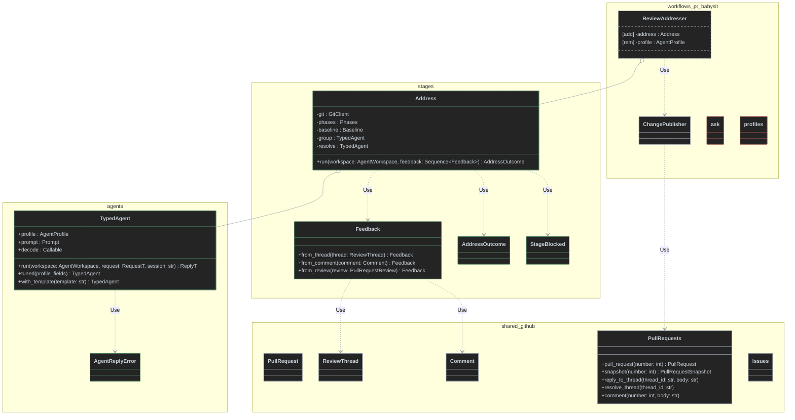

# Design options: cross-Workflow reusable agents

Ticket: [#149 — Design cross-Workflow reusable agents](https://github.com/antshc/loop/issues/149) (Wayfinder `contract-design`, Options phase).

> "Move the agents on the workflows level. Agents must be reusable across workflows."

> **Status.** Adopted: the factory design in [Factory Workflow Runtime](../concepts/str-factory-workflow-runtime.md), recorded in [Compose factory Workflows as declarative definitions](../adr/compose-factory-workflows-as-declarative-definitions-over-a-stages-library-run-by-a-factory-runtime.md). The options below, and the paths and rules they cite (`workflows/...`, `composition/`, Dishka), describe the code as it was when the options were compared and are kept as history; see the [Recommendation](#recommendation).

> **Current state.** The `dev` Workflow is now `implement_spec` (`workflows/implement_spec/`, `python -m workflows.implement_spec`). Its app-verification phase was removed with `verify/`, `AppVerifier`, the `verifier` agent, and `VerifyResponse`, so no option below carries a verifier agent or a `Verify` stage. The remaining `implement_spec` agents are `developer`, `planner`, `chore`, and `reviewer`.

## Context

Today each Workflow slice owns its agents end to end:

| Piece | `pr_babysit` | `implement_spec` |
|-------|--------------|-------|
| Profile | `ADDRESS`, `MAINTAINER` in `agents/profiles.py`: `copilot`, deny `git commit/push`, `gh`, 1800 s | `DEVELOPER`, `PLANNER`, `CHORE`, `REVIEWER` in `agents/delegates.py`: `replace(DEFAULT, name=...)` |
| Prompt | Instructions files `address.md`, `maintainer.md` with `mode`s; request is a JSON payload | `{{KEY}}` templates in `workflows/implement_spec/prompts/`, rendered by `agents/prompts.py` |
| Request | `ask(workspace, profile, mode, payload: dict)` in `agents/ask.py` | `*_args(context) -> dict[str, str]` per delegate |
| Response | Untyped `dict`; non-zero exit or missing JSON → `Blocked` | `DevResponse`, `PlanResponse`, `ChoreResponse`, `ReviewResponse` in `model/reply.py` → typed `*Result` records |
| Selection | Features import `ADDRESS`/`MAINTAINER` and `replace(..., timeout_sec=settings.timeout)` | `composition/repositories.py` binds `partial(delegate, template=load_prompt(name))` into `RepositoryWorkflow` per repository; stages receive `AgentWorkflow`, `PlanWorkflow`, … callables |

Shared glue in `workflows/shared/agents/`: `LastJsonObject`/`ContentDecodeError` (envelope.py), `render`/`PromptLibrary`/`PromptError` (prompts.py), `AgentLauncher` (launcher.py).

### Constraints any option must satisfy

- Workflows import only the public `loop` API; every run goes through `AgentWorkspace.agent(profile).run(AgentRequest)` ([Agent Client](../concepts/str-agent-client.md), [Agent Run](../concepts/str-agent-run.md)).
- The library returns raw output; envelope interpretation belongs to Workflow code, which reuses `LastJsonObject` ([Agent Client](../concepts/str-agent-client.md); superseded [output-parser ADR](../adr/stream-agent-output-live-and-parse-it-after-exit-with-a-per-agent-kind-output-parser.md) keeps the generic `status`/`result` envelope idea).
- An Agent Run carries no workflow-specific role in the Run contract ([Agent Run](../concepts/str-agent-run.md)); roles live in profiles and prompts.
- No Workflow imports another; only `composition/` and `workflows/shared/providers.py` import `dishka` ([vertical-slice ADR](../adr/structure-workflows-as-vertical-slices-over-a-shared-package-wired-by-dishka.md), [`pyproject.toml`](../../pyproject.toml)).
- Copying a Workflow to another harness copies its slice plus shared code; the agent home must travel with it.
- Independent of the parallel tickets: no PR model types (pr_babysit-owned) and no scheduled-Job types appear in agent contracts.

### Dependency classification (codebase-design)

| Dependency | Category | Seam treatment |
|------------|----------|----------------|
| Prompt rendering, envelope decoding, request → prompt mapping, reply → typed result | In-process | Merge behind the agent interface; test directly |
| `AgentWorkspace` / `AgentClient` (agent CLI process) | True external, already ported by `loop` (`CliRunner` fake) | Injected per call; tests pass a fake workspace whose `agent(profile).run` returns canned output |
| Prompt/instruction files on disk | Local-substitutable | Read through `Instructions.from_file` / `PromptLibrary`; tests use real files |

The seam under debate is **where the agent's interface lives** (slice, `workflows/shared/agents/`, or a new `workflows/agents/`) and **how much it hides**: profile + prompt + request mapping + envelope decoding.

### Policy currently in the way

1. [Workflow Architecture](../concepts/str-loop-library-workflow-architecture.md) rule: "workflow-specific models, rules, prompts, and orchestration stay inside the slice."
2. Import-linter: "Implement-spec stages run the delegates they are given, never a concrete agent" (`workflows.implement_spec.{backlog,chore,deliver,model,plan,review}` ↛ `workflows.implement_spec.agents`).
3. Import-linter: "Shared workflow infrastructure imports no workflow slice" (`workflows.shared` ↛ `workflows.implement_spec`, `workflows.pr_babysit`, …).

The design constraints applied (one per option, per *Design It Twice*): **A** minimize the interface; **B** maximize flexibility; **C** make the most common caller trivial; **D** ports & adapters for the cross-seam dependency. **E** extends A: it applies A's minimal interface to agents and adds a reusable stages layer.

---

## Option E — `software_factory` package with role agents and a reusable stages layer (A plus stages)

Workflows move into their own `software_factory` package that depends on `loop`. Its top-level packages under `src/` are `agents`, `stages`, `workflows`, and `shared`, one per layer:

- **agents:** Option A's typed catalog, grouped by **Agent role** rather than by Workflow, with the same `TypedAgent` contract.
- **stages:** a new layer holding each **Stage** that two or more Workflows run.
  - Each stage is a deep module with a single `run`. It owns its gates, rollback, and commits, and returns a report instead of publishing.
  - Stages take their inputs from the shared typed GitHub read model (`PullRequest`, `ReviewThread`, `Comment`), never from a GitHub client.
- **workflows:** the vertical slices, without agents. They own publishing and call the GitHub clients, which live in `shared`.
- **shared:** infrastructure. This includes the typed GitHub domain and its clients from the `gh-ddd` redesign:
  - `shared/github/issues/`: `Issue`, `Comment`, `Spec`, `Ticket`, `SpecGraphSnapshot`, Ticket readiness, and the `Issues` client.
  - `shared/github/pull_requests/`: `PullRequest`, `ReviewThread`, `PullRequestSnapshot`, `CheckResult`, the merge and lifecycle policies, and the `PullRequests` client.
  - The pure modules of both import no `gh` process code.

It takes nothing from Option D: no agent ports, publishing ports, stage ports, or `AgentsProvider`. Mid-batch resume (a `Checkpoint` port) is out of scope for now and can be added later as the first stage port.

### Interface

```python
# agents/contract.py — identical to Option A
class AgentReplyError(ValueError): ...
@dataclass(frozen=True)
class TypedAgent[RequestT, ReplyT]:
    def run(self, workspace: AgentWorkspace, request: RequestT, *, session: str | None = None) -> ReplyT: ...
    def tuned(self, **profile: Any) -> TypedAgent[RequestT, ReplyT]: ...
    def with_template(self, template: str) -> TypedAgent[RequestT, ReplyT]: ...
```

```python
# stages/errors.py
class StageBlocked(Exception):
    """The stage cannot proceed; the Workflow maps it to its own policy."""

    def __init__(self, stage: str, reason: str) -> None: ...
```

```python
# stages/address/stage.py
from shared.github.issues.issue import Comment
from shared.github.pull_requests.model import PullRequestReview, ReviewThread


@dataclass(frozen=True)
class Feedback:
    """One review thread, conversation Comment, or review body to address; `key` is stable across reads."""

    key: str
    author: str
    body: str
    path: str | None = None
    line: int | None = None
    thread_id: str | None = None  # set for review threads: the reply goes to the thread, which can then be resolved

    @classmethod
    def from_thread(cls, thread: ReviewThread) -> Feedback: ...

    @classmethod
    def from_comment(cls, comment: Comment) -> Feedback: ...

    @classmethod
    def from_review(cls, review: PullRequestReview) -> Feedback: ...


@dataclass(frozen=True)
class AddressOutcome:
    """One reply per feedback key, the commits made, and whether any issue stayed unclear."""

    replies: Mapping[str, str]
    commits: tuple[str, ...]
    unclear: bool


Baseline = Callable[[Path], None]  # raises StageBlocked when the repository's checks fail before editing


class Address:
    """Groups feedback into issues, resolves each in turn, and commits fixes; the Workflow publishes the outcome."""

    def __init__(
        self,
        git: GitClient,
        phases: Phases,
        baseline: Baseline,
        *,
        group: TypedAgent[AddressGroupRequest, AddressGroupReply] = ADDRESS_GROUP,
        resolve: TypedAgent[AddressResolveRequest, AddressResolveReply] = ADDRESS_RESOLVE,
    ) -> None: ...

    def run(self, workspace: AgentWorkspace, feedback: Sequence[Feedback]) -> AddressOutcome: ...
```

Invariants and error modes:

- **Agents:**
  - Option A's invariants and error modes apply unchanged.
  - Agents never publish, and never import a stage, a Workflow, or `shared.github`. Requests carry plain strings and paths.
  - Each role is one flat pair, `agents/<role>.py` plus `agents/<role>.md`, with no `prompts/` directory. The module loads the prompt that sits next to it and has the same name.
- **Stages:**
  - A stage never imports a Workflow or a GitHub client (`Issues`, `PullRequests`, `GitHubRepo`, `GhCli`), and stages are independent of each other.
  - A stage may import the pure GitHub read model: `pull_requests.model`, `issues.issue`, `issues.graph`, and `identity`.
  - A stage takes its agents as constructor arguments that default to the role's catalog entry.
  - An unclear address outcome is returned as a value.
  - `Address` raises `StageBlocked` for a dirty worktree, a failed baseline, an invalid reply, or incomplete feedback coverage.
- **Order inside `Address`:**
  1. Clean-tree check.
  2. Baseline.
  3. Group.
  4. For each issue: resolve, gate on the agent's head, then commit or record.
  5. Return the outcome. The caller then publishes: it replies to each thread with `thread_id` and resolves it, and comments for everything else.
- **Promotion rule:**
  - A slice becomes a stage only when a second Workflow runs it. One consumer means it stays in the slice. Reject any stage flag that only one Workflow sets.
  - Next candidate: a `publish` stage over `PullRequests` (head-SHA guard, thread replies, resolution). It qualifies once implement_spec publishes `Address` outcomes too.
  - The pure `MergeGateEvaluator` and `PullRequestLifecyclePolicy` stay in `shared` until two Workflows act on them.

### Delta class diagram



- The grouping, resolving, gating, and commit logic in `ReviewAddresser` moves into `Address`. Its resume state machine does not move; it is dropped for now.
- `ChangePublisher` keeps publishing over the shared `PullRequests` client.
- `Issues` and `PullRequests` are unchanged.

### Package layout

```text
software_factory/
├── pyproject.toml                       # depends on loop; own extras (dishka)
├── src/
│   ├── agents/                          # by Agent role; imports loop + shared (never shared.github)
│   │   ├── __init__.py                  # TypedAgent, Prompt, AgentReplyError + catalog re-exports
│   │   ├── contract.py
│   │   ├── _kit/                        # private: launcher, envelope decoders (strict, best-effort), render
│   │   ├── planner.py     planner.md       # <role>.py: Request/Reply types + catalog constant(s)
│   │   ├── developer.py   developer.md     # <role>.md: that role's prompt, side by side, same name
│   │   ├── reviewer.py    reviewer.md
│   │   ├── addresser.py   addresser.md     # one file shared by ADDRESS_GROUP and ADDRESS_RESOLVE modes
│   │   ├── maintainer.py  maintainer.md
│   │   └── chore.py       chore.md
│   ├── stages/                          # Stages used by ≥2 Workflows; imports agents, shared (pure GitHub model only), loop
│   │   ├── errors.py                    # StageBlocked
│   │   └── address/stage.py
│   ├── workflows/                       # vertical slices; no agents/ package
│   │   ├── implement_spec/{plan,deliver,backlog,chore,review,model,composition}/   # model/ holds the hitl hand-off policy
│   │   └── pr_babysit/{discover,monitor,watch,address,maintain_ci,publish,composition}/ model.py settings.py
│   └── shared/
│       ├── git.py  process.py  state.py  telemetry.py  providers.py
│       └── github/
│           ├── identity.py  repo.py  account.py   # RepositoryId/IssueRef/CommentRef; GhCli + GitHubRepo
│           ├── issues/                  # Issue, Comment, Spec, Ticket, SpecGraphSnapshot, readiness, ticketing; Issues client
│           └── pull_requests/           # PullRequest, ReviewThread, PullRequestSnapshot, CheckResult, merge/lifecycle policy; PullRequests client
└── tests/                               # mirrors src
    ├── agents/  stages/  architecture/
    ├── shared/github/{issues,pull_requests}/
    ├── shared/fakes/                    # the gh-boundary fake, reused by stage, implement_spec, and pr_babysit tests
    └── workflows/{implement_spec,pr_babysit}/
```

### What hides behind the seam

- **Agents:** everything listed under Option A, plus the decoder flavour (strict envelope or best-effort).
- **Stages:**
  - Phase and gate recording.
  - Commit and restore rules.
  - Turning threads, Comments, and reviews into stable feedback keys.
- **Workflows:**
  - Which Specs, pull requests, and feedback to act on (fingerprints, `hitl`, readiness).
  - Sequencing, delivery, and escalation policy.
  - Publishing through `Issues` / `PullRequests`.
- **shared/github:** `gh` REST/GraphQL calls, complete paged reads, retry-safe commands, and payload → typed model parsing.

### Dependency strategy

| Dependency | Category | Treatment |
|------------|----------|-----------|
| Prompt rendering, envelope decoding, gates, feedback keys | In-process | Merged behind `TypedAgent.run` and `Stage.run`; tested directly |
| Typed GitHub read model and pure policies (`pull_requests.model`, `issues.graph`, readiness, merge gate, lifecycle) | In-process | Imported by stages and Workflows as values; no port |
| `Phases` / `WorkflowRun` | In-process | `loop` type passed in; `WorkflowRun` is a `Phases` |
| Git, worktrees, filesystem | Local-substitutable | No port; stage tests use a real repository under `tmp_path` |
| Baseline command | Local-substitutable | `Baseline` callable; repository command runner or test stub |
| Agent CLI | True external, already ported by `loop` | Injected `AgentWorkspace`; tests use Loop's fake runner with canned envelopes |
| GitHub (`gh`) | True external | Clients `Issues` and `PullRequests` live in `shared` and are used only by Workflows. Tests fake at the `GhCli` boundary with `tests/shared/fakes/`. Stages never need a GitHub fake. |

### How slices consume it

- **implement_spec:**
  - `review/` can run `Address` on the threads its reviewer posted: it builds `Feedback.from_thread` over `pulls.threads(number)` and calls `Address.run`. That makes implement_spec the second consumer of `Address`.
  - `deliver/`, `plan/`, and `chore/` call catalog agents through slice-local delegates, which keeps stages as delegate runners as in Option A.
- **pr_babysit:**
  - `watch/` keeps choosing which feedback is new, keeping its fingerprints and its dictionary projection (`babysit_snapshot`) for persisted state.
  - `ReviewAddresser` builds `Feedback` from the typed `PullRequestSnapshot` (`from_thread`, `from_comment`, `from_review`) and calls `Address.run(workspace, feedback)`. It publishes replies and commits through `ChangePublisher` over `PullRequests` and maps `StageBlocked` to `Blocked`.
- **Composition:** each `workflows/<w>/composition/` builds `Address` from its constructor, binds `Issues` / `PullRequests` from `SharedProvider`, and tunes agents with `tuned(...)` or `with_template(...)`. `--fake` and `--dry` replace only the agent runner and the `GhCli` boundary.

### Policy / import-linter changes

- **Repository:** Workflows leave the `loop` repository for `software_factory`, so [Ship Loop as a workflow library](../adr/ship-loop-as-a-workflow-library-with-no-built-in-workflows.md) holds more strictly.
  - This needs a new ADR that supersedes both the per-slice `agents` package and the `workflows/shared` location in the [vertical-slice ADR](../adr/structure-workflows-as-vertical-slices-over-a-shared-package-wired-by-dishka.md).
  - The [shared Spec and Ticket model ADR](../adr/share-the-spec-and-ticket-model-in-workflows-shared-while-dev-keeps-its-delivery-policy.md) carries over as `shared/github/issues/`.
- **Concept rule 1** becomes: "Reusable agents live in `agents/` by Agent role. Stages reused by two or more Workflows live in `stages/` and read the shared GitHub model. Workflow-specific policy, sequencing, selection, and publishing stay in the slice."
- **New `layers` contract:** `workflows | stages | agents | shared`.
- **`independence` contracts:**
  - `workflows.implement_spec` and `workflows.pr_babysit`.
  - Every `stages.*` package.
  - Every agent role module.
- **New `forbidden` contracts:**
  - `stages` and `workflows` must not import `agents._kit`.
  - `stages` must not import the GitHub clients or process code: `shared.github.repo`, `shared.github.account`, `shared.github.issues.{client,commands,reader,ticketing}`, `shared.github.pull_requests.{client,reader,policy_reader}`, and `shared.process`.
  - `agents` must not import `shared.github`.
- **Rule 2:**
  - `implement_spec` features other than `review/` still must not import `agents`.
  - `review/` may import `stages.address`.
- **Rule 3:** unchanged in meaning. `shared` imports no other layer, and the existing "pure GitHub modules import no `gh` process code" contract carries over.
- **`dishka` rule:** unchanged in meaning: only `composition/` and `shared/providers.py` import it.

### Trade-offs

- **+** Two reuse levels:
  - Any Workflow can import an agent by role.
  - Gate-heavy activities (`Address`) are reused with one `run` call, so a gate or rollback fix applies to every Workflow.
- **+** The shared typed GitHub model removes most per-slice mapping: `Feedback.from_thread` / `from_comment` / `from_review`.
- **+** Stages read values and never call `gh`, so they are tested once through `run`, with a real repository and fake agents and no GitHub fake. The `ReviewAddresser` unit tests are replaced, not kept alongside.
- **+** The stages layer grows only through the promotion rule, so it can't fill up with single-use code.
- **−** Stages are coupled to the GitHub read model. A second code host (GitLab) or tracker (Jira) would need host-neutral target types first.
- **−** pr_babysit's address agent input changes from its projected dictionaries to typed `AddressResolveRequest` built from `Feedback`. Fingerprints and persisted state keep the projection.
- **−** Adding a stage means updating the stage-independence contract.
- **−** Highest migration cost: a new repository, a new package root, and every import path changes.

---

## Comparison

| | A — Typed agent catalog | B — Shared engine | C — Mode personas | D — Agent ports | E — Role agents + stages |
|---|---|---|---|---|---|
| Home | new `workflows/agents/` | `workflows/shared/agents/` | new `workflows/agents/` | new `workflows/agents/` | `software_factory`: `agents/` + `stages/` |
| Reusable unit | Whole agent (profile + prompt + typed reply) | Persona + mechanics | Persona + modes | Capability port + default adapter | Whole agent (as A) + whole Stage (gates, commits) |
| Interface size | 1 generic class, 1 method (+2 tuners) | 4 parts to assemble | 1 method, untyped | 1 Protocol per capability | As A for agents; 1 `run` per stage |
| Depth (leverage) | High | Low | Medium (decoding left to callers) | High per port, wide overall | High (agents and stages) |
| Locality of a reply-shape fix | `workflows/agents/<agent>/` | each slice | each consumer | `workflows/agents/copilot/` | `agents/<role>.py`; gate fixes in `stages/<stage>/` |
| Typed request/reply | Yes, agent-owned | Yes, slice-owned | No (dicts) | Yes, port-owned | Yes, agent-owned; stage targets built from the shared GitHub model |
| Envelope decoding | Inside each agent's decoder | Shared `EnvelopeDecoder` + slice `parse` | Inside `ask` (JSON only) | Inside adapters | Inside each agent's decoder (`_kit` strict / best-effort) |
| Slice parameterization | `tuned(...)`, `with_template(...)` | Composition assembles parts | `tuned(...)`, payload | Adapter ctor args via providers | `tuned(...)`, `with_template(...)`, stage ctor args |
| implement_spec delegates | Kept as thin mappers | Replaced by `PromptedAgent` instances (same callable shape) | Kept, build payloads | Removed; stages take ports | Kept as thin mappers |
| `implement_spec/model/reply.py` | Moves into agent `reply.py` modules | Shrinks to `parse_*` functions | Stays (parses dicts) | Moves into adapters | Moves into agent role modules |
| Stage contract (rule 2) | Kept, also forbids `workflows.agents` | Kept/dropped (module gone) | Kept, also forbids `workflows.agents` | Replaced by "ports, never adapters" | Kept; `implement_spec` `review/` may import its stage |
| Shared imports no slice (rule 3) | Kept + `layers` contract | Kept | Kept + `layers` contract | Kept + `layers` contract | Kept + 4-layer `layers` contract |
| Concept rule 1 | Revised: agents move up | Narrow revision: personas only | Revised: personas move up | Revised: ports + adapters move up | Revised: agents by role and reused stages move up |
| `dishka` rule | Unchanged | Unchanged | Unchanged | Widened | Unchanged |
| Migration cost | Medium | Low | High (implement_spec prompts rewritten) | High | Highest (new repository + stages extraction) |

## Recommendation

**Adopted: the factory design, which takes Option E's shape and replaces its runtime model.** The reusable unit is the *whole agent* behind one typed contract (Options A and E) and the *whole Stage* above it; Workflows are declarative definitions over those Stages, executed by a factory runtime ([Factory Workflow Runtime](../concepts/str-factory-workflow-runtime.md), [decision](../adr/compose-factory-workflows-as-declarative-definitions-over-a-stages-library-run-by-a-factory-runtime.md)). The earlier recommendation of Option A, a `workflows/agents/` layer beside vertical slices that keep slice-local delegates, is stale: the slices, delegates, per-slice composition roots and Dishka it preserved no longer exist.

What was carried forward from the options, and what changed:

- **Typed role agents.** `software_factory/agents/` holds one agent per Agent role (developer, planner, chore, reviewer, address, maintainer) behind one typed contract, with private strict and best-effort envelope decoders in `_kit/` (Option A, with Option B's two decoder flavours as private helpers). It imports only the public `loop` package, never `shared/` or another role.
- **Stages above agents.** `software_factory/stages/` holds every Stage, and `software_factory/flows/` the fragments composed from several Stage modules (Option E's stages layer). A Stage is a typed definition value, not a class with a `run` method; its gate, repository contract and routes are data the runtime enforces.
- **Workflows.** `software_factory/workflows/<name>/` holds a definition, a policy module of values and pure functions, settings and the entry point; implement_spec's delegates are replaced by role agents plus policy values, and per-repository variability is data on the routed `RepositoryTarget`.
- **Layers.** `workflows > flows > stages > events > runtime > agents | shared`, enforced by import-linter; Stages, Workflows and role agents are mutually independent.
- **Location.** A flat package at this repository's root, not a new repository ([Keep `software_factory` in this repository as an unpackaged root](../adr/keep-software-factory-in-this-repository-as-an-unpackaged-root.md)).
- **Wiring.** Services are passed explicitly as a `Services` bundle; the Dishka rule is retired, not kept as Option E proposed.
- **Reporting.** The factory reports Stage attempt spans, not Phases ([decision](../adr/report-factory-runs-as-opentelemetry-spans-bypassing-loops-phase-reporting.md)).
