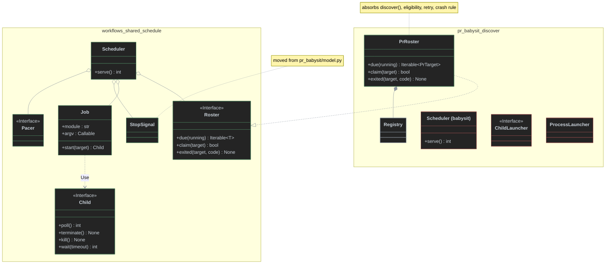
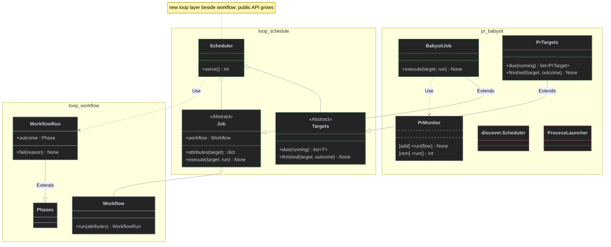
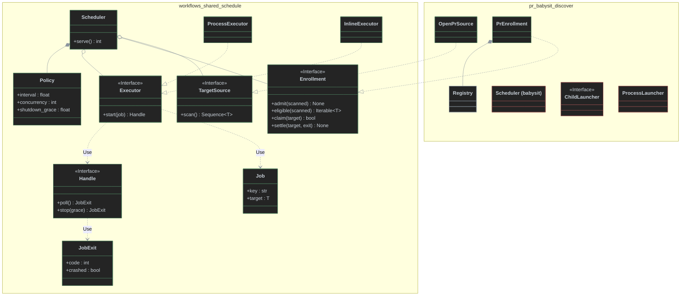
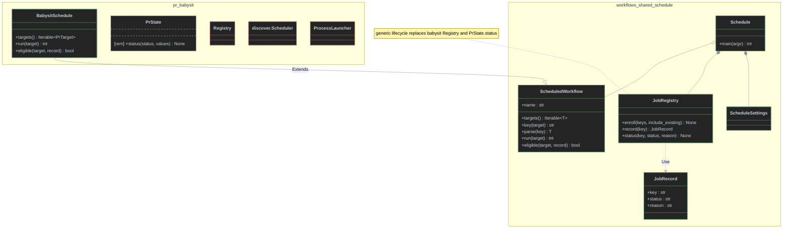

# Reusable scheduled Job and Scheduler contract — options

Ticket: [#147 Design the reusable scheduled Job and Scheduler contract](https://github.com/antshc/loop/issues/147) (Wayfinder `contract-design`, Options phase).

## Context

> "extract the job class what runs using scheduler and may reuse by the workflows, it must be thin and call the workflow what executes the logic."

Today the only scheduled Workflow is `pr_babysit`. Its discover feature mixes generic supervision with babysit rules:

| Concern | Where today | Generic or babysit? |
|---|---|---|
| Single-scheduler lock (`scheduler.lock`) | [`discover/scheduler.py`](../../workflows/pr_babysit/discover/scheduler.py) `Scheduler.serve` | Generic |
| Poll loop, `Pacer`, `StopSignal` | `Scheduler.serve`, [`model.py`](../../workflows/pr_babysit/model.py) | Generic |
| Concurrency cap, child start, reap, terminate → wait → kill on shutdown | `Scheduler.serve`, [`discover/children.py`](../../workflows/pr_babysit/discover/children.py) | Generic |
| Child command and trace-context scrubbing | `children.py` (`child_command`, `child_environment`) | Generic except the module name and `--pr` argument |
| Target discovery (open PRs by author) | `Scheduler.discover` | Babysit |
| Enrollment baseline, `--include-existing`, exactly-once | [`discover/registry.py`](../../workflows/pr_babysit/discover/registry.py) | Babysit |
| Eligibility (ignored, closed → completed, blocked + same fingerprint, `--retry`) | `Scheduler.serve` | Babysit |
| Claim (per-PR lock still held by a surviving child, set `queued`) | `Scheduler.serve` | Babysit rule, generic shape |
| Crash handling (`running`/`queued` → `blocked`, `worker-crash`) | `Scheduler.serve` | Babysit rule, generic trigger |
| Run entry for one target | [`composition/entry.py`](../../workflows/pr_babysit/composition/entry.py) `maintain_pr` → [`monitor/pr.py`](../../workflows/pr_babysit/monitor/pr.py) `PrMonitor.run`, which opens [`babysit_workflow`](../../workflows/pr_babysit/monitor/definition.py)`.run(...)` | Babysit |

Constraints honoured by every option:

- Only logic whose business meaning is identical across Workflows goes to `workflows/shared/` or, for every Workflow, the `loop` library ([Loop Library Workflow Architecture](../concepts/str-loop-library-workflow-architecture.md)). Discovery, enrollment, and eligibility are babysit business rules; locking, polling, concurrency, supervision, and shutdown are not.
- Loop ships no Workflows and no command; an ABC exists only where Loop's own code calls a replaceable part ([Ship Loop as a workflow library](../adr/ship-loop-as-a-workflow-library-with-no-built-in-workflows.md)).
- Only `composition/` and `workflows/shared/providers.py` import `dishka`; APP scope is the process, REQUEST scope is one unit of work ([Structure Workflows as vertical slices](../adr/structure-workflows-as-vertical-slices-over-a-shared-package-wired-by-dishka.md)).
- Import-linter contracts in [`pyproject.toml`](../../pyproject.toml): `workflows.shared` imports no slice; Workflows import only the public `loop` package; the `loop` library is layered (`factory | workflow` on top).
- "The Workflow" in the glossary ([CONTEXT.md](../../CONTEXT.md)) is the whole user-written procedure. In code, the `loop` abstraction for one run of it is `Workflow.run(...)` → `WorkflowRun` ([`workflow.py`](../../src/loop/workflow/workflow.py), over `Phases` in [`phases.py`](../../src/loop/workflow/phases.py)). Dev already opens one `WorkflowRun` and hands it to a REQUEST scope ([`dev/composition/entry.py`](../../workflows/dev/composition/entry.py) `run_workflow`). Babysit opens it inside `PrMonitor.run`.

### Dependency categories

| Dependency | Category | Consequence |
|---|---|---|
| Poll timing, stop flag, concurrency bookkeeping | In-process | Behind the Scheduler, tested directly |
| Cross-process lock (`process_lock`), JSON state | Local-substitutable | Real files under `tmp_path` in tests; no port |
| Child process (`subprocess.Popen`) | Local-substitutable, but slow and OS-bound | Today's `ChildLauncher` port has a production adapter and a test fake: a real seam |
| GitHub discovery, PR snapshots | True external | Stays behind the Workflow's own port (`GitHub`), never seen by the Scheduler |
| Telemetry/OTel export | True external | Child-only; the Scheduler must never initialize it |

### Glossary used below

- **Target**: the one thing a Job works on (babysit: a PR; dev: a Spec). Identified by a stable string key.
- **Job**: a thin, domain-free unit of scheduled work. It identifies one Target and calls the Workflow's run entry for it.
- **Scheduler**: the long-running loop that owns the lock, polling, concurrency, Job supervision, and shutdown.
- **Roster** (Options 1, 4): the Workflow-supplied module that answers "which Targets are due now?" It hides discovery, enrollment, and eligibility.

---

## Option 1 — Minimal supervisor over a Workflow Roster (`workflows/shared`, child process)

_Design constraint: minimize the interface (3 entry points at most)._

The Workflow supplies a **Roster** with three methods, plus a **Job** that turns a Target into a child-process command. Everything else is inside `workflows/shared/schedule/`.

### Interface

```python
# workflows/shared/schedule/roster.py
from __future__ import annotations

from collections.abc import Hashable, Iterable, Set
from typing import Protocol


class Roster[T: Hashable](Protocol):
    """The Workflow's view of which Targets are due; hides discovery, enrollment, and eligibility."""

    def due(self, running: Set[T]) -> Iterable[T]:
        """Targets ready to start now, in priority order, excluding `running`; raises OSError when discovery is unavailable."""

    def claim(self, target: T) -> bool:
        """Marks `target` as started; False when another process still owns it."""

    def exited(self, target: T, code: int) -> None:
        """Records a finished Job; the Workflow decides whether a non-zero code blocks the Target."""
```

```python
# workflows/shared/schedule/job.py
@dataclass(frozen=True)
class Job[T]:
    """Runs one Target as `python -m <module> <argv(target)>` with a fresh trace context."""

    module: str
    argv: Callable[[T], Sequence[str]]

    def start(self, target: T) -> Child: ...


class Child(Protocol):
    """The subset of `subprocess.Popen` the Scheduler supervises."""

    returncode: int | None
    def poll(self) -> int | None: ...
    def terminate(self) -> None: ...
    def kill(self) -> None: ...
    def wait(self, timeout: float | None = None) -> int: ...
```

```python
# workflows/shared/schedule/scheduler.py
class Scheduler[T: Hashable]:
    """Supervises at most `concurrency` Jobs, polling the Roster every `interval` seconds until stopped."""

    def __init__(self, roster: Roster[T], job: Job[T], *, lock: Path, interval: float,
                 concurrency: int, pacer: Pacer, stop: StopSignal) -> None: ...

    def serve(self) -> int:
        """0 after a requested stop; StateError when another Scheduler holds `lock`."""
```

`Pacer`, `SleepPacer`, and `StopSignal` move from `pr_babysit/model.py` to `workflows/shared/schedule/` unchanged; `PrMonitor` keeps using them.

Invariants and ordering:

- One Scheduler per `lock`; held for the whole `serve`.
- Each cycle: reap exited children → `exited(target, code)` for each, then `due(running)` → `claim` → `start` until the cap, then `pacer.wait(interval)`.
- `due` is consumed lazily and stops at the cap, so a Roster can do expensive per-Target checks only for Targets that may start.
- `OSError`, `subprocess.CalledProcessError`, and `subprocess.TimeoutExpired` from `due` are logged and the cycle is skipped.
- On stop: terminate all children, wait 10 s, kill survivors.

### Delta class diagram



### Behind the seam

Lock acquisition, poll cadence, concurrency accounting, the running-set, child start with trace-context scrubbing (`traceparent`, `tracestate`, `baggage`), reaping, discovery-error tolerance, and graceful-then-forceful shutdown.

### Dependency strategy

- Child process: `Job` is the production adapter; tests replace it with a fake `Job` returning fake `Child`ren (today's `ChildLauncher` fake, generalized). Two adapters → real seam.
- Lock: real `process_lock` on `tmp_path`.
- The Roster is the Workflow's port; the Scheduler test uses an in-memory Roster.

### Use

Babysit composition:

```python
roster = provide(PrRoster, provides=Roster[PrTarget], scope=Scope.APP)

@provide(scope=Scope.APP)
def job(self, request: DiscoveryRequest) -> Job[PrTarget]:
    return Job("workflows.pr_babysit", lambda pr: ["--config", str(request.config), "--pr", pr.url])

@provide(scope=Scope.APP)
def scheduler(self, settings: Settings, roster: Roster[PrTarget], job: Job[PrTarget],
              pacer: Pacer, stop: StopSignal) -> Scheduler[PrTarget]:
    return Scheduler(roster, job, lock=settings.state_dir / "scheduler.lock",
                     interval=settings.interval, concurrency=settings.concurrency, pacer=pacer, stop=stop)
```

The child keeps `main --pr <url>` → `maintain_pr` → `PrMonitor.run`. `PrRoster` owns `Registry`, the author scan, `include_existing`, `retry`, the closed → `completed` rule, the fingerprint check, the per-PR lock claim, and `exited` → `blocked`/`worker-crash`.

Dev over Specs (hypothetical): `SpecRoster.due` lists open Specs from the tracker that are not awaiting human input; `Job("workflows.dev", lambda spec: ["--spec", str(spec)])` reuses the existing `--spec` flag.

### Trade-offs

- **Leverage high:** a scheduled Workflow writes three methods and a one-line Job; all supervision code is written and tested once.
- **Locality:** every babysit rule lands in one `PrRoster`; the shared Scheduler has no PR vocabulary.
- **Thin:** the Job is a command builder; "the workflow" it calls is the slice's `__main__` entry, not a `loop` abstraction, so phase reporting stays wherever the slice puts it.
- **Cost:** the child re-parses config and rebuilds its container per Target (as today).

---

## Option 2 — In-process Job on a `loop` `WorkflowRun` (`loop` library, threads)

_Design constraint: build the Job on the `loop` Workflow abstraction; one run per Target._

Loop gains a `loop.schedule` package. A **Job** is an ABC bound to one `loop.Workflow`; the Scheduler opens one `WorkflowRun` per Target and runs the Job's body inside it on a worker thread. The root phase outcome (`WorkflowRun.outcome`) is the result the Scheduler hands back to the Workflow.

### Interface

```python
# src/loop/schedule/job.py
from __future__ import annotations

from abc import ABC, abstractmethod
from typing import Any

from ..workflow import Phase, Workflow, WorkflowRun


class Job[T](ABC):
    """Runs one Target as one WorkflowRun; carries no domain logic."""

    def __init__(self, workflow: Workflow) -> None:
        self.workflow = workflow

    def attributes(self, target: T) -> dict[str, Any]:
        """Root-phase attributes that identify the Target in reports and traces."""
        return {"target": str(target)}

    @abstractmethod
    def execute(self, target: T, run: WorkflowRun) -> None:
        """Calls the Workflow's logic; fails `run` to report a business failure."""


class Targets[T](ABC):
    """The Workflow's discovery, enrollment, and eligibility."""

    @abstractmethod
    def due(self, running: frozenset[T]) -> list[T]:
        """Targets ready to start now."""

    @abstractmethod
    def finished(self, target: T, outcome: Phase) -> None:
        """Receives the run's root outcome (`completed`, `failed`, or `cancelled`)."""
```

```python
# src/loop/schedule/scheduler.py
class Scheduler[T]:
    """Runs at most `concurrency` Jobs on threads, each inside its own WorkflowRun."""

    def __init__(self, targets: Targets[T], job: Job[T], *, lock: Path, interval: float,
                 concurrency: int, stopped: Callable[[], bool], sleep: Callable[[float], None] = time.sleep) -> None: ...

    def serve(self) -> int: ...
```

Invariants: each Target runs in a fresh `WorkflowRun` opened by the Scheduler (`job.workflow.run(**job.attributes(target))`); an exception in `execute` fails that run (Phases records `failed`/`cancelled`) and never stops the Scheduler; stop is cooperative — `stopped()` is polled by the Scheduler and must be polled by `execute`.

### Delta class diagram



### Behind the seam

The thread pool, the per-Target `WorkflowRun` lifecycle (open, fail on exception, close, report outcome), the lock, polling, and cooperative shutdown. Reporting and OTel export come free from the `Workflow`'s configured reporters.

### Dependency strategy

- No child process: everything is in-process, so tests run real Jobs with fake Workflow collaborators.
- Lock: Loop gains its own file lock (today `process_lock` lives in `workflows/shared/state.py`, outside the library).
- Dishka stays out of Loop: the babysit composition's `BabysitJob.execute` opens the REQUEST scope (`container(context={PrTarget: target, WorkflowRun: run})`). The APP container then serves concurrent threads, so it needs `make_container(..., lock_factory=threading.Lock)`.

### Use

```python
class BabysitJob(Job[PrTarget]):  # in composition/, the only place that knows the container
    def __init__(self, workflow: Workflow, container: Container) -> None: ...

    def execute(self, target: PrTarget, run: WorkflowRun) -> None:
        with self._container(context={PrTarget: target, WorkflowRun: run}) as scope:
            scope.get(PrMonitor).run()
```

`PrMonitor.run` stops opening `babysit_workflow().run(...)` and receives the `WorkflowRun` instead. Crash-isolation rules move into `PrTargets.finished`: a `failed` outcome with `status in {running, queued}` → `blocked`.

Dev over Specs: `DevJob.execute(spec, run)` puts `run` in the REQUEST scope as `Phases`, exactly like today's `run_workflow`, but one run per Spec instead of one run for all Specs.

### Trade-offs

- **Leverage:** the strongest reuse of the `loop` Workflow abstraction; every Job is automatically one reported, traced `WorkflowRun`.
- **Lost isolation:** a hung agent CLI, a leaked file descriptor, or an interpreter crash in one PR takes every PR down; `worker-crash` is no longer detectable as an exit code.
- **Signals and cancellation:** `SIGTERM` only reaches the main thread; today's single-PR `KeyboardInterrupt` path and the 130 exit code have no thread equivalent, so every `execute` must poll `stopped()`.
- **Telemetry:** the Scheduler process now initializes telemetry (babysit deliberately avoids that today); trace contexts must be kept per thread.
- **Library cost:** Loop's public API, layering contract, and compatibility surface grow with a scheduling runtime that only some Workflows use; Loop's own code would call `Job`/`Targets`, so the ABCs satisfy the ADR, but the "identical across **every** Workflow" bar for the library is not met (dev runs once today).

---

## Option 3 — Ports & adapters with pluggable executors (`workflows/shared`)

_Design constraint: maximize flexibility; every cross-seam dependency is a port._

The Scheduler composes five small ports. Discovery, enrollment, and eligibility are separate; how a Job runs (child process, inline, thread) is an **Executor** adapter.

### Interface

```python
# workflows/shared/schedule/ports.py
class TargetSource[T](Protocol):
    """Lists every candidate Target in one complete scan."""
    def scan(self) -> Sequence[T]: ...


class Enrollment[T](Protocol):
    """Durable membership and eligibility."""
    def admit(self, scanned: Sequence[T]) -> None: ...
    def eligible(self, scanned: Sequence[T]) -> Iterable[T]: ...
    def claim(self, target: T) -> bool: ...
    def settle(self, target: T, exit: JobExit) -> None: ...


@dataclass(frozen=True)
class JobExit:
    """How a Job ended: `code`, or `crashed` when no code was produced."""
    code: int | None
    crashed: bool


@dataclass(frozen=True)
class Job[T]:
    """One Target bound to the Workflow entry that executes it."""
    key: str
    target: T


class Executor[T](Protocol):
    """Starts a Job and returns a handle the Scheduler supervises."""
    def start(self, job: Job[T]) -> Handle: ...


class Handle(Protocol):
    def poll(self) -> JobExit | None: ...
    def stop(self, grace: float) -> JobExit: ...


@dataclass(frozen=True)
class Policy:
    interval: float
    concurrency: int
    shutdown_grace: float = 10.0
```

```python
# workflows/shared/schedule/executors.py
class ProcessExecutor[T]:
    """`python -m <module> <argv(target)>` with scrubbed trace context."""
    def __init__(self, module: str, argv: Callable[[T], Sequence[str]]) -> None: ...

class InlineExecutor[T]:
    """Runs `entry(target)` on a thread; for Workflows that accept shared-process risk, and for tests."""
    def __init__(self, entry: Callable[[T], int]) -> None: ...


class Scheduler[T]:
    def __init__(self, source: TargetSource[T], enrollment: Enrollment[T], executor: Executor[T],
                 policy: Policy, *, lock: Path, pacer: Pacer, stop: StopSignal) -> None: ...
    def serve(self) -> int: ...
```

### Delta class diagram



### Behind the seam

Only the cycle ordering (scan → admit → eligible → claim → start; reap → settle), the lock, the cap, and shutdown. Process details live in `ProcessExecutor`; thread details in `InlineExecutor`.

### Dependency strategy

Every cross-seam dependency is a port with at least two adapters: `ProcessExecutor` (production) and `InlineExecutor` (tests, or a Workflow that opts into shared-process risk). Source and Enrollment get in-memory test adapters.

### Use

Babysit: `OpenPrSource` (author scan across configured repositories), `PrEnrollment` (Registry, baseline, retry, fingerprint, crash rule), `ProcessExecutor("workflows.pr_babysit", ...)`. The child entry is unchanged.

Dev over Specs: `OpenSpecSource` from the tracker, a trivial `Enrollment` (every open Spec, no baseline), and either executor — `InlineExecutor(lambda spec: deliver_spec(container, spec))` keeps one process.

### Trade-offs

- **Flexibility:** in-process vs child process becomes a per-Workflow composition choice, not a contract decision.
- **Shallow:** five ports and three value objects for a loop that is ~80 lines today; babysit's `admit`/`eligible`/`claim`/`settle` are tightly coupled (they share the registry and PR state), so splitting `TargetSource` from `Enrollment` scatters one rule set across two classes without a second adapter that varies.
- **Speculative:** `InlineExecutor` has no production caller yet; the "two adapters" for `TargetSource` and `Enrollment` are both test fakes.

---

## Option 4 — `Schedule` facade owning a generic Job registry (`workflows/shared`, dual-mode entry)

_Design constraint: make the common caller trivial._

The Workflow declares one `ScheduledWorkflow` and hands it to a `Schedule`. The `Schedule` owns **both** process modes (serve, and run one Job) plus a generic durable Job registry with lifecycle statuses, so a Workflow writes almost nothing beyond "list targets" and "run one target".

### Interface

```python
# workflows/shared/schedule/schedule.py
class ScheduledWorkflow[T]:
    """What a Workflow declares to be scheduled; override only what differs."""

    name: str

    def targets(self) -> Iterable[T]:
        """Every Target that should exist now; raises OSError when unavailable."""
        raise NotImplementedError

    def key(self, target: T) -> str:
        """Stable, round-trippable Target identity."""
        raise NotImplementedError

    def parse(self, key: str) -> T:
        raise NotImplementedError

    def run(self, target: T) -> int:
        """Runs the Workflow for one Target in this process: 0 done, 1 blocked, 130 interrupted."""
        raise NotImplementedError

    def eligible(self, target: T, record: JobRecord) -> bool:
        """Extra eligibility beyond the registry's lifecycle; default allows."""
        return True


@dataclass(frozen=True)
class JobRecord:
    key: str
    status: str            # queued | ignored | running | blocked | completed
    reason: str = ""


@dataclass(frozen=True)
class ScheduleSettings:
    state_dir: Path
    interval: float
    concurrency: int
    include_existing: bool = False
    retry: str | None = None


class Schedule[T]:
    """Serves the Workflow continuously, or runs one Job when `--job <key>` is given."""

    def __init__(self, workflow: ScheduledWorkflow[T], settings: ScheduleSettings) -> None: ...

    def main(self, argv: Sequence[str]) -> int: ...
```

The `Schedule` owns `jobs.json`: enrollment baseline, exactly-once enrollment, `include_existing`, `retry`, `completed` when a Target disappears, `blocked`/`worker-crash` on non-zero exit, and the per-Job lock. The child is `python -m <module> --job <key>`.

### Delta class diagram



### Behind the seam

Argument parsing for both modes, the registry and its lifecycle, enrollment baseline, retry, crash marking, claim locks, the child command, supervision, and shutdown.

### Dependency strategy

The child process stays (two adapters: Popen and an in-process fake that calls `workflow.run` directly). The registry is JSON on `tmp_path`. `run(target)` is where the composition opens the REQUEST scope.

### Use

Babysit: `BabysitSchedule.targets` scans PRs by author; `eligible` applies the fingerprint rule; `run` = `maintain_pr(container, target)`. `PrState` loses its execution status to `jobs.json` and keeps items, retries, and batches.

Dev over Specs: `targets` = open Specs, `run` = `deliver_spec(container, spec)`; dev inherits enrollment baseline and `--include-existing` whether or not they mean anything for Specs.

### Trade-offs

- **Leverage for the common case:** a new scheduled Workflow is ~20 lines; the CLI surface for scheduling is identical across Workflows.
- **Puts business meaning in `shared`:** baseline/ignored, "disappeared → completed", and "non-zero → blocked" are babysit decisions today. Moving them into a generic lifecycle breaks the "identical meaning across Workflows" rule and the guidance to accept duplication over similar-looking code.
- **Ownership clash:** the Schedule owns `argv` parsing and the process entry, competing with each slice's `main(argv, *, providers=())` convention.
- **Migration:** splitting PR status out of `PrState` touches babysit's durable state format.

---

## Comparison

| | 1 Roster supervisor | 2 `loop` in-process | 3 Ports & executors | 4 Schedule facade |
|---|---|---|---|---|
| Home | `workflows/shared/schedule/` | `src/loop/schedule/` (public API) | `workflows/shared/schedule/` | `workflows/shared/schedule/` |
| Job runs as | Child process | Thread in the Scheduler process, in a `WorkflowRun` | Executor choice | Child process |
| "The workflow" the Job calls | Slice entry (`python -m … --pr`) | `loop` `Workflow.run` → `Job.execute(target, run)` | Slice entry or callable | `ScheduledWorkflow.run(target)` |
| Workflow supplies | `Roster` (3 methods) + `Job(module, argv)` | `Targets` (2) + `Job.execute` | `TargetSource` + `Enrollment` (4) + executor | `targets/key/parse/run` (+ `eligible`) |
| Where babysit rules live | `PrRoster` (one place) | `PrTargets` | Split over source + enrollment | Mostly in `shared` |
| Depth (leverage per interface) | High | Medium (cooperative-stop burden on every Job) | Low | High for callers, but hides business rules |
| Crash isolation / `worker-crash` | Kept | Lost | Per executor | Kept |
| Loop public API change | None | New `schedule` layer, lock, ABCs | None | None |
| Fit with ADRs/concept | Fits | Strains "identical for every Workflow" in Loop | Fits, speculative seams | Breaks "identical meaning" in `shared` |
| Babysit migration | Small: move loop + children, extract `PrRoster` | Large: threads, signals, telemetry, `PrMonitor.run` | Medium | Large: state format, CLI |
| Dev over Specs | `--spec N` child, ready today | One `WorkflowRun` per Spec, in-process | Either | Inherits babysit lifecycle |

## Recommendation

**Option 1, with Option 2's Workflow-run rule applied inside the child.**

Adopt the Roster supervisor in `workflows/shared/schedule/` with child-process Jobs, and make the child's run entry open exactly one `loop` `WorkflowRun` per Target and hand it to the REQUEST scope, as dev's `run_workflow` already does with `Phases`. Babysit's `maintain_pr` then becomes:

```python
def maintain_pr(container: Container, target: PrTarget) -> int:
    """Runs one PR as one babysit WorkflowRun in its own REQUEST scope."""
    observer = container.get(Telemetry).observer
    with babysit_workflow(observer=observer).run(repository=target.repo, pr=target.number) as run:
        with container(context={PrTarget: target, WorkflowRun: run}) as scope:
            return scope.get(PrMonitor).run()
```

`PrMonitor.run` stops opening `babysit_workflow` itself and receives the `WorkflowRun` through its constructor. The scheduled Job is therefore thin twice over: the Scheduler-side `Job` only names the Target and the slice's module, and the child-side entry only opens the `loop` run and resolves the slice's logic.

Reason: it moves only lock, polling, concurrency, supervision, and shutdown into `shared` — the behaviour that is identical across Workflows. It keeps crash isolation, signal semantics, and the scheduler's freedom from telemetry. It builds on the `loop` `Workflow` abstraction without growing Loop's public API, and it concentrates every babysit rule in one `PrRoster`.

Revisit Option 2's in-process execution only when a second scheduled Workflow needs it; Option 1's `Job` adapter seam can take an in-process adapter then without changing `Roster` or `Scheduler`.
