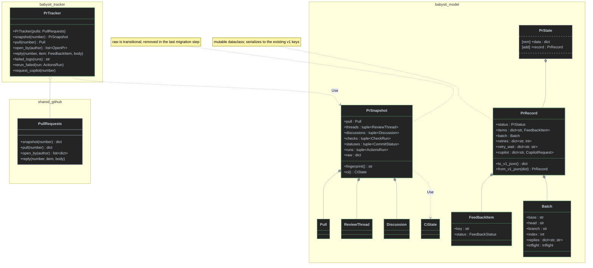
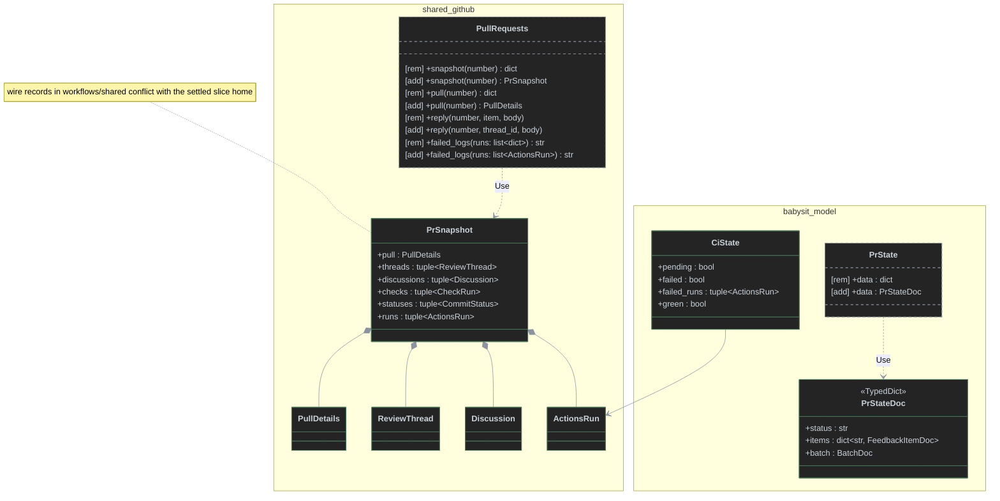

# Typed pull-request models and a PR tracker for babysit

This is the Options phase of the design for [antshc/loop#148](https://github.com/antshc/loop/issues/148), which is part of #146. It covers the current state, the options, their trade-offs, and a recommendation. It changes no production code.

**Settled:** the models and the PR tracker live in the `workflows/pr_babysit` slice, not in `workflows/shared`. The rule at line 37 of [Loop Library Workflow Architecture](../concepts/str-loop-library-workflow-architecture.md) says workflow-specific models stay inside the slice.

**Pattern to mirror:** dev keeps frozen records in `workflows/implement_spec/model/records.py` (`Comment` at :86-90). Module-level mappers in `workflows/implement_spec/tracker/tickets.py` map `gh` JSON into them: `_comments` (:37-42), `_spec` (:53-64), and `_ticket` (:67-76). The mappers sit inside `TicketsTracker` (:79-162), which `TicketsTracker.of(GitHubRepo)` (:87-90) builds over a `GhRunner`.

## 1. Current state

### 1.1 The `gh` adapter returns raw JSON

`workflows/shared/github/pull_requests.py`:

| Operation | Lines | Returns | Babysit-only? |
|---|---|---|---|
| `create_draft_pull_request`, `find_open` | :47-72 | typed `PullRequest` (:12-18) | no — dev `backlog/router.py:57` |
| `mark_ready` | :74-76 | `None` | no — dev `review/reviewer.py:75` |
| `diff` | :78-80 | `str` | unused by either slice |
| `open_by` | :82-85 | `list[dict]` (REST pull) | yes — `discover/scheduler.py:34` |
| `threads` | :87-107 | `list[dict]` (GraphQL nodes; drops `PENDING` comments :104) | yes |
| `pull` | :109-111 | `dict` (REST pull) | yes — `publish/changes.py:113` |
| `snapshot` | :113-136 | `dict` with keys `pr`, `threads`, `other`, `checks`, `statuses`, `runs`, `review` (`review` only when open, :121) | yes |
| `reply` | :138-143 | dispatches on `item["kind"]`/`item["thread_id"]` of a babysit feedback item | yes |
| `failed_logs`, `rerun_failed`, `request_copilot` | :145-155 | `str` / `None`, take `list[dict]` runs | yes |

`snapshot` already shapes babysit feedback. It builds the `other` items with `kind`, `id`, `body`, `author` (the full REST user object), `author_association`, `created_at`, `updated_at`, and `url`, and it drops pending or empty reviews (:123-130). That filtering and that shape are babysit business meaning, yet they sit in `workflows/shared`.

### 1.2 Consumers index the dicts directly

- `watch/feedback.py`:
  - `trusted` (:20-25) reads both GraphQL `authorAssociation` and REST `author_association`, and accepts `author` as either a dict or a string. It has to, because threads and `other` items have different shapes.
  - `fingerprint` (:33-39) digests the raw `threads`/`other` dicts plus projected check, status, and run tuples.
  - `pending_threads` (:42-62) builds the thread feedback items.
  - `observe` builds `other` feedback items by spreading the raw item and adding `key` (:73), then persists every item into `state.data["items"]` (:74-80).
  - `ci_state` (:91-103) returns `{"pending", "failed", "runs", "green"}`.
- `monitor/pr.py`:
  - Reads `pr["state"]`, `merged`, `head.sha`, `user.login`, `head.repo.full_name`, `draft`, `mergeable`, `mergeable_state`, `requested_reviewers`, and `snapshot["review"]["reviewDecision"]` (:75-114).
  - Writes `state.data["head"]` (:85) and `state.data["copilot"][sha]` (:102-108).
  - Reads `batch["kind"]` (:87-97).
- `address/reviews.py`:
  - Validates the agent's `group` envelope, `issues[].id/statement/keys` (:19-34), and its `resolve` envelope, `verdict`, `replies`, and `evidence` (:37-49).
  - Creates the address batch dict (:76-79).
  - Sends the raw persisted items to the agent (:86-87).
- `maintain_ci/failures.py`:
  - Keys the `retry_wait` and `retries` maps by head SHA (:36-37, :57-62).
  - Creates the CI batch dict (:71-72).
  - Sends the whole raw snapshot to the agent in `diagnose` and `fix` (:51, :75).
  - Reads the `diagnose` and `fix` envelopes without types (:53, :76-77).
- `agents/workspace.py` — `worktree_branch`, `worktree_base`, `batch["head"]` (:32-52).
- `publish/changes.py`:
  - `_reply_exists` walks the raw threads and `other` items (:17-26).
  - `recover`, `commit_issue`, and `publish` change `batch["inflight"]`, `head`, `index`, `replies`, `pushed`, and item `status` in place, and save after each step (:62-135).
- `discover/registry.py` and `discover/scheduler.py`:
  - Read `pr["number"]` and `pr["html_url"]` from `open_by` (registry :29-37, scheduler :34, :57).
  - `registry.data["prs"]` records `{repo, number, url}` (registry :37).
  - Read `state.data["status"]` and `state.data["fingerprint"]` (scheduler :51, :62, :73-74).
  - Read `snapshot(...)["pr"]["state"]` (scheduler :68).
- `agents/ask.py` — every envelope is a `dict` (:16-24).

### 1.3 Persisted state is an untyped versioned dict

`model.py` `PrState` (:92-122) holds `self.data`. Its default is `{"version": 1, "repo", "number", "status": "queued", "items": {}, "retries": {}, "copilot": {}, "batch": None}` (:98-101).

Validation checks only four things (:102-110): the identity, the status set (:89), the container types, and each item's `status`. Callers add more keys later: `execution`, `reason`, `fingerprint`, `outcome`, `head`, `retry_wait`, `worktree_branch`, and `worktree_base`. None of these has a type or a check. `status(**values)` merges arbitrary keys (:119-122).

In `workflows/shared/state.py`, `JsonFile.read_versioned` accepts only `version == 1` (:35-40). A schema bump therefore needs either a shared change or a version check in the slice.

### 1.4 Constraints that shape every option

- `workflows.shared` may not import any slice (`pyproject.toml` contract "Shared workflow infrastructure imports no workflow"). A shared adapter therefore cannot return slice models.
- Maintenance features may not import `discover` ("PR maintenance decisions do not depend on the discovery scheduler"). A new `tracker` package must sit below both.
- Only `composition/` may import `dishka`. A new `tracker` package must be added to that contract's `source_modules` and to "Babysit features never reach back into their composition root".
- Tests fake GitHub at `GitHub.pull_requests()` with a `Remote` that returns dict snapshots (`tests/support.py:57-93`). `workflows/shared/tests/test_github.py:101-106` asserts the dict snapshot.
- PR states that are `blocked` already store fingerprints, which are digests of the raw dicts (`feedback.py:33-39`). A typed fingerprint produces a different digest. The scheduler's "unchanged since blocked" check (`scheduler.py:72-75`) would then relaunch every blocked PR once, unless the migration handles it.
- The agent prompts fix the envelope shapes (`agents/address.md:13`, :22-23; `agents/maintainer.md:13`, :18). The JSON sent to agents must stay stable, or change in the same PR as the prompts.

## 2. Model set (common to all options)

Every option uses the same domain vocabulary. The options differ in where `gh` JSON is mapped, how state is typed and serialized, and how the migration is cut.

| Group | Model | Fields (abridged) | Replaces |
|---|---|---|---|
| Read | `PrHead` | `sha`, `ref`, `repo` | `pr["head"]` |
| Read | `Pull` | `number`, `url`, `state`, `merged`, `draft`, `author`, `head: PrHead`, `mergeable`, `mergeable_state`, `requested_reviewers: tuple[str, ...]`, `review_decision` | `snapshot["pr"]` + `snapshot["review"]`, `pull()` |
| Read | `ThreadComment` | `id`, `author`, `association`, `body`, `created_at`, `url`, `diff_hunk` | GraphQL comment node |
| Read | `ReviewThread` | `id`, `path`, `line`, `resolved`, `outdated`, `comments: tuple[ThreadComment, ...]` | `snapshot["threads"][i]` |
| Read | `Discussion` | `kind` (`comment`/`review`), `id`, `author`, `association`, `body`, `created_at`, `updated_at`, `url` | `snapshot["other"][i]` |
| Read | `CheckRun` | `id`, `name`, `app_id`, `status`, `conclusion` | `snapshot["checks"][i]` |
| Read | `CommitStatus` | `id`, `context`, `state` | `snapshot["statuses"][i]` |
| Read | `ActionsRun` | `id`, `workflow_id`, `event`, `status`, `conclusion`, `attempt` | `snapshot["runs"][i]` (named to avoid `loop.WorkflowRun`) |
| Read | `PrSnapshot` | `pull`, `threads`, `discussions`, `checks`, `statuses`, `runs`; `fingerprint()`, `ci()` | the snapshot dict |
| Read | `CiState` | `pending`, `failed`, `failed_runs`, `green` | `ci_state()` dict |
| Read | `OpenPr` | `repo`, `number`, `url` | `open_by()` dicts, registry records |
| State | `PrStatus`, `FeedbackStatus`, `CopilotRequest` | `StrEnum`s | `_STATUSES` (model.py:89), item status strings, `"requested"`/`"unavailable"` |
| State | `ThreadFeedback` / `DiscussionFeedback` (`FeedbackItem` union) | `key`, `status`; thread: `thread_id`, `path`, `line`, `outdated`, `comments`, `previous_reply`; discussion: `discussion: Discussion` | `pending_threads`/`observe` item dicts |
| State | `Inflight` | `parent`, `message` | `batch["inflight"]` |
| State | `AddressBatch` / `CiBatch` (`Batch` union) | `base`, `head`, `branch`, `index`, `replies`, `inflight`; address adds `issues`, `pushed`, `unclear` | `batch` dicts (reviews.py:76-79, failures.py:71-72) |
| State | `PrRecord` | `repo`, `number`, `status`, `reason`, `execution`, `fingerprint`, `outcome`, `head`, `items`, `batch`, `retries`, `retry_wait`, `copilot`, `worktree_branch`, `worktree_base` | `PrState.data` |
| Envelope | `Issue`, `Resolution`, `Diagnosis`, `CiFix` | match `address.md`/`maintainer.md` | `ask()` dicts |

Each agent mode gets one parse function next to `ask` that builds its envelope model and raises `Blocked` on invalid input. These functions absorb `group_issues` and `validate_resolution` (reviews.py:19-49). The envelope JSON stays identical to the shapes in the prompts.

**PR tracker operations** (all options):

- `snapshot(number) -> PrSnapshot`
- `pull(number) -> Pull`
- `open_by(author) -> list[OpenPr]`
- `reply(number, item: FeedbackItem, body)`
- `failed_logs(runs: Sequence[ActionsRun]) -> str`
- `rerun_failed(run: ActionsRun)`
- `request_copilot(number)`

## 3. Options

### Option A — Wrap the shared adapter; state keeps the v1 JSON; migrate feature by feature

**Mapping.** A new `workflows/pr_babysit/tracker/pulls.py` holds `PrTracker`. It wraps the unchanged shared `PullRequests` and maps its dicts with module-level mappers (`_pull`, `_thread`, `_comment`, `_discussion`, `_check`, `_status`, `_run`), the same way `TicketsTracker` maps GraphQL nodes. `workflows/shared/github/pull_requests.py` does not change. It stays the raw-JSON transport for babysit and the typed `PullRequest` API for dev.

**State.** `PrState` stays a mutable store that holds a mutable `@dataclass` `PrRecord`, like dev's mutable `Spec`. Its `AddressBatch`, `CiBatch`, and `FeedbackItem` values are mutable too, so the existing change-in-place-then-`save()` code (changes.py:62-135) keeps its shape. A slice codec writes the **same v1 key names**. `version` stays `1` and `read_versioned` does not change. The decoder accepts the extra GraphQL and REST fields that v1 items already contain.

**Migration.** A strangler migration with one PR per feature, each leaving the tests passing:

1. The tracker and the read models, with a transitional `PrSnapshot.raw` dict for consumers that are not converted yet.
2. `watch`.
3. `monitor`.
4. `address`, `publish`, and `agents/workspace` together, because they share the batch.
5. `maintain_ci`.
6. `discover`.
7. Remove `PrSnapshot.raw` and `PrState.data`.

`fingerprint` keeps hashing the raw dicts until step 7 and switches to the typed models there. Step 7 accepts that each blocked PR relaunches once.

**Tests.** `support.Remote` keeps returning dict snapshots and the tracker maps them, so the scenario tests barely change.

The diagram shows `PullRequests` only as unchanged context; its members stay the same.

### Option B — Slice tracker owns the babysit `gh` calls; state v2 with a migrator; read side then state side

**Mapping.** `workflows/pr_babysit/tracker/pulls.py` holds `PrTracker.of(GitHubRepo)` over a `GhRunner`, a direct copy of the `TicketsTracker.of` pattern (tickets.py:87-90).

- The `_THREADS`, `_COMMENTS`, and `_REPLY` GraphQL documents **move** from `workflows/shared/github/pull_requests.py` into the tracker.
- The babysit-only operations move with them: `open_by`, `threads`, `pull`, `snapshot`, `reply`, `failed_logs`, `rerun_failed`, and `request_copilot`. The tracker maps their `gh` JSON straight into the slice models.
- Shared `PullRequests` keeps only what dev uses: `PullRequest`, `create_draft_pull_request`, `find_open`, `mark_ready`, and `diff`.
- The `PENDING` and empty-body filters (pull_requests.py:104, :124-125) become babysit rules inside the tracker.
- The composition root provides one `PrTracker` per request. The scheduler reaches several repositories, so it gets a `PrTrackers` factory (`slug -> PrTracker`).

**State.**

- Read models and state values are frozen.
- `PrState` becomes the store. It holds `record: PrRecord` (frozen) and offers `checkpoint(**changes)`, which applies `dataclasses.replace` and writes the file in one call. Code can no longer change the state and forget to save it.
- The file moves to `version: 2` with a typed schema. `batch.kind` becomes the discriminator between `AddressBatch` and `CiBatch`, and items store only the modeled fields.
- A slice codec, `model/state_codec.py`, decodes v2 files. It migrates v1 files on read, and the next checkpoint writes them back as v2.
- `JsonFile.read_versioned` gains a `versions` parameter. Alternatively, the slice calls `read()` and checks the version itself.
- The v1→v2 migration replaces each stored `blocked` fingerprint with the sentinel `"migrated"`. The scheduler treats it like `"worker-crash"`: the PR needs an explicit retry, so no blocked PR relaunches unnoticed.

**Migration.** Two PRs:

1. **Read side:** the tracker, the read and envelope models, the reduced shared adapter, and typed `fingerprint`/`ci()`. `PrState` is still a dict. The `Remote` test fake becomes a `FakePrTracker` bound through a Dishka override, and the shared snapshot tests move to the slice.
2. **State side:** the v2 records, the codec, the v1→v2 migration, and the `"migrated"` fingerprint sentinel.

```mermaid
%%{init: {'themeVariables': {'lineColor': '#8b949e'}}}%%
%% diagram-id: option-b-owned-tracker-delta
classDiagram
    namespace shared_github {
        class GitHubRepo {
            +run(args) str
            +json(args) object
            +pages(endpoint) list
        }
        class PullRequests {
            [rem] +open_by(author) list~dict~
            [rem] +threads(number) list~dict~
            [rem] +pull(number) dict
            [rem] +snapshot(number) dict
            [rem] +reply(number, item, body)
            [rem] +failed_logs(runs) str
            [rem] +rerun_failed(run_id)
            [rem] +request_copilot(number)
        }
    }
    namespace shared_state {
        class JsonFile {
            [add] +read_versioned(default, versions) dict
        }
    }
    namespace babysit_tracker {
        class PrTracker {
            +of(repo: GitHubRepo)$ PrTracker
            +snapshot(number) PrSnapshot
            +pull(number) Pull
            +open_by(author) list~OpenPr~
            +reply(number, item: FeedbackItem, body)
            +failed_logs(runs) str
            +rerun_failed(run: ActionsRun)
            +request_copilot(number)
        }
        class PrTrackers {
            <<Interface>>
            +tracker(slug) PrTracker
        }
    }
    namespace babysit_model {
        class PrSnapshot {
            +pull : Pull
            +threads : tuple~ReviewThread~
            +discussions : tuple~Discussion~
            +checks : tuple~CheckRun~
            +statuses : tuple~CommitStatus~
            +runs : tuple~ActionsRun~
            +fingerprint() str
            +ci() CiState
        }
        class PrState {
            [rem] +data : dict
            [rem] +status(status, values)
            [add] +record : PrRecord
            [add] +checkpoint(changes)
        }
        class PrRecord {
            +status : PrStatus
            +items : Mapping~str, FeedbackItem~
            +batch : Batch
            +retries : Mapping~str, int~
            +retry_wait : Mapping~str, str~
            +copilot : Mapping~str, CopilotRequest~
            +fingerprint : str
        }
        class StateCodec {
            +decode(document) PrRecord
            +encode(record) dict
            +migrate_v1(document) dict
        }
        class Batch {
            +base : str
            +head : str
            +branch : str
            +index : int
            +replies : Mapping~str, str~
            +inflight : Inflight
        }
        class AddressBatch {
            +issues : tuple~Issue~
            +pushed : bool
            +unclear : bool
        }
        class CiBatch
    }

    PrTracker o-- GitHubRepo
    PrTrackers ..> PrTracker : Use
    PrTracker ..> PrSnapshot : Use
    PrState *-- PrRecord
    PrState ..> StateCodec : Use
    PrState ..> JsonFile : Use
    PrRecord *-- Batch
    AddressBatch --|> Batch : Extends
    CiBatch --|> Batch : Extends

    note for PrTracker "mirrors TicketsTracker: owns babysit GraphQL/REST calls and the _pull/_thread/_run mappers"
    note for StateCodec "v1 is read and migrated; blocked fingerprints become the migrated sentinel"

    class PullRequests:::memberChanged
    class JsonFile:::memberChanged
    class PrTracker:::added
    class PrTrackers:::added
    class PrSnapshot:::added
    class PrState:::memberChanged
    class PrRecord:::added
    class StateCodec:::added
    class Batch:::added
    class AddressBatch:::added
    class CiBatch:::added

    classDef default fill:#242424,stroke:#8b949e,color:#c9d1d9,stroke-width:1px
    classDef added stroke:#4a7a5a,stroke-width:1px
    classDef removed stroke:#8a4a4a,stroke-width:1px
    classDef memberChanged stroke:#8b949e,stroke-width:1px,stroke-dasharray:5 5
```

### Option C — Shared adapter maps into typed wire records; slice keeps only state and feedback models; one cut

**Mapping.** `workflows/shared/github/pull_requests.py` maps `gh` JSON itself into frozen wire records. The records are defined in `workflows/shared/github/` next to the existing `PullRequest`, which sets a precedent because dev re-exports it (records.py:14). The records are `PullDetails`, `ReviewThread`, `ThreadComment`, `Discussion`, `CheckRun`, `CommitStatus`, `ActionsRun`, and `PrSnapshot`, and `snapshot()` returns the typed `PrSnapshot`.

The slice has **no tracker**: features keep calling `PullRequests`. The slice adds only `CiState`, `FeedbackItem`, the batches, the envelopes, and `PrRecord`. `reply` takes `(thread_id | None, body)` instead of a babysit item.

**State.** Types are checked statically only. `TypedDict` schemas (`PrStateDoc`, `AddressBatchDoc`, `CiBatchDoc`, `FeedbackItemDoc`) describe the unchanged v1 JSON, and `PrState.data` is typed as `PrStateDoc`. There is no runtime codec, no version bump, and no migration. The type checker enforces the shape; nothing checks it at runtime.

**Migration.** A single PR changes the shared adapter, every consumer, the shared tests, and the `Remote` fake together. It cannot be split, because the shared return types change for every caller at once.

**Conflict.** This option contradicts the settled home, because the wire models would sit in `workflows/shared`. It also breaks concept rule 37, because `Discussion` filtering and the feedback shape are babysit meaning. It is included to make the trade-off of mapping in the shared adapter explicit.

## 4. Trade-offs

| Criterion | A — Wrap, v1 kept, strangler | B — Own calls, v2 + migrator, two steps | C — Shared wire records, TypedDict, one cut |
|---|---|---|---|
| Fits the settled slice home | Yes | Yes | No — wire models in `shared` |
| Fits concept rule 37 (shared holds only cross-workflow meaning) | No — babysit-only `snapshot`/`reply`/filters stay in `shared` | Yes — `shared` keeps only dev's operations | No |
| Mirrors `TicketsTracker` | Partly — wraps an adapter instead of a `GhRunner` | Fully — `of(GitHubRepo)`, own queries, module mappers | No tracker |
| Places that know `gh` JSON shapes | Two (adapter builds `other`, tracker maps) | One (tracker) | One (shared adapter) |
| Runtime validation of persisted state | Yes (codec) | Yes (codec + explicit version) | No — static only |
| Persisted state compatibility | No bump; decoder accepts extra fields | v2, migrated on read; needs `read_versioned` change | Unchanged |
| Blocked-PR fingerprints after upgrade | Each blocked PR relaunches once, unnoticed, at the final step | No relaunch — `"migrated"` sentinel requires explicit retry | Each blocked PR relaunches once, unnoticed (typed digest differs) |
| Save-after-each-change discipline in `publish` | Unchanged change-then-`save()` | Enforced by `checkpoint(**changes)` | Unchanged |
| Test churn | Lowest — dict `Remote` keeps working | Medium — `Remote` becomes `FakePrTracker`; shared snapshot tests move to slice | High — shared and slice tests in one PR |
| Review size per PR | Smallest (≈7 PRs) | Two medium PRs | One large PR |
| Transitional debt | `PrSnapshot.raw`, `PrState.data` shim until last step | Only the dict `PrState` between the two PRs | None |
| Impact on dev | None | None — dev's three operations stay (router.py:57, reviewer.py:75, records.py:14) | None functionally, but `shared` grows babysit types |

## 5. Recommendation

**Choose Option B.** It is the only option that satisfies both the settled slice home and concept rule 37:

- Every babysit-specific `gh` query, filter, and reply dispatch moves into a `PrTracker` built the same way as `TicketsTracker`. `workflows/shared/github/pull_requests.py` keeps only what dev uses: `PullRequest`, `create_draft_pull_request`, `find_open`, `mark_ready`, and `diff`.
- A versioned v2 schema with a slice codec checks at runtime every key that callers add without checks today: `execution`, `fingerprint`, `retry_wait`, and `worktree_*`.
- The `"migrated"` fingerprint sentinel keeps blocked PRs blocked across the upgrade.
- `checkpoint(**changes)` builds the publish transaction's save-after-every-change rule into the API.

Take two practices from Option A:

- Keep the envelope JSON and the feedback-item JSON sent to agents identical to today's prompt shapes.
- Land the read side before the state side, so each PR stays reviewable.

Decisions to confirm in the next phase:

1. `JsonFile.read_versioned(default, versions=...)` in `shared` versus a slice-side version check over `JsonFile.read`.
2. Whether `Discussion.author` keeps only the login, since nothing reads the full REST user object beyond `login`.
3. Whether `diff` stays in shared (no current caller) or is deleted.
4. Add `workflows.pr_babysit.tracker` to the dishka and composition-root import-linter contracts, and keep it below `discover` and the maintenance features.
