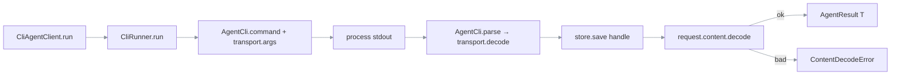

## Plan: Agent transport and content decoders

Add two seams to the Agent client contract, following Design 4 (ports and adapters):

- **`Transport`** is owned by each `AgentCli`. It decodes the CLI's stdout (text or JSONL) into the assistant text. It also encodes text back into stdout, so dry run and test fakes go through the real decode path.
- **`ContentDecoder[T]`** is carried on each `AgentRequest`. It turns the assistant text into `str` (`PlainText`) or a JSON object (`LastJsonObject`).

`AgentRequest` and `AgentResult` become generic in `T`. Copilot defaults to `CopilotJson`. Workflows stop scanning text themselves: `extract_response` and `parse_response` are removed.

**Steps**

*Phase A: transport seam (`loop.clis`)*
1. Create `src/loop/clis/transport.py`:
   - `Transcript(text, handle_value: str | None, exit_code: int | None)`.
   - `Transport` Protocol with `args: tuple[str, ...]`, `decode(stdout) -> Transcript` (pure and total; unreadable lines are skipped) and `encode(text, handle_value) -> str`.
   - Adapters:
     - `CopilotText`: args `("--output-format","text")`; decode and encode both return the text unchanged.
     - `CopilotJson`: args `("--output-format","json")`.
       - `decode` joins `assistant.message_delta` `data.deltaContent` and reads `sessionId` and `exitCode` from the `result` event. Event shape per [copilot-cli-json-output-events.md](../experiments/copilot-cli-json-output-events.md).
       - `encode` writes one delta event plus one `result` event.
     - `CodexJson`: args `("--json",)`.
       - `decode` moves in from `_parse_codex_events` (`thread.started` and the last `item.completed` `agent_message`).
       - `encode` writes `thread.started` plus one `item.completed`.
2. Update `AgentCli` in `src/loop/clis/base.py` to add a `transport: Transport` member. *Depends on 1.*
3. Update `CopilotCli` in `src/loop/clis/copilot_cli.py`. *Depends on 2.*
   - Add `__init__(args=("--allow-all-tools",), *, transport: Transport = CopilotJson())`.
   - `command` adds `*self.transport.args` right after `-p <prompt>`.
   - `parse` calls `transport.decode`. The handle rule is unchanged: the name on start, `turn.handle` on resume, and the stream's `sessionId` is ignored.
   - Exit code: the process exit code wins; when it is 0, use `transcript.exit_code or 0`.
4. Update `CodexCli` in `src/loop/clis/codex_cli.py`. *Parallel with 3.*
   - Add `transport = CodexJson()` as a fixed class attribute (no `CodexText`, because text mode has no thread id).
   - `command` builds `["codex","exec",*self.transport.args, ...]`, so the argv order stays the same.
   - `parse` uses `transport.decode`. The `SessionHandleMissing` and resume-fallback rules are unchanged.
   - Delete `_parse_codex_events`.
5. Export `Transport`, `Transcript`, `CopilotText`, `CopilotJson` and `CodexJson` from `src/loop/clis/__init__.py`. Then export them from `src/loop/__init__.py` (`__all__`), because Workflows may only import from `loop`.

*Phase B: content seam (`loop.run`). Parallel with Phase A.*

6. Create `src/loop/run/content.py`:
   - `ContentDecoder[T]` Protocol with `dry_run_text: str` and `decode(text) -> T`.
   - `ContentDecodeError(message, output)`.
   - `PlainText` (identity, `dry_run_text=""`).
   - `LastJsonObject(where=lambda _: True, *, dry_run: dict | None = None)`.
     - Uses the `raw_decode` scan from `workflows/platforms/agent_response.extract_response`.
     - Returns the last top-level dict that satisfies `where`.
     - Raises `ContentDecodeError` when nothing matches.
7. Update `src/loop/run/request.py`. *Depends on 6.*
   - `AgentRequest(Generic[T])`: `prompt: str`, `content: ContentDecoder[T] = PlainText()`.
   - `AgentResult(Generic[T])`: `output: str` (the assistant text), `content: T`, `session`, `exit_code`.
8. Export `ContentDecoder`, `ContentDecodeError`, `PlainText` and `LastJsonObject` from `src/loop/run/__init__.py` and `src/loop/__init__.py`.

*Phase C: client and runners. Depends on A and B.*

9. Update `CliAgentClient.run` in `src/loop/agents/client.py`:
   - Signature becomes `run(request: AgentRequest[T], context=None) -> AgentResult[T]`.
   - Order: runner, then `store.save(handle)`, then `request.content.decode(outcome.output)`, then build `AgentResult`.
   - Saving the handle before decoding means a malformed reply can still be resumed. `ContentDecodeError` propagates.
   - Make `AgentClient.run` in the Protocol generic the same way.
10. Make the run signatures of `GitAgent` and `DockerAgent` in `src/loop/agents/wrappers.py` generic. They behave the same as before.
11. Update `LoggingRunner.run` in `src/loop/dryrun/adapters.py`:
    - Log as today, then build `stdout = profile.cli.transport.encode(request.content.dry_run_text, handle.value)` and return `profile.cli.parse(stdout, turn, 0)`.
    - The old `cwd=… cmd=…` line is logged only and no longer returned as the output.
12. `ProcessCliRunner` in `src/loop/clis/runner.py` needs no code change: it already calls `profile.cli.parse(result.stdout, …)`.

*Phase D: Workflow migration. Depends on C.*

13. Update `workflows/plan_implement.py`:
    - Add a module constant `ENVELOPE = LastJsonObject(where=status ∈ {completed, failed} and result is a dict, dry_run={"status":"completed","result":{"plan":"dry-run"}})`.
    - `_run_step` calls `run(AgentRequest(prompt, ENVELOPE)).content` and catches `CalledProcessError` and `ContentDecodeError`.
    - Delete `_envelope` and the `extract_response` import.
14. Update `workflows/dev.py`:
    - Add a `DevResponse(identifier: WorkIdentifier)` class that implements `ContentDecoder[DevResult]`.
      - It wraps `LastJsonObject(where=lambda o: "status" in o)`.
      - It maps `ContentDecodeError` to `DevResultError("no response object in agent output")`.
      - It then runs `parse_dev_result` and the identifier check.
      - `dry_run_text` is a completed envelope carrying the identifier.
    - `parse_dev_result` now takes a `dict` instead of a `str`. Keep `_decode_envelope`'s shape checks and drop its `json.loads`.
    - Remove `parse_response`.
    - At [dev.py](../../workflows/dev.py#L433), call `client.run(AgentRequest(prompt, DevResponse(identifier))).content`. The existing `except DevError` still catches the failure.
15. Update `workflows/dev2.py` the same way at line 90, and swap the `parse_response` import for `DevResponse`. *Parallel with 14 after `DevResponse` exists.*
16. Delete `workflows/platforms/agent_response.py` once nothing references it.

*Phase E: tests. Each item follows its code step.*

17. New `tests/unit/test_transport.py`:
    - A parametrized contract test over `CopilotText`, `CopilotJson` and `CodexJson`: `decode(encode(t, h)).text == t`.
    - Non-JSON lines are skipped for both JSON transports.
    - A recorded multi-delta fixture for `CopilotJson`, plus its `sessionId` and `exitCode`.
    - Move the Codex event cases from `test_parse_codex_events` into this file.
18. New `tests/unit/test_content.py`:
    - `PlainText` returns its input unchanged.
    - `LastJsonObject`: the last match wins; nested objects and braces inside strings parse correctly; prose around the object is ignored; `where` filters; no match raises `ContentDecodeError`; `decode(dry_run_text)` never raises.
    - Move the cases from the `extract_response` tests in `tests/unit/test_dev_support.py` here.
19. Update `tests/unit/test_agent_builder.py`:
    - `test_copilot_command`: insert `--output-format json` after the prompt, and add one case for `CopilotCli(transport=CopilotText())`.
    - `test_codex_command_new_and_resume`: no change expected.
    - `UserCli` gets a `transport` attribute.
    - Add a client test with a failing decoder that asserts the handle is saved before `ContentDecodeError`.
    - Add a client test that `AgentResult.content` equals the decoded value.
20. Give the `_Cli` fake in `tests/unit/test_logging.py` a `transport = CopilotText()`.
21. `FakeRunner` in `tests/workflow_harness.py` stays as it is: it returns a `CliOutcome` holding the assistant text, and the client decodes it.
22. Update `tests/unit/test_dev_support.py`: rewrite the `parse_response` tests as `DevResponse(identifier).decode(text)` tests. `test_dev_workflow.py`'s noise test should pass unchanged.
23. Add a dry-run test: `Agent(AgentOptions(dry_run=True)).create().run(AgentRequest("p", LastJsonObject(dry_run={"status":"completed","result":{}})))` returns that object as `.content`.

*Phase F: docs. Parallel with D and E.*

24. Update the **Agent result** entry in `CONTEXT.md`: "the assistant's text the agent CLI produced for an Agent request, plus the content decoded from it by the request's content decoder, with the Agent session's identity and the exit code". Optionally add **Transport** and **Content decoder** terms through `record-term`.
25. Record an ADR through `record-adr`: "Decode agent CLI output through a per-CLI transport and a per-request content decoder". It updates [stream-agent-output-live-and-parse-it-after-exit-with-a-per-agent-kind-output-parser.md](../adr/stream-agent-output-live-and-parse-it-after-exit-with-a-per-agent-kind-output-parser.md) and records the rejected options (Designs 1–3 and the hybrid). Then update the ADR index in `ARCHITECTURE.md`.
26. Update the [str-agent-client.md](../concepts/str-agent-client.md) Concept to describe the two seams.

**Class diagram**

```mermaid
%%{init: {'themeVariables': {'lineColor': '#8b949e'}}}%%
%% diagram-id: agent-transport-content-decoders-delta
classDiagram
    namespace clis {
        class AgentCli {
            <<Interface>>
            +[add] transport : Transport
            +parse(stdout, turn, exit_code) CliOutcome
        }
        class Transport {
            <<Interface>>
            +args : tuple~str~
            +decode(stdout) Transcript
            +encode(text, handle_value) str
        }
        class Transcript {
            +text : str
            +handle_value : str | None
            +exit_code : int | None
        }
        class CopilotText {
            +args = --output-format text
        }
        class CopilotJson {
            +args = --output-format json
        }
        class CodexJson {
            +args = --json
        }
        class CopilotCli {
            +[add] transport : Transport = CopilotJson
            +[add] __init__(args, transport)
        }
        class CodexCli {
            +[add] transport : Transport = CodexJson
            +[rem] _parse_codex_events(stdout)
        }
    }
    namespace run {
        class ContentDecoder~T~ {
            <<Interface>>
            +dry_run_text : str
            +decode(text) T
        }
        class PlainText
        class LastJsonObject {
            +where : Callable
            +decode(text) dict
        }
        class ContentDecodeError {
            +output : str
        }
        class AgentRequest~T~ {
            +prompt : str
            +[add] content : ContentDecoder~T~ = PlainText
        }
        class AgentResult~T~ {
            +output : str
            +[add] content : T
        }
    }
    namespace agents {
        class CliAgentClient {
            +[add] run(AgentRequest~T~, context) AgentResult~T~
        }
    }
    namespace dryrun {
        class LoggingRunner {
            +[add] run() encodes dry_run_text then cli.parse
        }
    }
    namespace workflows {
        class DevResponse {
            +identifier : WorkIdentifier
            +decode(text) DevResult
        }
        class agent_response {
            +[rem] extract_response(text) str | None
        }
    }

    CopilotText ..|> Transport
    CopilotJson ..|> Transport
    CodexJson ..|> Transport
    Transport ..> Transcript : Use
    CopilotCli ..|> AgentCli
    CodexCli ..|> AgentCli
    AgentCli o-- Transport
    PlainText ..|> ContentDecoder
    LastJsonObject ..|> ContentDecoder
    LastJsonObject ..> ContentDecodeError : Use
    DevResponse ..|> ContentDecoder
    DevResponse *-- LastJsonObject
    AgentRequest o-- ContentDecoder
    CliAgentClient ..> AgentRequest : Use
    CliAgentClient ..> AgentResult : Use
    LoggingRunner ..> Transport : Use

    class Transport:::added
    class Transcript:::added
    class CopilotText:::added
    class CopilotJson:::added
    class CodexJson:::added
    class ContentDecoder:::added
    class PlainText:::added
    class LastJsonObject:::added
    class ContentDecodeError:::added
    class DevResponse:::added
    class agent_response:::removed
    class AgentCli:::memberChanged
    class CopilotCli:::memberChanged
    class CodexCli:::memberChanged
    class AgentRequest:::memberChanged
    class AgentResult:::memberChanged
    class CliAgentClient:::memberChanged
    class LoggingRunner:::memberChanged

    classDef default fill:#242424,stroke:#8b949e,color:#c9d1d9,stroke-width:1px
    classDef added stroke:#4a7a5a,stroke-width:1px
    classDef removed stroke:#8a4a4a,stroke-width:1px
    classDef memberChanged stroke:#8b949e,stroke-width:1px,stroke-dasharray:5 5
```

**Flow view**

**Relevant files**
- `src/loop/clis/transport.py`: new. Holds `Transcript`, `Transport` and the three adapters.
- `src/loop/clis/base.py`: adds the `AgentCli.transport` member.
- `src/loop/clis/copilot_cli.py`: `transport` keyword argument, `command` flags, `parse` decode.
- `src/loop/clis/codex_cli.py`: `--json` moves to `CodexJson`; `_parse_codex_events` is removed.
- `src/loop/clis/__init__.py`, `src/loop/run/__init__.py`, `src/loop/__init__.py`: new exports.
- `src/loop/run/content.py`: new. Holds `ContentDecoder`, `PlainText`, `LastJsonObject` and `ContentDecodeError`.
- `src/loop/run/request.py`: generic `AgentRequest` and `AgentResult`.
- `src/loop/agents/client.py`: `CliAgentClient.run` decodes after saving the handle; generic `AgentClient`.
- `src/loop/agents/wrappers.py`: generic signatures only.
- `src/loop/dryrun/adapters.py`: `LoggingRunner` encodes `dry_run_text` and calls `cli.parse`.
- `workflows/plan_implement.py`, `workflows/dev.py`, `workflows/dev2.py`: switch to decoders.
- `workflows/platforms/agent_response.py`: deleted.
- `tests/unit/test_transport.py`, `tests/unit/test_content.py`: new.
- `tests/unit/test_agent_builder.py`, `tests/unit/test_logging.py`, `tests/unit/test_dev_support.py`: updated.
- `CONTEXT.md`, `ARCHITECTURE.md`, `docs/adr/…`, `docs/concepts/str-agent-client.md`: docs.

**Verification**
1. `pytest` from the repo root. All unit tests pass, and the import-linter layer contracts still hold:
   - `transport` sits in `clis`, which may import `run`.
   - `content` sits in `run`, which imports nothing above it.
   - Workflows import only `loop`.
2. `pytest tests/unit/test_transport.py tests/unit/test_content.py -v`: the contract suites are green.
3. Manual check with real Copilot: `python -m workflows.plan_implement "<small task>"` with the default `CopilotJson`.
   - The log shows `--output-format json`.
   - The plan step returns a dict.
4. Manual check of text mode: run the same task with `AgentProfile(CopilotCli(transport=CopilotText()))` and get the same result.
5. Dry run of `plan_implement` / `dev` with `AgentOptions(dry_run=True)`: each step's `.content` equals its `dry_run_text` object, and no process starts.

**Decisions**
- Design 4 was chosen over the minimal (1), flexible (2), common-caller (3) and hybrid options.
- Copilot defaults to `CopilotJson`. Codex has only `CodexJson`; no `CodexText`, because text mode can't produce a thread id.
- `AgentResult.output` becomes the assistant text, not raw stdout. Raw stdout is still logged by `ProcessCliRunner` at debug level.
- The session handle is saved before content is decoded. `ContentDecodeError` propagates; `CalledProcessError` behaves as before.
- The library knows no envelope keys. `where` predicates and envelope shapes belong to the Workflows.
- Out of scope: live streaming or `feed(line)` on `Transport`, early termination, stream-json and other formats, typed-model decoders, and an `events` field on the result.
