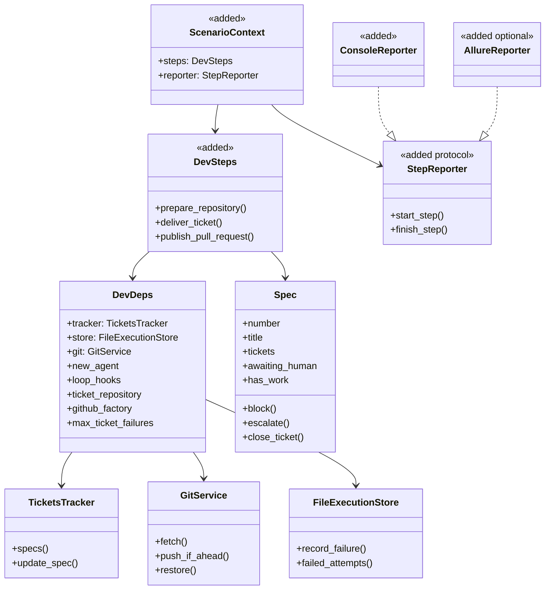

## Plan: Scenario-Driven BDD and Allure Architecture

Refactor the example development workflow in `antshc/loop` into readable, code-first, nested scenarios with named reusable steps, application services, infrastructure adapters, live console progress, and optional Allure reports. Keep ordinary Python control flow; do not introduce Gherkin or Given/When/Then conventions. This is an architectural refactor, **not** a change to delivery semantics.

**Target:** `workflows/dev/`. The public `src/loop/` library, `workflows/plan_implement.py`, and existing Git/GitHub behavior remain unchanged.

### Current code and constraints

- `workflows/dev/run.py:main` parses CLI options, configures root logging, creates GitHub/repository/tracker dependencies, calls `process_specs`, and converts unexpected exceptions to exit code 1.
- `workflows/dev/backlog.py:process_specs` validates repository mappings, skips human-blocked Specs, and aggregates failures. `_process_spec` validates target labels and catches selected operational exceptions. `_prepare` fetches and validates the target branch, publishing prior commits *before* worktree creation. `_deliver_on_worktree` creates the worktree, delivers tickets, publishes the PR and announces completion.
- `workflows/dev/attempt.py:deliver_tickets` loops over actionable Tickets, retries on failure, restores Git state, persists failure counts, and escalates at the failure cap. `_attempt` validates agent responses and commits.
- `workflows/dev/records.py` owns `Spec`, `Ticket`, `Repository`, `RepositoryId`, and `TicketResult`.
- `workflows/dev/platforms.py`, `checkout.py`, and `journal.py` implement concrete GitHub, Git, and execution-store access.
- `workflows/dev/tests/doubles.py:DevHarness` and `test_run.py` verify behavior through injected fakes. `pyproject.toml` already enforces library/workflow import constraints.
- `ARCHITECTURE.md` explicitly defines Loop as a library, with user-owned plain-Python Workflows; this must remain true.

### Architecture

1. **Entry point** (`run.py`): Parse configuration, wire dependencies, select reporting mode, execute one top-level scenario, and preserve exit-code/error boundaries.
2. **Scenarios** (`scenarios/`): Describe control flow and nested subflows explicitly. Contain conditional routing and iteration, but no Git/GitHub commands, retry storage mechanics, or agent API details.
3. **Steps** (`steps/`): Expose small, meaningful, typed operations; delegate to application services. Steps have descriptive language and report observable actions. Do not duplicate business rules.
4. **Services** (`services/`): Retain domain decisions, response/commit validation, retry counters, failure escalation, and persistence sequencing. Prefer extracting existing functions over introducing superficial wrapper classes.
5. **Infrastructure** (existing `checkout.py`, `platforms.py`, `journal.py`, etc.): Own external I/O, keep ignorant of scenarios and Allure.
6. **Reporting** (`reporting/`): Separate console and optional Allure implementations behind one small execution-scoped reporting interface. Decorators/context managers provide nested scenario/step events; report emission must never alter business outcomes.

Dependency direction: `run → scenarios → steps → services → infrastructure`. Scenario/step code may depend on domain records and reporting contracts; services/infrastructure MUST NOT import scenarios, steps, console or Allure. Preserve existing `workflows` → public `loop` imports-only rule. Keep reusable library independent of reporting packages.

### Illustrative package layout

- `workflows/dev/run.py` — CLI and composition root
- `workflows/dev/scenarios/development.py` — root scenario and specification enumeration
- `workflows/dev/scenarios/specification.py` — per-Spec scenario
- `workflows/dev/scenarios/ticket.py` — ticket-delivery/retry subscenario where control-flow extraction is justified
- `workflows/dev/steps/repository.py` — preparation/worktree actions
- `workflows/dev/steps/specification.py` — ticket loading/status/publication actions
- `workflows/dev/steps/ticket.py` — agent attempt/verification/update actions
- `workflows/dev/services/backlog.py` — Spec rules extracted from `backlog.py`
- `workflows/dev/services/attempt.py` — Ticket rules extracted from `attempt.py`
- `workflows/dev/reporting/core.py` — scenario/step reporting contract and execution scope
- `workflows/dev/reporting/console.py` — streaming status output
- `workflows/dev/reporting/allure.py` — optional Allure runtime adapter
- `workflows/dev/tests/` — preserved harness plus reporting and scenario tests

Prefer the minimum required new modules. Do not move `records.py` or infrastructure solely for naming consistency. Preserve existing import paths where reasonable or update their tests and callers explicitly.

### Scenario flow

`development_scenario(context)` describes the whole workflow in ordinary Python and calls named steps plus `specification_scenario(context, spec, targets)` for each eligible Spec. A Spec scenario resolves the target, prepares the checkout, handles no-work/blocked branches, opens the worktree, invokes ticket delivery, publishes the PR, and announces completion. A ticket scenario makes retry and escalation behavior visible while delegating validation/rollback/persistence to existing services.

Scenario names should read like actions: "Development workflow", "Process specification #42", "Deliver ticket #101", "Validate agent commit", "Publish draft pull request". No feature files, no explicit Given/When/Then vocabulary. Nested scenario calls must create parent/child report steps automatically.

Expected successful hierarchy:
- Development workflow
  - Connect to GitHub
  - Load repositories
  - Load specifications
  - Process specification #42
    - Prepare repository
    - Deliver specification #42
      - Open worktree
      - Deliver ticket #101
        - Execute agent
        - Validate commit
        - Close ticket
      - Publish draft pull request
      - Announce delivery

This is an *illustration*; conditional steps only appear when executed, and Git/PR operations must remain in the existing actual order.

### Class-level design sketch

`[add]` marks proposed classes/contracts; unchanged classes are grounded in current source.

Only introduce `ScenarioContext`/`DevSteps` if they simplify orchestration; prefer lightweight functions to unnecessary object state. Reporter method signatures and Allure adapter are to be proven in the first phase.

### Steps

**Phase 1 — Reporting spike (blocks later phases)**

1. Verify an executable nested scenario produces correct hierarchy and statuses in a *standalone* Python workflow, not just inside pytest. `allure-pytest` decorators alone do not guarantee CLI-generated `allure-results`: test the actual Allure lifecycle/plugin integration. If standalone emission is impractical, document a fallback that preserves console reporting and delegates Allure reporting to pytest.
2. Implement one reporting contract with nested start/finish, elapsed time, and explicit `SUCCESS`/`FAILED`/`SKIPPED` outcomes. Handle returned failure statuses as well as raised exceptions. Reporting errors must not mask workflow failures; opt-in report failures should be visible.
3. Implement console reporting with indentation and live start/complete/fail/skip messages; make output compatible with existing root logging. Do not print secrets, credentials or raw agent prompts.
4. Keep Allure optional (e.g. a `reports` extra), disabled by default and enabled through an explicit CLI argument such as `--allure-results <dir>`. Ensure default `python -m workflows.dev` runs with no Allure package installed.

**Phase 2 — Extract executable scenarios (depends on Phase 1)**

5. Move the top-level composition of steps into `development_scenario`, preserving `run.main` signature, argument parsing, injected fakes, logging destination, and unexpected-error exit boundary.
6. Extract the per-Spec flow from `backlog.py` into `specification_scenario`. Retain case-insensitive target mapping, duplicate-target rejection, HITL handling, branch validation, prior-push-before-worktree, draft-PR reuse and publication semantics.
7. Extract ticket flow from `attempt.py` only where it improves scenario readability. Retain per-ticket retries, persisted failure count, reset to previous commit on failed attempts, single-commit validation and escalation. Preserve processing order and stop-on-failure behavior.

**Phase 3 — Separate steps and services (depends on Phase 2; repository and ticket extraction can proceed in parallel once interfaces are stable)**

8. Add reusable, thin step functions/methods around existing service operations, with descriptive labels and typed inputs/results. Keep scenarios as the single place that describes high-level flow; avoid both scenario and service implementing the same orchestration.
9. Extract relevant existing `backlog.py` and `attempt.py` logic to `services/`, retaining domain decisions and their behavior. Keep `platforms.py`, `checkout.py`, `journal.py` and `records.py` as existing infrastructure/domain modules unless a concrete dependency issue requires movement.
10. Add import-linter rules for dependency direction; do not put reporting imports in the domain/services/infrastructure or `src/loop`.

**Phase 4 — Tests and documentation (depends on prior phases)**

11. Preserve `DevHarness` end-to-end behavior tests against fakes; do not introduce live Git, GitHub, Docker or agent calls. Add tests for each nested reporting path, no-report mode, exceptions, returned failed outcomes, skips, and parallel/recursive reporter scope where relevant.
12. Run `python -m pytest` and architecture checks, `python -m workflows.dev --help`, and both installation/entry-point smoke checks on Python 3.10.12 and a newer supported interpreter. Validate console output for live ordered steps and verify generated report files with an Allure viewer where the standalone adapter is enabled.
13. Update `ARCHITECTURE.md` and the relevant Workflow/test documentation to describe layers, reporting opt-in, scenario authoring style, and package boundaries. Document limitations of Allure used outside pytest.

### Verification

- All existing `workflows/dev/tests/test_run.py` and `test_backlog.py` scenarios still produce the same exit codes, issue comments/labels, pushes, PRs, worktree cleanup, and agent calls.
- Exact regression cases: human-blocked Spec; invalid target; missing remote branch; no work but unpublished commits; existing draft PR; no commits to publish; two Tickets in order; retry after one failure; HITL escalation after cap; invalid agent response; unexpected error logging.
- Unexpected exceptions do not escape `main`; returned failed outcomes are logged/reported as failures even when no exception is raised. Skips remain semantically distinct from failures.
- Console status is emitted live, in the correct nesting order, with durations; reporting disabled does not change execution side effects.
- With reporting enabled, an actual standalone CLI invocation generates an Allure-readable result with nested steps; failed/skipped statuses match workflow outcomes. If the Phase 1 spike proves otherwise, adjust reporting design *before* the large refactor.
- `python -m pytest`, import-linter checks, and Python 3.10+ entry-point smoke checks pass.

### Decisions and boundaries

- This is **code-first BDD style** (human-readable scenarios), not a Gherkin test runner.
- **No Given/When/Then** in workflow names, step names or report labels. Existing tests' mandated Given/when/then docstrings belong to the test strategy and are out of scope unless separately changed.
- Reporting is observation, never the engine of business decisions. It MUST NOT convert a returned nonzero exit status into apparent Allure success.
- Preserve `Spec` and `Ticket` domain entities, `DevDeps`-based dependency injection, and the public `loop` package independence.
- Favor functions and narrow interfaces over an unnecessary object hierarchy; the diagram is conceptual.
- Excluded: converting sibling `plan_implement` workflow, adding a general-purpose BDD engine to `src/loop`, changing ticket/agent behavior, or adding real integration tests.
- No application code changes as part of creating this plan.
