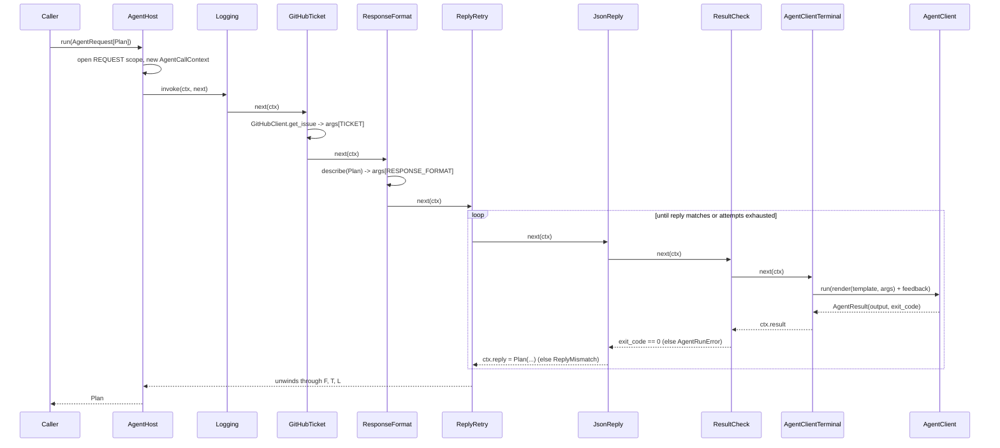

# Agent middleware pipeline (chain of responsibility prototype)

A standalone async sketch of an ASP.NET Core–style middleware pipeline around an agent client. A **composition root** registers services and middlewares in a [Dishka](https://dishka.readthedocs.io/) container and orders the chain. Each agent call flows through class middlewares that **fill the prompt template before** the agent runs (ticket, response format, role-specific sections) and **check and decode the result after** it (exit code, JSON → typed dataclass, retry on mismatch).

It does not import `loop`; it is an exploration of what could replace today's hard-wired steps in `CliAgentClient.run` (instructions prepended) and `TypedAgent.run` (encode → run → exit-code check → decode).

## Concept mapping

| ASP.NET Core | Prototype |
|---|---|
| `builder.Services` | Dishka providers in [`composition.py`](agentmw/composition.py) |
| `Program.cs` `app.Use…` | `configure_pipeline(app)` |
| `HttpContext` | `AgentCallContext`: request, `args`, `attempt`, `feedback`, `prompt`, `result`, `reply`, `items` |
| `HttpContext.RequestServices` | `ctx.services`, the Dishka REQUEST-scope container |
| `RequestDelegate` | `Next = Callable[[AgentCallContext], Awaitable[None]]` |
| `IMiddleware.InvokeAsync` | `async def invoke(self, ctx, next)` |
| Factory-activated middleware | middleware types resolved from the REQUEST scope on every call |
| `app.Use<T>()` | `app.use(T)` |
| `app.UseWhen(pred, …)` | `app.use_when(pred, configure)`: sub-chain, then rejoins |
| `app.MapWhen(pred, …)` | `app.map_when(pred, configure)`: separate chain with its own (or the parent's) terminal |
| — | `app.for_role(role, configure)`, which is `use_when` on `ctx.role` |
| — | `app.map_role(role, configure)`, which is `map_when` on `ctx.role`: a separate chain per role |
| — | `chain.apply(fragment)`: reuse a group of middlewares across chains |
| Endpoint | `app.run(AgentClientTerminal)`: renders the template and calls `AgentClient.run(prompt)` |
| Short-circuit | a middleware returns without calling `next` |
| `WebApplication` | `AgentHost`; `host.run(request) -> R` for a single call |
| — | `host.run_scope()` → `AgentRun.call(...)`: several calls sharing one Dishka `SESSION` scope |

## Default pipeline

```python
def configure_pipeline(app: PipelineBuilder) -> None:
    app.use(LoggingMiddleware)          # timing, attempts, outcome
    # shared pre-agent: every role
    app.use(GitHubTicketMiddleware)     # metadata["issue"] -> {{TICKET}}
    app.use(ResponseFormatMiddleware)   # reply dataclass  -> {{RESPONSE_FORMAT}}
    # per role, outside the retry: once per call
    app.for_role("planner", lambda b: b.use(RememberPlanMiddleware))       # post: typed reply -> PlanStore
    app.for_role("implementer", lambda b: b.use(PlanMiddleware))           # pre:  PlanStore   -> {{PLAN}}
    app.for_role("reviewer", lambda b: b.use(ReviewChecklistMiddleware))   # pre:  checklist   -> {{CHECKLIST}}
    app.use(ReplyRetryMiddleware)       # re-runs the inner chain on ReplyMismatch
    # per role, inside the retry: every attempt
    app.for_role("implementer", lambda b: b.use(VerifyChecksMiddleware))   # post: failing checks -> ReplyMismatch
    # shared post-agent
    app.use(JsonReplyMiddleware)        # last JSON object -> reply dataclass
    app.use(ResultCheckMiddleware)      # non-zero exit -> AgentRunError
    app.run(AgentClientTerminal)        # render {{KEY}} template (+ retry feedback), call agent
```

Order matters the same way it does in ASP.NET Core:

- Pre-agent middlewares (ticket, format, plan, checklist) sit **outside** the retry, so they run once per call; the retry re-runs only the agent and the parsing.
- `RememberPlanMiddleware` is also outside the retry, so it stores only the final, decoded plan.
- `VerifyChecksMiddleware` sits **inside** the retry and **outside** `JsonReplyMiddleware`. The checks run only after a well-formed reply, and a failure becomes the feedback for the implementer's next attempt.
- `ResultCheckMiddleware` sits **inside** `JsonReplyMiddleware`, so a failed process raises `AgentRunError` before any parser sees its output, and the retry never catches it.
- The terminal fails with `PromptError` when any placeholder is still unfilled. A role that skips a middleware cannot silently send `{{CHECKLIST}}` to the agent.



## Different chains per role

The default pipeline is **one shared chain with role branches** (`for_role` = `UseWhen`): every role runs the same spine, and a branch adds a step for one role, then rejoins. `configure_role_pipelines` instead gives **each role a chain of its own** (`map_role` = `MapWhen`). Each role's chain is one function that lists every step, from logging to the terminal, so the full chain reads top to bottom:

```python
def planner_pipeline(chain: PipelineBuilder) -> None:
    chain.use(LoggingMiddleware)
    chain.use(GitHubTicketMiddleware)     # pre:  {{TICKET}}
    chain.use(ResponseFormatMiddleware)   # pre:  {{RESPONSE_FORMAT}} from PlanReply
    chain.use(RememberPlanMiddleware)     # post: final PlanReply -> PlanStore
    chain.use(ReplyRetryMiddleware)       # re-ask on ReplyMismatch
    chain.use(JsonReplyMiddleware)        # post: JSON -> PlanReply
    chain.use(ResultCheckMiddleware)      # post: non-zero exit -> AgentRunError
    chain.run(AgentClientTerminal)


def implementer_pipeline(chain: PipelineBuilder) -> None:
    chain.use(LoggingMiddleware)
    chain.use(GitHubTicketMiddleware)     # pre:  {{TICKET}}
    chain.use(ResponseFormatMiddleware)   # pre:  {{RESPONSE_FORMAT}} from ImplementReply
    chain.use(PlanMiddleware)             # pre:  {{PLAN}} from PlanStore
    chain.use(ReplyRetryMiddleware)       # re-ask on ReplyMismatch
    chain.use(VerifyChecksMiddleware)     # post: failing checks -> ReplyMismatch
    chain.use(JsonReplyMiddleware)        # post: JSON -> ImplementReply
    chain.use(ResultCheckMiddleware)      # post: non-zero exit -> AgentRunError
    chain.run(AgentClientTerminal)


def reviewer_pipeline(chain: PipelineBuilder) -> None:
    chain.use(LoggingMiddleware)
    chain.use(GitHubTicketMiddleware)     # pre:  {{TICKET}}
    chain.use(ResponseFormatMiddleware)   # pre:  {{RESPONSE_FORMAT}} from ReviewReply
    chain.use(ReviewChecklistMiddleware)  # pre:  {{CHECKLIST}}
    chain.use(ReplyRetryMiddleware)       # re-ask on ReplyMismatch
    chain.use(JsonReplyMiddleware)        # post: JSON -> ReviewReply
    chain.use(ResultCheckMiddleware)      # post: non-zero exit -> AgentRunError
    chain.run(AgentClientTerminal)


def configure_role_pipelines(app: PipelineBuilder) -> None:
    app.map_role("planner", planner_pipeline)
    app.map_role("implementer", implementer_pipeline)
    app.map_role("reviewer", reviewer_pipeline)
    app.run(UnknownRoleTerminal)          # a role with no chain raises LookupError; no agent runs


host = create_host(..., configure=configure_role_pipelines)
```

```
┬─ planner:     Logging → Ticket → Format → RememberPlan → Retry → Json → ResultCheck → AgentClientTerminal
├─ implementer: Logging → Ticket → Format → Plan → Retry → VerifyChecks → Json → ResultCheck → AgentClientTerminal
├─ reviewer:    Logging → Ticket → Format → Checklist → Retry → Json → ResultCheck → AgentClientTerminal
└─ (other)      UnknownRoleTerminal → LookupError
```

Each role's chain can also end at a **different terminal**, for example `chain.run(ReadOnlyAgentTerminal)` for a planner on another model, or a terminal that resolves another `AgentClient`. A chain that never calls `run(...)` ends at the parent's terminal. To avoid repeating a step group, a role function can call `chain.apply(fragment)`, which trades some of the top-to-bottom readability for less repetition.

| | Shared chain + `for_role` | One function per role with `map_role` |
|---|---|---|
| Read a role's steps | Scan the whole chain for its branches | Read one function |
| Add a step to every role | One `use(...)` | Add it to each role function |
| Order per role | Shared positions only (branches sit between shared steps) | Any order, any terminal |
| Unknown role | Runs the shared chain | Fails fast (`UnknownRoleTerminal`) |

Both run the same tests: `RolePipelinesTests` re-runs the planner/implementer role tests against `configure_role_pipelines`.

## Usage

```python
from agentmw import AgentClient, AgentRequest, GitHubClient, RetryPolicy, bind, create_host

host = create_host(
    bind(GitHubClient, real_github),       # infrastructure the caller owns
    bind(AgentClient, copilot_client),
    bind(RetryPolicy, RetryPolicy(max_attempts=2)),  # later providers override defaults
)
plan = await host.run(
    AgentRequest("planner", "## Ticket\n{{TICKET}}\n\n{{RESPONSE_FORMAT}}", Plan,
                 metadata={"issue": "antshc/loop#12"})
)  # -> Plan, typed
await host.aclose()
```

To write a middleware, add a class with `async def invoke(self, ctx, next)`, inject its collaborators through `__init__`, register it in a provider, and `app.use(...)` it. The container validates the dependency graph when `create_host` builds it, so a missing `GitHubClient` or `AgentClient` fails at startup rather than on the first call.

## Run

From this directory, on Python 3.14:

```sh
python -m pip install -r requirements.txt   # dishka
python -m agentmw                           # demo: planner (retries once) → implementer → reviewer
python -m unittest discover -s tests -t .
```

## Layout

```
agentmw/
  context.py        AgentRequest[R], AgentResult, AgentCallContext
  errors.py         PromptError, ReplyMismatch, AgentRunError, AgentReplyError
  template.py       {{KEY}} placeholders and render
  middleware.py     Next, Middleware, Terminal protocols
  pipeline.py       PipelineBuilder: use, use_when, map_when, for_role, map_role, apply, run, build
  host.py           AgentClient protocol, AgentHost, AgentRun (run scope)
  terminal.py       AgentClientTerminal, UnknownRoleTerminal
  integrations.py   GitHubClient, TicketCache, Issue, RetryPolicy, ReviewChecklist
  middlewares/      log, ticket, response_format, checklist, plan, checks, retry, json_reply, result_check
  composition.py    the composition root: providers, configure_pipeline, configure_role_pipelines, bind, create_host
  fakes.py          FakeGitHubClient, ScriptedAgentClient
  __main__.py       demo
tests/              pipeline ordering and branching, each middleware, end-to-end host and run scope
```

## Example: planner → implementer

A Workflow with two agent calls, a planner and then an implementer, makes **two passes through the same pipeline**, like two HTTP requests to one ASP.NET Core app. Sequencing and passing data between the calls is the Workflow's job (in Loop, its `Flow` Stages), not the middlewares'. Middlewares only shape one call each.

```python
async with host.run_scope() as run:        # one Workflow run: Dishka SESSION scope
    plan = await run.call(AgentRequest(
        "planner", PLAN_TEMPLATE, PlanReply,
        metadata={"issue": "antshc/loop#12"},
    ))                                     # RememberPlanMiddleware stores the plan
    change = await run.call(AgentRequest(
        "implementer", IMPLEMENT_TEMPLATE, ImplementReply,
        metadata={"issue": "antshc/loop#12"},
    ))                                     # PlanMiddleware fills {{PLAN}}
```

```markdown
<!-- IMPLEMENT_TEMPLATE -->
You are the implementer. Follow the plan.

## Ticket
{{TICKET}}            ← GitHubTicketMiddleware (cached for the run)

## Plan
{{PLAN}}              ← PlanMiddleware, from the planner's reply in PlanStore

## Response format
{{RESPONSE_FORMAT}}   ← ResponseFormatMiddleware, from ImplementReply
```

### What each role gets

| Role | Shared | Role-specific |
|---|---|---|
| planner | logging, `{{TICKET}}`, `{{RESPONSE_FORMAT}}`, retry, JSON → `PlanReply`, exit check | `RememberPlanMiddleware`: after a successful reply, stores it in the run's `PlanStore` |
| implementer | same | `PlanMiddleware`: `{{PLAN}}` from `PlanStore` (or the caller's `args["PLAN"]`); `PromptError` if no planner ran in this run. `VerifyChecksMiddleware`: runs `CheckRunner` after each attempt; failing output is fed back and the implementer is re-asked |
| reviewer | same | `ReviewChecklistMiddleware`: `{{CHECKLIST}}` |

### Scopes

| Dishka scope | Lifetime | Holds |
|---|---|---|
| `APP` | `create_host(...)` to `aclose()` | `GitHubClient`, `AgentClient`, `CheckRunner`, `RetryPolicy`, `ReviewChecklist` |
| `SESSION` | `async with host.run_scope()`, one Workflow run | `TicketCache` (the issue is read once), `PlanStore` (planner → implementer) |
| `REQUEST` | one `run.call(...)`, one agent call | every middleware, the terminal, the `AgentCallContext` |

`host.run(request)` is shorthand for a run scope with a single call, so nothing is shared. Other run-level state would also go in `SESSION`: the worktree both agents edit, or a session store so the implementer can resume the planner's agent session.

### What stays per call

- **Context.** The `args`, `attempt`, `feedback` and `reply` of the planner never leak into the implementer's `AgentCallContext`; only what a middleware deliberately puts in a SESSION service (`PlanStore`) crosses over.
- **Retry.** A mismatched reply or failing checks re-ask only the implementer. If the implementer's process fails, the error is raised to the Workflow, which decides whether to re-plan (a `Flow` route); the pipeline never re-runs the planner.
- **Backends.** Roles that need a different backend (another model, read-only versus worktree) branch with `map_when` to their own terminal.

### Passing the plan: middleware or argument

- **`PlanMiddleware`** (above): the planner's reply travels through the run's `PlanStore`, so the Workflow only sequences the calls. A durable version would load the plan from the Execution ledger, which also covers resume.
- **`args={"PLAN": ...}`**: the caller renders the typed `PlanReply` itself; `PlanMiddleware` leaves an explicit argument alone.

`python -m agentmw` runs this flow against fakes. The planner needs one retry. The implementer gets the stored plan, fails its checks once, and is re-asked with the failure. The reviewer gets its checklist. It prints `GitHub fetches: 1, check runs: 2`.

## Open questions before adopting

- **DI container.** The Dishka ADR ([structure workflows as vertical slices…](../../adr/structure-workflows-as-vertical-slices-over-a-shared-package-wired-by-dishka.md)) is superseded: the factory now passes services explicitly. Adopting this pipeline needs a new ADR, either re-introducing a container or resolving middlewares from explicit factories.
- **Sync versus async.** `loop` is synchronous today, so an async pipeline means an async `AgentClient` or a thread bridge.
- **Where profile instructions go.** `CliAgentClient` prepends `AgentProfile.instructions`. Here they would become one more pre-agent middleware.
- **Session resume.** Retries currently re-run with a fresh prompt plus feedback. A resumable session could send only the feedback.
- **`TypedAgent` overlap.** `TypedAgent.encode/decode` per role would be replaced by template + reply type + pipeline, with per-role differences expressed through `for_role`.
