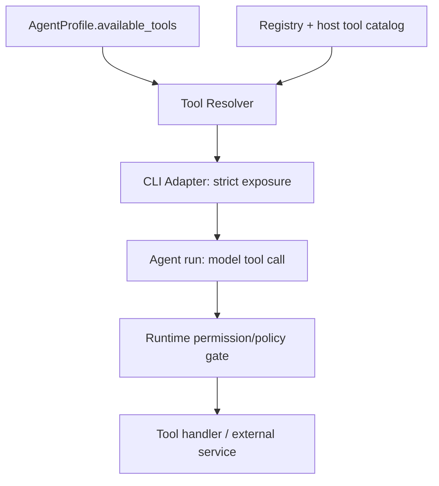

# Agent Tool Architecture for Loop

Date: 2026-10-27  
Status: Research / design recommendation (not implemented)  
Scope: Agent tool definition, discovery, availability, and enforcement in the Loop library

## Recommendation

Use an **explicit tool allowlist on `AgentProfile`**, resolved before an Agent run and enforced by the selected Agent CLI. Keep executable tool definitions separate from agent profiles and workflow actions. Start with a small in-process registry for Loop-defined tools; expose them through the CLI's supported tool mechanism, such as MCP, only when needed.

**Availability is not approval.** A tool omitted from the agent's available set must not be callable. Allow/deny confirmation flags decide whether an already available tool requires approval; they do not reliably remove it from the model's available set.

Current Loop has `AgentProfile.permissions: Permissions`, with `Permissions.tools` and `deny_tools` translated into CLI approval flags. It does **not** yet implement the proposed tool-availability contract. Do not reinterpret existing `Permissions.tools` as a strict allowlist.

## Concepts and boundaries

| Concept | Responsibility |
| --- | --- |
| **Agent Tool** | Capability the model may call directly during an Agent run (built-in CLI, custom, or MCP tool) |
| **ToolDefinition** | Stable name, description, input schema, and callable implementation for a Loop-defined tool |
| **ToolRegistry** | Maps names to definitions; validates uniqueness and resolves requested tools |
| **AgentProfile.available_tools** | Proposed exact allowlist of tool names for one agent; independent of prompts and approval flags |
| **Tool Resolver** | Checks requested names against registry and host-provided tool catalogs; builds the effective set |
| **CLI Adapter** | Translates that set into provider-native availability configuration; rejects unsupported strict restrictions |
| **Runtime Policy** | Enforces deny rules and operation-specific guards at actual execution boundaries |
| **Workflow Action** | Python code invoked by the Workflow before/after an agent or without one; not an Agent Tool |
| **Service / Adapter** | Shared domain implementation callable from both a Workflow Action and an Agent Tool wrapper |



## Availability options

| Option | Mechanism | Fit |
| --- | --- | --- |
| **Explicit allowlist (recommended)** | Agent profile names exact tools; provider exposes only those tools | Standard Loop agents when the host supports strict filtering |
| Named tool groups | Expand `read_only`, `github`, etc. into explicit names at configuration time | Optional convenience for recurring profiles |
| Dedicated MCP facade | Export selected Loop tools from an MCP server and expose only that server's tools | Cross-provider custom-tool support; more infrastructure |

For a local single-developer factory, start with the explicit allowlist. Do not add a generic plugin framework or remote registry.

## Proposed Python contract

Illustrative API, **not existing Loop code**:

```python
from dataclasses import dataclass
from collections.abc import Awaitable, Callable, Mapping

@dataclass(frozen=True)
class ToolDefinition:
    name: str
    description: str
    parameters: Mapping[str, object]  # JSON Schema
    handler: Callable[[Mapping[str, object]], Awaitable[object]]

# Proposed addition to existing AgentProfile:
# available_tools: tuple[str, ...] | None = None

developer = AgentProfile(
    cli=copilot,
    name="developer",
    available_tools=(
        "github_issue_read",
        "github_issue_comment",
        "github_pr_create",
    ),
)
```

`ToolDefinition.handler` is a Python implementation. It becomes agent-callable **only after** a CLI adapter registers or exposes it through a supported interface (for example MCP). Supplying a Python callable to `AgentProfile` alone cannot install a tool into a separate Copilot/Codex process.

### Allowlist semantics

| `available_tools` | Meaning |
| --- | --- |
| `None` | Inherit host defaults (backward compatible; **not** restricted) |
| `()` | Expose no tools |
| `("github_issue_read",)` | Expose only the named tool |

Exact names are required. Unknown, duplicate, or ambiguous names must fail during resolution. Future tool groups must expand to exact names before the session starts.

Effective tool access has **three separate layers**:

1. **Exposure:** The host makes only the resolved tools visible and callable.
2. **Approval:** Existing Loop `Permissions` controls native allow/deny approval behavior for supported CLIs.
3. **Execution policy:** The tool implementation or trusted runtime checks arguments, repository scope, credentials, and side-effect permissions.

An approval flag such as `--allow-tool` must not be treated as proof of exclusive availability. An observe-only hook must not be treated as a blocking security boundary.

## Runtime sequence

1. Workflow selects `AgentProfile` and invokes `AgentClient`.
2. Resolver validates names and obtains Loop-defined plus host-native tool metadata.
3. Adapter checks whether its CLI supports **strict tool availability**, including removal of native tools.
4. Adapter creates the restricted Agent session. If strict enforcement is requested but unsupported, **fail before execution**.
5. The model invokes an exposed tool; execution policy checks the call and dispatches its handler.
6. Adapter returns a structured tool result to the model. Workflow later receives `AgentResult` and decides the next Workflow Action or gate.

The Workflow must not infer that an `AgentResult` success message proves a gate passed.

## Constraints

All constraints apply **even if skipping them appears faster or simpler**.

| Constraint | Rationale |
| --- | --- |
| MUST keep agent tool calls separate from Workflow Actions | Preserve model-controlled versus code-controlled execution |
| MUST resolve tool names before the Agent run | Detect missing tools without mid-run surprises |
| MUST enforce the effective allowlist at the host/runtime boundary | Prompt instructions cannot prevent unauthorized tool calls |
| MUST fail closed if a CLI cannot guarantee requested strict restrictions | Avoid silently running with broader default tools |
| MUST NOT equate `Permissions.tools` with visibility | Current Loop permissions select approval flags, not an exclusive tool catalog |
| MUST NOT implicitly include shell, filesystem, browser, or other MCP tools in a nonempty allowlist | Keep least privilege and predictable behavior |
| MUST validate arguments and operation scope at execution | Availability alone does not authorize every action or target |
| MUST keep secrets and provider-specific transport details out of ToolDefinition | Preserve reuse, auditability, and safe configuration |
| MUST preserve the same restrictions when starting or resuming sessions | Prevent broader access after resume |
| MUST NOT use observe-only Agent CLI hooks as the policy enforcement mechanism | Observation is not interception |
| MUST NOT require every Workflow Action to be an agent-exposed tool | Deterministic code should call services directly |

## Validation cases

- `available_tools=None` preserves current provider default behavior.
- Empty allowlist runs with zero exposed tools, including native tools.
- Named allowlist exposes the exact subset and blocks a call to an unlisted native/MCP tool.
- Unknown tool name or name collision fails before process launch.
- Unsupported strict filtering fails before process launch; no permissive fallback.
- Explicit deny or operation-scope policy blocks a call even when the tool is available.
- Resumed sessions retain the same policy or fail if it cannot be verified.
- Workflow code can still invoke `TicketTracker` directly as an Action without exposing it to the agent.
- Fake CLI adapters verify translated config and failure paths without starting a real agent process.

## Implementation placement

- **Loop library:** Definitions/registry (if needed), profile availability contract, resolution, CLI capability checks, and adapter translation.
- **Factory workflow:** Select allowed tools for Developer/Reviewer/Maintainer profiles, handle blocked work, and own ticket/PR actions and business gates.
- **Provider boundary:** MCP or native tool registration, tool visibility filtering, and enforceable execution policy.
- **Existing `Permissions`:** Remains approval/deny policy; do not silently change its established meaning.

## Sources

- [Loop Glossary](https://github.com/antshc/loop/blob/main/GLOSSARY.md) — Agent Tool vs Workflow Action vs Service/Adapter.
- [Existing AgentProfile](https://github.com/antshc/loop/blob/main/src/loop/clis/base.py).
- [Existing Permissions](https://github.com/antshc/loop/blob/main/src/loop/clis/permissions.py).
- [Existing Copilot CLI adapter](https://github.com/antshc/loop/blob/main/src/loop/clis/copilot_cli.py).
- [Loop Agent Client architecture](https://github.com/antshc/loop/blob/main/docs/concepts/str-agent-client.md).
- [GitHub Copilot custom-agent tool availability](https://docs.github.com/en/copilot/reference/custom-agents-configuration).
- [GitHub Copilot CLI tool-availability configuration](https://docs.github.com/en/copilot/how-tos/copilot-cli/set-up-copilot-cli/configure-copilot-cli).
