# Agentic Software Factory: SDLC Workflow Catalog

**Status:** Research / proposed workflow model  
**Date:** 2026-10-27  
**Scope:** Event-driven software factory workflows across development, PR handling, deployment, production incidents, maintenance, and improvement.

**Related:** [Agentic Software Factory Lifecycle](agentic-software-factory-lifecycle.md) describes the eight industry-aligned lifecycle phases. This document decomposes the lifecycle into reusable, trigger-driven workflows.

## Findings

An agentic software factory coordinates specialized agents, deterministic gates, human decisions, and persistent work state. The taxonomy below is a **synthesis of vendor documentation and established SRE/DevOps practices**, not a formal industry standard. A workflow can start another workflow; stages may repeat.

| Operational stage | Purpose |
| --- | --- |
| Triage | Classify, deduplicate, route incoming work |
| Build | Specify, break down, implement |
| Validate | Review, test, secure, prove behavior |
| Release | Merge, deploy, measure rollout |
| Monitor | Detect incidents, mitigate, investigate |
| Improve | Maintain, document, learn, evolve factory |

Warp Factories documents foreman-led triage, spec, implementation, review, and human handoff. Factory's Software Factory extends this with release, documentation, and incident monitoring. GitHub provides PR review and merge controls. Google SRE supplies incident and production-safety practices.

## Workflow catalog

| # | Workflow | Trigger | Outcome |
| --- | --- | --- | --- |
| 1 | Work intake and triage | Issue, message, alert | Routed work item |
| 2 | Specification and ticket breakdown | Specification request or spec-labeled issue | Specification and linked tickets |
| 3 | Feature development | Ready implementation ticket | Tested implementation PR |
| 4 | Independent PR review | PR opened or synchronized | Review findings and recommendation |
| 5 | PR babysitting | Review comment, failed check, conflicting branch | Merge-ready PR or explicit blocker |
| 6 | PR merge coordination | All review and validation conditions satisfied | Merged PR and completion event |
| 7 | Release and deployment | Merged PR, version tag, schedule | Verified production release or rollback |
| 8 | Production incident response | Monitoring or paging alert | Mitigated incident and recorded follow-up |
| 9 | Production bug remediation | Customer report or incident follow-up | Permanent fix PR |
| 10 | CI failure recovery | Failed pipeline/check | Repaired build or recorded infrastructure blocker |
| 11 | Security vulnerability remediation | SAST, dependency or advisory alert | Validated security fix PR |
| 12 | Dependency maintenance | Schedule or package advisory | Compatible dependency update PR |
| 13 | Technical debt reduction | Schedule, quality rule, backlog | Behavior-preserving refactor PR |
| 14 | Documentation synchronization | Code, interface, or schema change | Updated documentation |
| 15 | Post-incident learning | Resolved incident | Reviewed postmortem and prevention tickets |
| 16 | Factory self-improvement | Repeated failures, cost or quality drift | Reviewed factory definition change |

## Text sequence diagrams

The Mermaid source is a text sequence diagram, renderable on GitHub. Participants describe responsibilities, not necessarily distinct processes. Decisions, loops, and human approvals are illustrative policy branches.

## Planning and development

### 1. Work intake and triage

**Trigger:** Issue, message, alert. **Outcome:** Routed work item.

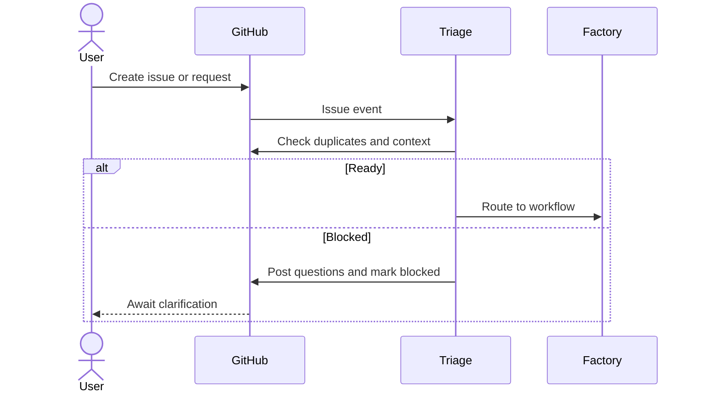

**Gate:** Valid scope; duplicate check; known owner; sufficient context.

### 2. Specification and ticket breakdown

**Trigger:** Specification request or spec-labeled issue. **Outcome:** Specification and linked tickets.

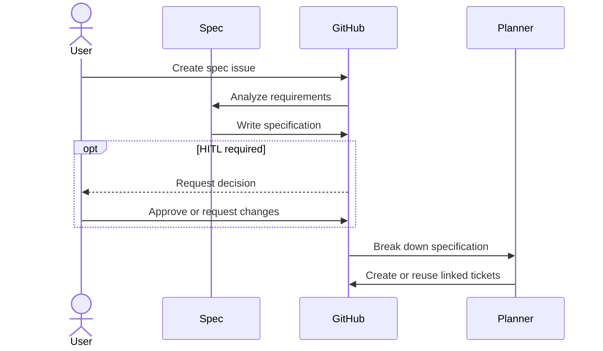

**Gate:** Testable criteria; decisions resolved; HITL only when requested or blocked.

### 3. Feature development

**Trigger:** Ready implementation ticket. **Outcome:** Tested implementation PR.

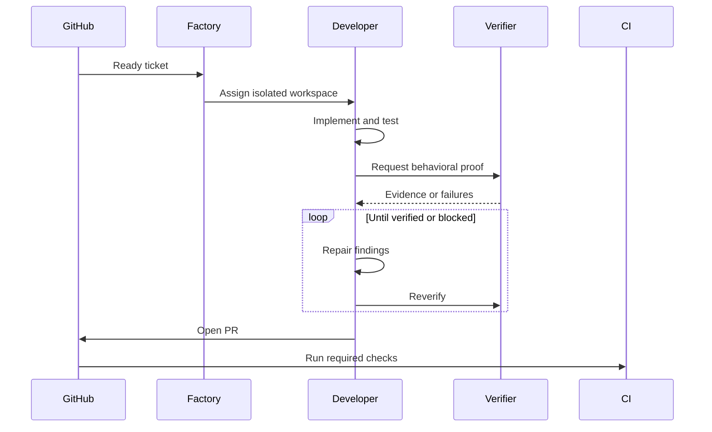

**Gate:** Acceptance criteria; automated tests; independent verification evidence.

## Pull request lifecycle

### 4. Independent PR review

**Trigger:** PR opened or synchronized. **Outcome:** Review findings and recommendation.

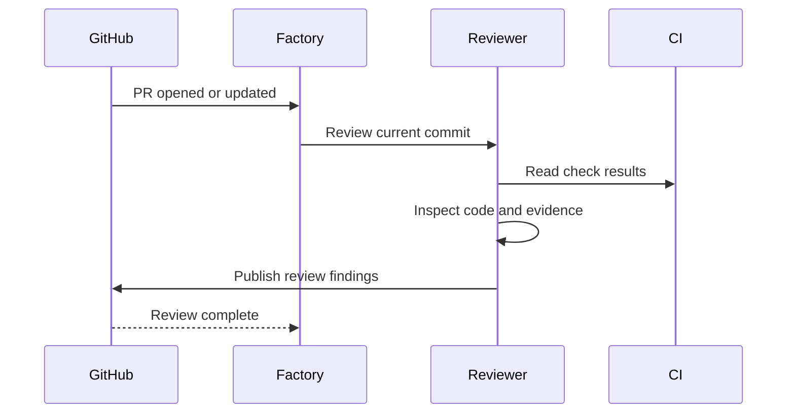

**Gate:** Correctness; requirements; security; tests; independent reviewer.

### 5. PR babysitting

**Trigger:** Review comment, failed check, conflicting branch. **Outcome:** Merge-ready PR or explicit blocker.

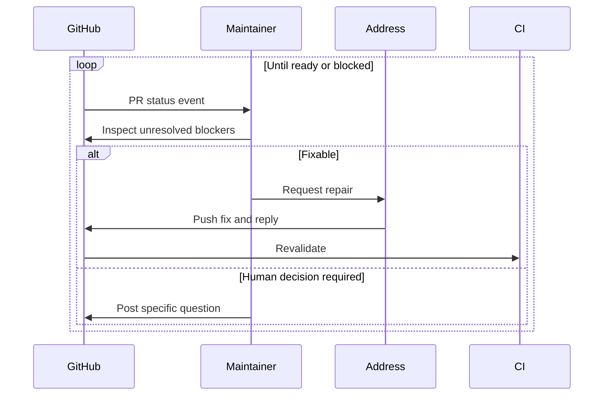

**Gate:** No blocking feedback; passing checks; no unresolved merge conflict.

### 6. PR merge coordination

**Trigger:** All review and validation conditions satisfied. **Outcome:** Merged PR and completion event.

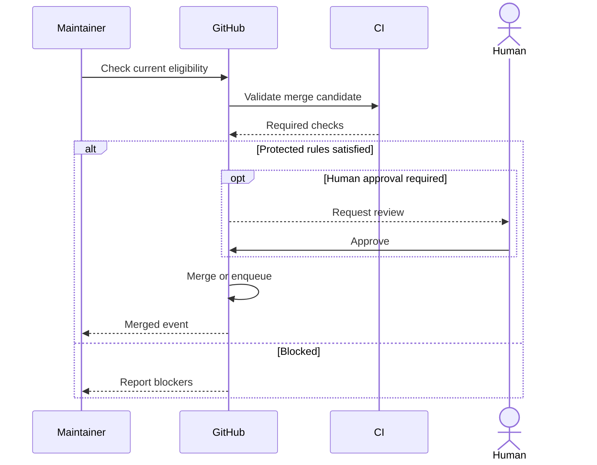

**Gate:** GitHub-enforced protection rules and required approvals.

## Release and production

### 7. Release and deployment

**Trigger:** Merged PR, version tag, schedule. **Outcome:** Verified production release or rollback.

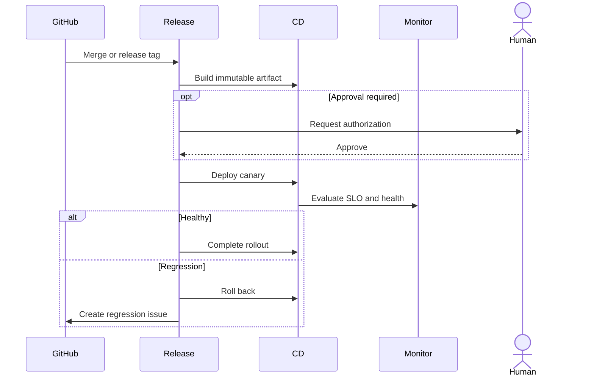

**Gate:** Release readiness; authorization; canary health; rollback available.

### 8. Production incident response

**Trigger:** Monitoring or paging alert. **Outcome:** Mitigated incident and recorded follow-up.

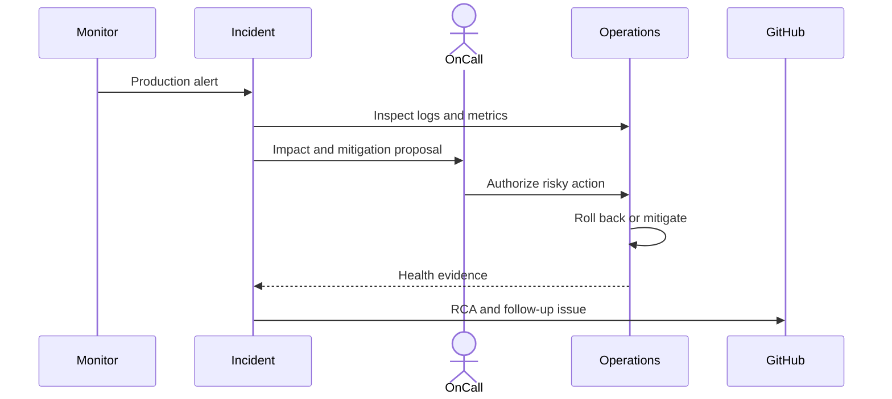

**Gate:** Impact assessed; risky action authorized; service restoration observed.

### 9. Production bug remediation

**Trigger:** Customer report or incident follow-up. **Outcome:** Permanent fix PR.

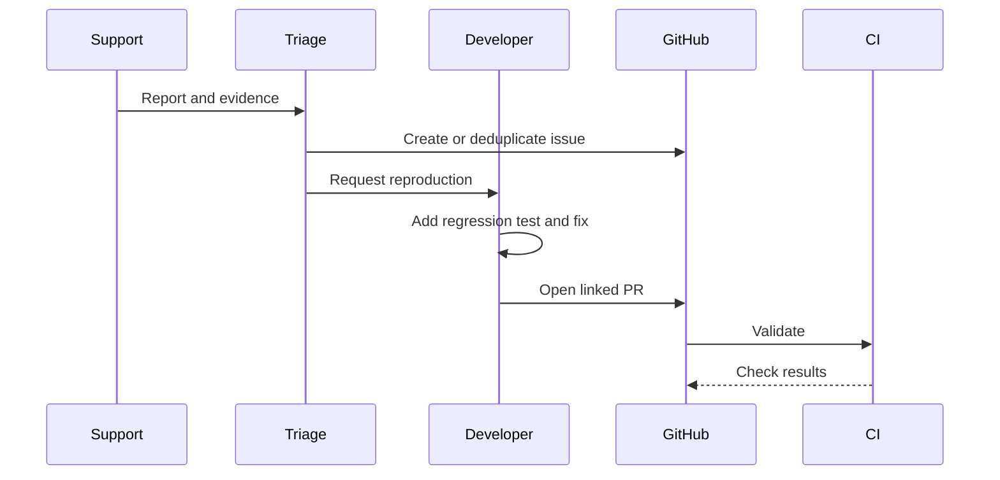

**Gate:** Reproduction or clear causal evidence; regression coverage; passing validation.

## Recovery, security, and maintenance

### 10. CI failure recovery

**Trigger:** Failed pipeline/check. **Outcome:** Repaired build or recorded infrastructure blocker.

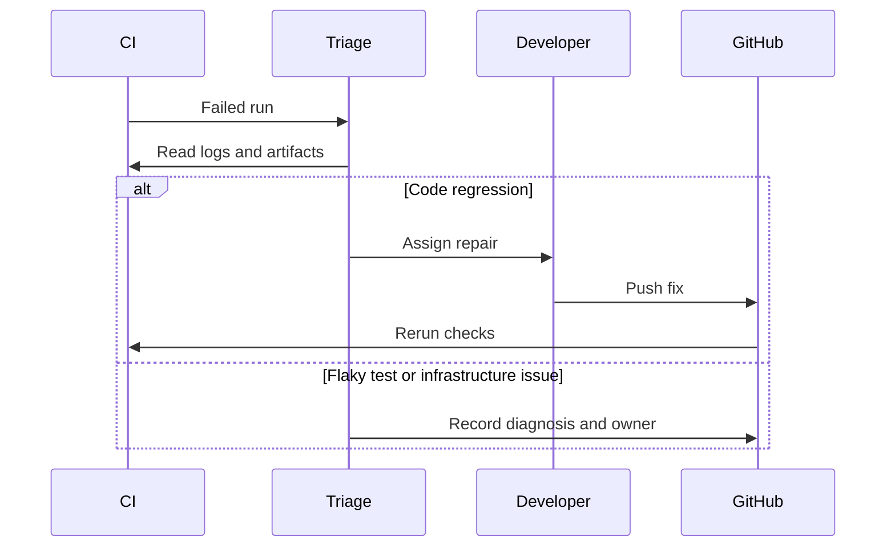

**Gate:** Classified failure; passing checks on relevant commit.

### 11. Security vulnerability remediation

**Trigger:** SAST, dependency or advisory alert. **Outcome:** Validated security fix PR.

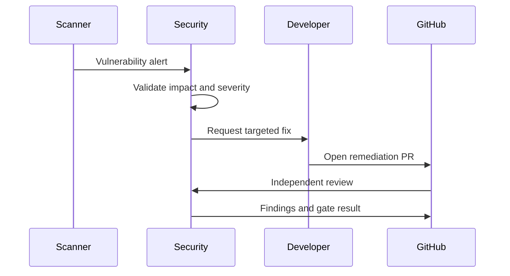

**Gate:** Threat impact confirmed; fix verified; sensitive disclosure protected.

### 12. Dependency maintenance

**Trigger:** Schedule or package advisory. **Outcome:** Compatible dependency update PR.

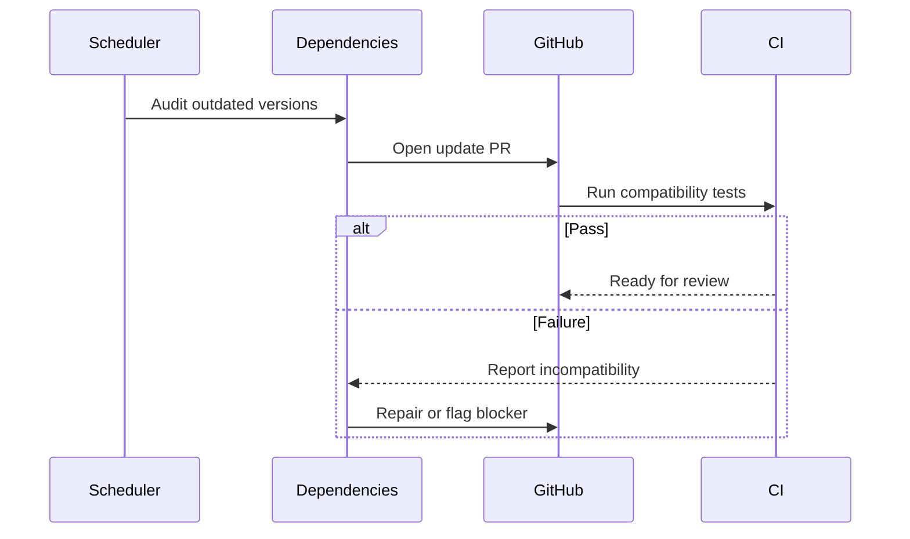

**Gate:** Tests; compatibility; licenses; supply-chain policy.

### 13. Technical debt reduction

**Trigger:** Schedule, quality rule, backlog. **Outcome:** Behavior-preserving refactor PR.

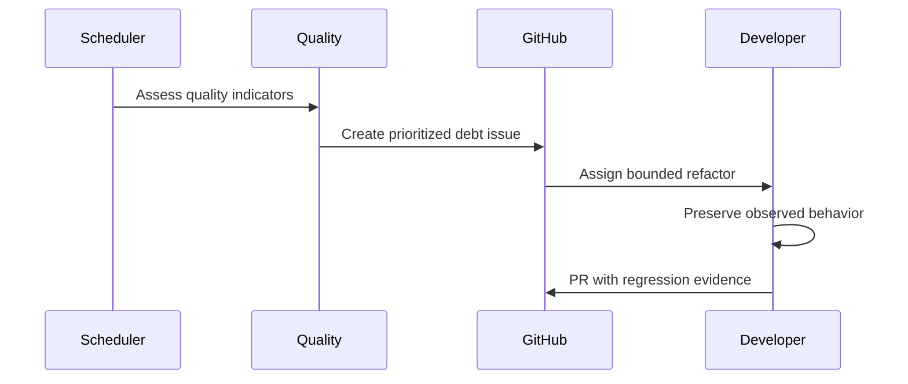

**Gate:** Behavior unchanged; improvement measured; test suite passes.

### 14. Documentation synchronization

**Trigger:** Code, interface, or schema change. **Outcome:** Updated documentation.

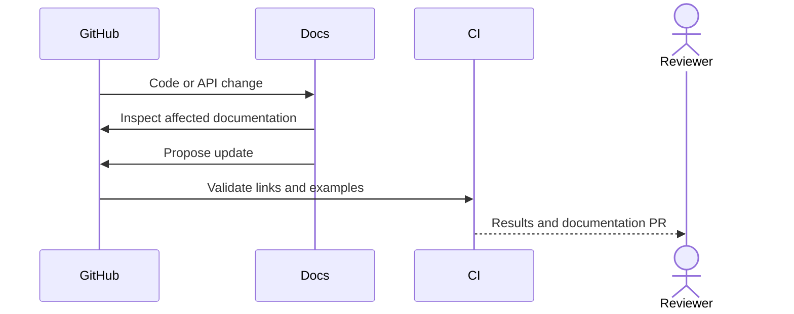

**Gate:** Examples run; links work; documentation agrees with code.

## Learning and improvement

### 15. Post-incident learning

**Trigger:** Resolved incident. **Outcome:** Reviewed postmortem and prevention tickets.

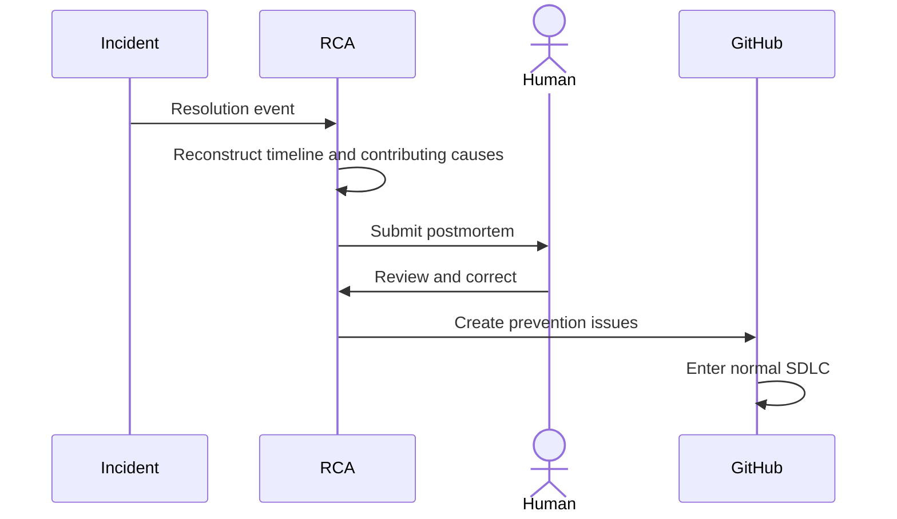

**Gate:** Credible cause analysis; owners and measurable actions.

### 16. Factory self-improvement

**Trigger:** Repeated failures, cost or quality drift. **Outcome:** Reviewed factory definition change.

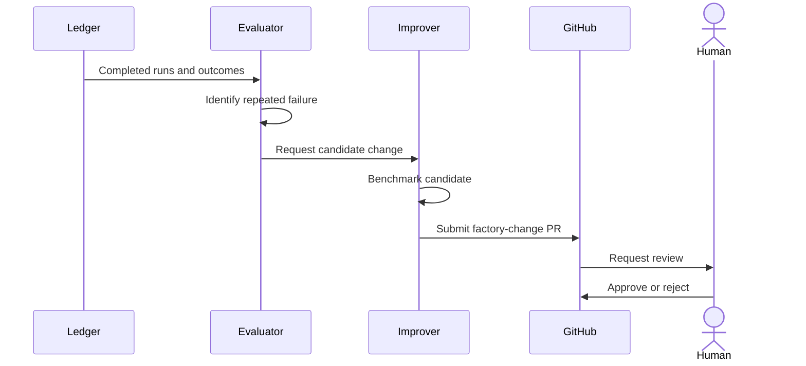

**Gate:** Measured gain; regression checks; governed adoption.

## Cross-workflow architecture

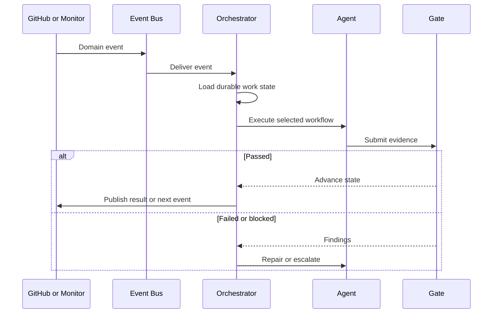

| Component | Responsibility |
| --- | --- |
| Event Bus | Distribute GitHub, CI, alert, and schedule events |
| Orchestrator | Route work, coordinate workflows, recover failed runs |
| Workflow | Define steps, transitions, gates, completion |
| Agent | Execute task-specific reasoning and actions |
| Gate | Enforce test, evidence, security, or approval policy |
| Ledger | Persist work identity, state, attempts, artifacts, evidence, decisions |
| Human Inbox | Collect approvals and blocked-work answers |
| Scheduler | Start maintenance and evaluation workloads |

### Required constraints

- **MUST persist workflow state.** Rationale: survive failures and restarts.
- **MUST handle repeated and out-of-order events safely.** Rationale: webhook delivery and retries can produce duplicates; use idempotency and commit/version checks.
- **MUST enforce mandatory gates outside prompts, even if skipping is faster.** Rationale: agents cannot self-bypass policy.
- **MUST preserve evidence and recovery state, even if cleanup is simpler.** Rationale: diagnose failures, protect incomplete work.
- **MUST authorize production actions by risk and permissions.** Rationale: investigative access does not grant destructive or deployment authority.
- **MUST track work-item correlation across workflows.** Rationale: connect issues, PRs, releases, incidents, and prevention actions.
- **MUST distinguish verified completion from agent-reported completion.** Rationale: deterministic gates need concrete receipts.

## Recommended adoption in antshc/loop

| Priority | Workflows |
| --- | --- |
| P1 — Core | Intake, Specification, Development, PR Review, PR Babysitting, Merge |
| P2 — Delivery | CI Recovery, Release, Production Bug Remediation |
| P3 — Operations | Incident Response, Security, Dependencies |
| P4 — Evolution | Technical Debt, Documentation, Postmortem, Factory Self-Improvement |

Adaptation for the existing Loop design:

- Preserve `dev` and PR babysitting as composable workflows, not hard-coded stages in a single pipeline.
- GitHub issues, PRs, checks, comments, and direct user requests should become normalized events.
- Keep the `hitl` label as a blocking policy; eligible work proceeds automatically. Ask questions in issue/PR comments only when genuinely blocked.
- Automatically break down actionable specifications into tickets; reuse existing subtickets.
- Keep Git worktree management in the Loop Git service; leave scheduling, isolation policy, merge retries, and recovery orchestration to workflows.
- Production mitigation and factory self-modification require explicit policy and evidence review.

**Recommended first architecture increment:** event normalization → persistent work ledger → workflow routing → existing dev and PR babysitting workflows → deterministic gate results.

## Primary sources

1. [Warp — Factories overview](https://docs.warp.dev/factories/)
2. [Warp — How Factories work](https://docs.warp.dev/factories/how-factories-work/)
3. [Warp — Factory automations](https://docs.warp.dev/factories/automations/)
4. [Warp — Measure and improve](https://docs.warp.dev/factories/measure-and-improve/)
5. [Factory — Software Factory overview](https://docs.factory.com/software-factory/overview)
6. [Factory — Triage](https://docs.factory.com/software-factory/triage)
7. [Factory — Release](https://docs.factory.com/software-factory/release)
8. [Factory — Incident response](https://docs.factory.com/software-factory/incident-response)
9. [Factory — AutoWiki](https://docs.factory.com/software-factory/wiki/overview)
10. [GitHub — Deploying code and merge gates](https://docs.github.com/en/pull-requests/concepts/deploying-code)
11. [GitHub — Copilot PR review and feedback](https://docs.github.com/en/copilot/how-tos/use-copilot-agents/use-code-review)
12. [GitHub — Dependabot security updates](https://docs.github.com/en/code-security/concepts/supply-chain-security/dependabot-security-updates)
13. [Google SRE — Incident response](https://sre.google/workbook/incident-response/)
14. [Google SRE — Canarying releases](https://sre.google/workbook/canarying-releases/)
15. [Google SRE — AI for reliable operations](https://sre.google/resources/practices-and-processes/ai-engineering-reliable-operations/)

**Bottom line:** The factory is a collection of durable, event-driven workflows connected by a shared state model, enforceable gates, and feedback from production.