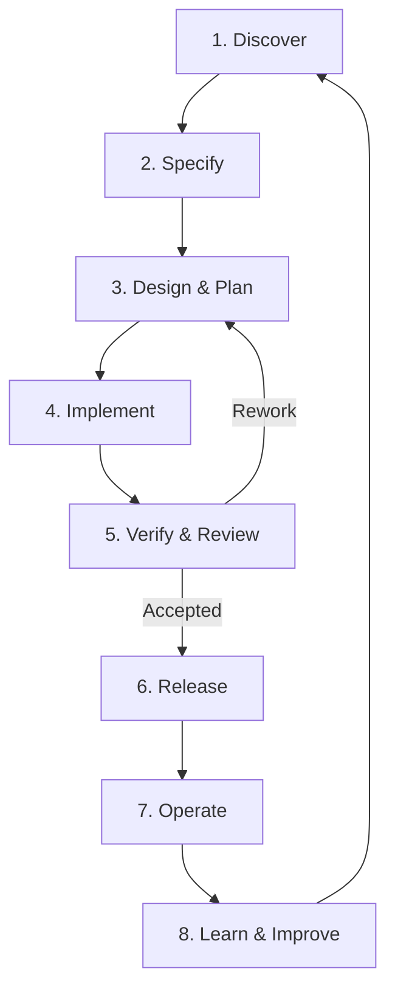

# Agentic Software Factory: Industry-Aligned Lifecycle

**Status:** Research  
**Date:** 2026-10-24  
**Scope:** Industry-standard software engineering lifecycle adapted to AI-agent execution. This document is independent of any specific agent framework, repository, or implementation.

## Definition

An **Agentic Software Factory (ASF)** is a software delivery system in which AI agents autonomously or semi-autonomously perform engineering work across the software lifecycle: understanding requirements, designing solutions, implementing changes, verifying behavior, releasing software, operating services, and learning from results.

Humans retain responsibility for goals, risk acceptance, policy, and consequential approval decisions. Agents execute delegated work within defined constraints, using feedback to detect and correct failures.

**Important distinction:** There is no single universally accepted ISO/IEEE standard defining an "Agentic Software Factory" or prescribing its stages. The eight-phase model below is a **proposed synthesis** of established software engineering lifecycle practices, not a verbatim process mandated by a standard.

## Standards and industry foundations

| Foundation | Contribution |
| --- | --- |
| [ISO/IEC/IEEE 12207:2026](https://www.iso.org/standard/90219.html) | Common framework for software lifecycle processes from conception and development through operation, maintenance, and retirement. The standard supports iterative, concurrent, and recursive application; it does not require a particular lifecycle model. |
| [NIST SSDF (SP 800-218)](https://csrc.nist.gov/projects/ssdf) | Security practices throughout development: prepare the organization, protect the software, produce well-secured software, and respond to vulnerabilities. |
| [DORA research](https://dora.dev/research/) | Continuous delivery capabilities, monitoring and observability, software delivery performance, and ongoing improvement. |
| [DORA delivery metrics](https://dora.dev/guides/dora-metrics/) | Measures throughput and instability using change lead time, deployment frequency, failed deployment recovery time, change fail rate, and deployment rework rate. |
| [Google Cloud: Agentic Coding](https://cloud.google.com/discover/what-is-agentic-coding) | Describes agents that plan, write, test, modify, and repair software with limited human intervention. This describes the agent execution approach, not a normative lifecycle standard. |

## Eight main phases

The following phases describe responsibilities and outcomes—not mandatory sequential gates. Activities can overlap, repeat, or return to earlier phases as feedback arrives.

| Phase | Purpose | Typical activities | Expected outputs |
| --- | --- | --- | --- |
| **1. Discover** | Identify the right problem and desired outcome. | Gather stakeholder needs, investigate opportunities, assess feasibility, prioritize by value and risk. | Product goals, problem statement, prioritized backlog. |
| **2. Specify** | Define the intended behavior and completion criteria. | Elicit requirements, define boundaries, acceptance criteria, constraints and non-functional requirements. | Specification, testable acceptance criteria. |
| **3. Design & Plan** | Decide how the change can be delivered safely. | Explore architecture, alternatives, interfaces, dependencies, risks, and implementation slices. | Technical design, decisions, implementation plan. |
| **4. Implement** | Produce working software. | Write code, tests, configuration, migrations, and supporting documentation; integrate small changes continuously. | Source changes, automated tests, buildable artifacts. |
| **5. Verify & Review** | Establish whether the result meets requirements and quality standards. | Exercise acceptance criteria, integration and end-to-end checks, security tests, performance checks, code review, evidence inspection. | Verification evidence, test results, review decision, accepted or rejected change. |
| **6. Release** | Make an accepted change available safely. | Integrate, package, approve, deploy, validate rollout, and roll back when needed. | Versioned release, deployment record, rollout status. |
| **7. Operate** | Maintain production reliability and security. | Monitor telemetry and SLOs, detect incidents, remediate failures, investigate vulnerabilities, manage maintenance. | Service health, incidents, operational evidence. |
| **8. Learn & Improve** | Feed observed results back into product and delivery decisions. | Analyze incidents and customer feedback, inspect delivery metrics, identify systemic causes, improve agents and workflows. | Corrective actions, refined backlog, improved engineering system. |

### Lifecycle sketch

**Verification is not postponed until phase 5.** Acceptance criteria should be testable from phase 2, and automated checks should run during phase 4. Phase 5 provides explicit evidence and review before promotion.

**Release is not the end of delivery.** Operational telemetry, customer outcomes, security findings, and incidents inform the next cycle.

## Agent and human ownership by phase

The following is a **recommended operating model**, not a role assignment mandated by ISO/IEC/IEEE 12207 or another industry standard.

**Principle:** AI agents perform routine engineering execution; humans remain accountable for product goals, consequential decisions, and risk acceptance. Human involvement is risk-based, not an approval requirement for every automated transition.

| Phase | Lead | AI-agent responsibilities | Human responsibilities | Gate or escalation |
| --- | --- | --- | --- | --- |
| **1. Discover** | **Human-led** | Research the problem, summarize user feedback, assess opportunities and feasibility. | Define business goals, priorities, and acceptable outcomes. | Human confirms the problem and priority. |
| **2. Specify** | **Agent-led** | Draft requirements, acceptance criteria, constraints, and test scenarios. | Confirm expected behavior, scope, and business rules. | Human accepts the desired outcome and success criteria. |
| **3. Design & Plan** | **Agent-led** | Explore technical alternatives, propose architecture, identify risks, and decompose work. | Resolve major architectural tradeoffs, resource constraints, and high-impact decisions. | Escalate significant or irreversible design decisions. |
| **4. Implement** | **Agent-led** | Write code, automated tests, migrations, configurations, and documentation; fix failures. | Intervene for blocked, ambiguous, or sensitive changes. | Automated build, test, and policy checks; human involvement when required. |
| **5. Verify & Review** | **Agent-led** | Independently test behavior, review code, run security and quality checks, and collect evidence. | Review unresolved exceptions, consequential changes, and accepted risks. | Accept, reject, or return changes for rework. |
| **6. Release** | **Agent-led** | Package, deploy, perform health/smoke checks, and trigger policy-approved recovery. | Authorize high-risk releases or exceptions where policy requires. | Release controls and deployment health checks. |
| **7. Operate** | **Agent-led** | Monitor telemetry, triage incidents, diagnose issues, and carry out bounded remediation. | Lead critical incidents and approve high-impact production actions. | SLOs, incident policies, and escalation thresholds. |
| **8. Learn & Improve** | **Shared** | Analyze outcomes, incidents, delivery metrics, and recurring failures; propose improvements. | Choose product and process priorities and approve material changes to policy. | Add validated improvements to the next iteration. |

### Ownership at a glance

- **Human-led:** Discover.
- **Agent-led:** Specify, Design & Plan, Implement, Verify & Review, Release, Operate.
- **Shared:** Learn & Improve.

### Human-in-the-loop principles

1. **Accountability stays with humans.** Agents can execute work autonomously within delegated permissions; they do not independently redefine business objectives or accept unlimited risk.
2. **Verification should be independent where practical.** The implementation agent should not be the sole judge of its own correctness; separate checks, tools, or reviewers provide stronger evidence.
3. **Approvals depend on risk.** Routine, reversible changes may pass through automated gates; uncertain, security-sensitive, customer-impacting, or irreversible actions require escalation according to policy.
4. **Evidence supports decisions.** Human or automated approval should rely on requirements, test results, review findings, and operational outcomes—not solely an agent's self-report.
5. **Feedback loops are explicit.** Failed verification returns work to specification, design, or implementation; production findings feed discovery, maintenance, and improvement.

Human and agent assignments are **operational responsibilities**, not fixed job titles or necessarily separate agent instances. The same agent may work across phases, while high-risk work may involve independent agents and human reviewers.

## Cross-cutting factory capabilities

These are shared capabilities, not separate stages:

| Capability | Responsibility |
| --- | --- |
| **Orchestration** | Coordinate agents, dependencies, scheduling, handoffs, retries, failures, and escalations. |
| **Context & knowledge** | Provide requirements, repository state, architectural decisions, standards, and relevant prior outcomes. |
| **Execution environments** | Offer isolated and reproducible sandboxes, dependencies, credentials scoped to tasks, and build/test resources. |
| **Governance & human oversight** | Enforce authorization, policies, risk limits, budgets, auditability, and approval boundaries. |
| **Quality & security** | Apply automated tests, static analysis, dependency checks, threat analysis, and software supply-chain safeguards throughout the lifecycle. |
| **Evidence & traceability** | Relate requests, requirements, designs, code changes, verifications, deployment outcomes, and incidents. |
| **Observability** | Measure agent runs, tool use, errors, costs, software delivery performance, and production behavior. |

NIST SSDF specifically supports treating security as an integrated set of practices rather than a single late-stage test.

## Three different levels of work

A software factory should distinguish the scope of the **product lifecycle**, **engineering delivery cycle**, and **agent execution loop**.

| Level | Question answered | Typical cycle |
| --- | --- | --- |
| **Product lifecycle** | Are we building and operating the right product? | Discover → Specify → Design → Build → Release → Operate → Improve. |
| **Engineering delivery cycle** | Can this change be safely delivered? | Specify → Design & Plan → Implement → Verify & Review → Release. |
| **Agent execution loop** | Can the delegated task be completed successfully? | Receive task → Act → Observe result → Correct or escalate → Complete. |

An agent loop is an **execution mechanism within the factory**. It should not be confused with the factory's entire lifecycle. A coding agent that opens a pull request has not thereby demonstrated that the feature meets customer requirements or operates successfully in production.

Agent roles need not map one-to-one to lifecycle phases. One agent may work across phases; multiple agents may collaborate within a single phase. The organizing principle is **responsibility and verifiable outcome**, not agent count.

## Quality gates and evidence

Useful decision gates between phases or during continuous delivery include:

1. **Ready to implement:** Problem, scope, constraints, and acceptance criteria are sufficiently clear.
2. **Ready to integrate:** Required checks pass; changes are reviewed; unresolved risks are explicit.
3. **Ready to release:** Release artifact is identifiable; deployment and recovery paths are verified; required approvals are satisfied.
4. **Ready to close:** Delivery evidence matches the acceptance criteria, and operational follow-up is defined where needed.

Examples of durable evidence include automated test results, build outputs, API assertions, deployment identifiers, application telemetry, and incident records. Screenshots can supplement evidence but generally should not be the sole proof of a behavior that can be checked through stable interfaces.

Gates should be **proportional to risk**. Not every change needs the same depth of design, tests, or human approval.

## Measuring factory effectiveness

Use software delivery outcomes rather than counting generated lines, commits, or agent messages.

**DORA software delivery metrics:**

- **Change lead time:** Time from code commit to successful production deployment.
- **Deployment frequency:** How often application changes are deployed.
- **Failed deployment recovery time:** Time required to recover from a deployment that fails.
- **Change fail rate:** Share of deployments requiring immediate intervention.
- **Deployment rework rate:** Share of deployments involving unplanned remediation work.

DORA groups these metrics under **throughput** and **instability**. Definitions and measurement should follow the current DORA guidance.

**Suggested agent-specific operational metrics** (not a universal industry standard):

- Accepted-task completion rate.
- Verification pass rate and escaped defects.
- Human intervention and escalation rate.
- Time and cost per accepted change.
- Agent retry/rework rate.
- Traceability coverage between requirements and evidence.

Measure business and reliability outcomes as well; faster code generation alone is not evidence of better delivery.

## Conclusions

1. Use the **eight phases** as a high-level lifecycle model: **Discover, Specify, Design & Plan, Implement, Verify & Review, Release, Operate, Learn & Improve**.
2. Treat **orchestration, context, execution environments, governance, quality, evidence, and observability** as shared factory capabilities.
3. Keep the **agent execution loop** separate from the full engineering and product lifecycles.
4. Apply phases **iteratively** and use **risk-based approval and verification**, not a rigid waterfall.
5. Evaluate success through **delivered behavior, reliability, security, and DORA outcomes**, not agent activity volume.

## References

- ISO, *ISO/IEC/IEEE 12207:2026 — Systems and software engineering — Software life cycle processes*: https://www.iso.org/standard/90219.html
- NIST, *Secure Software Development Framework (SSDF)*: https://csrc.nist.gov/projects/ssdf
- NIST, *SP 800-218, SSDF Version 1.1*: https://csrc.nist.gov/pubs/sp/800/218/final
- DORA, *Research*: https://dora.dev/research/
- DORA, *Software Delivery Performance Metrics*: https://dora.dev/guides/dora-metrics/
- DORA, *History of DORA's Software Delivery Metrics* (2026): https://dora.dev/insights/dora-metrics-history/
- Google Cloud, *What is Agentic Coding?*: https://cloud.google.com/discover/what-is-agentic-coding
