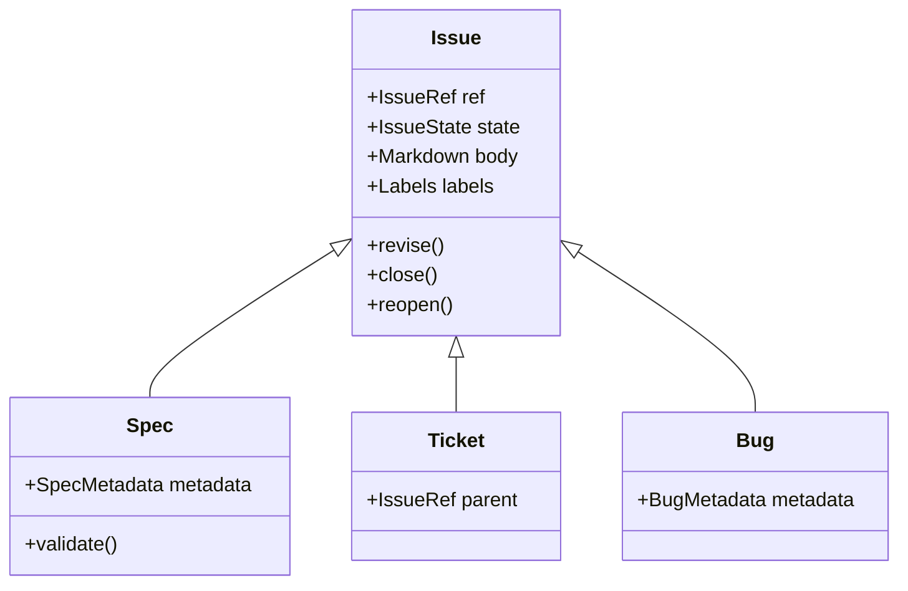

# GitHub Issues: API Research and DDD Domain Redesign

**Status:** Research / proposed design (not implemented)  
**Date:** 2026-10-27  
**Repository:** `antshc/loop`  
**Scope:** Redesign GitHub Issues integration and extract a reusable Issue aggregate, value objects, specialized Spec/Ticket issue types, and domain services.

## Goal

Replace the workflow-specific `Spec`/`Ticket` representations and `TicketsTracker` implementation with a cohesive GitHub Issues domain model. Reuse common issue state and behavior through inheritance (`Spec(Issue)`, `Ticket(Issue)`) while preserving independent GitHub issue identities and aggregate boundaries.

This document proposes **domain contracts and migration**, not implementation. The factory's SDLC policy remains outside reusable GitHub transport and persistence.

## Key GitHub API findings

| Concept | GitHub contract | Design implication |
| --- | --- | --- |
| Identity | `number` is repository-scoped; REST `id` and GraphQL `node_id` are distinct | `IssueRef(repo, number)` for addressing; retain database ID for relationship writes |
| Lifecycle | `open`/`closed`, `state_reason` (`completed`, `not_planned`, `duplicate`, `reopened`, nullable) | Separate state and state reason; preserve source data |
| Classification | Labels and optional native `type` are independent | Loop's `spec` label selects the Spec role; never equate it with native type |
| Discussion | Comments have separate IDs, author, body, created/updated timestamps | Model `IssueComment` independently; paginate and handle revisions |
| Hierarchy | Native parent/sub-issue relationships, across eligible repositories | Store child references, not mutable child aggregates in Spec |
| Dependencies | Native blocked-by and blocking relationships | Use native edges; do not interpret `Blocked by #N` prose as authoritative |
| Metadata | Assignees, milestone, labels, optional organization issue types/fields | Represent external metadata, avoid enforcing organization-only features |
| PR overlap | GitHub Issues REST endpoints can return pull requests | Detect `pull_request`; keep PR aggregate distinct from plain Issue |
| Webhooks | `issues`, `issue_comment`, `sub_issues`, `issue_dependencies` | Translate into facts, deduplicate by delivery ID, then reconcile current state |

GitHub's issue creation API supports `parent_issue_id`, and REST supports adding/removing/reordering child links. Dependency endpoints accept the other issue's REST database `id`. As of this research, GitHub documents a maximum of **100 direct sub-issues** per parent and **eight nested levels**. Native issue types are organization-managed; Loop's user-owned tracker must not depend on defining a custom organizational `Spec` type.

GitHub CLI provides `gh issue create --parent`, plus `gh issue edit --add-sub-issue`, `--add-blocked-by`, `--type`, and related removal operations. These are transport choices; the domain must not model CLI flags.

## Existing Loop code and gaps

| Current location | Current design | Gap / required change |
| --- | --- | --- |
| [`workflows/dev/model/records.py`](../../workflows/dev/model/records.py) | Mutable `Spec` owns `Ticket` objects, commands, and pending changes | Split issue aggregates; separate cross-issue effects from domain objects |
| Same file | `Ticket` repeats issue number/title/state/labels/body/comments | Move shared fields to `Issue`; inherit for Spec/Ticket |
| Same file | `Ticket.actionable` checks only `open` and excludes `hitl`/`spec` | Evaluate native dependencies, parent, completeness, and hold policy |
| [`workflows/dev/tracker/tickets.py`](../../workflows/dev/tracker/tickets.py) | GraphQL issue fields omit stable GitHub issue IDs, issue type, full metadata | Introduce explicit hydration and identity mapping |
| Same file | `comments(first:50)`, `labels(first:20)`, `issues(first:100)`, `subIssues(first:100)` without explicit cursors | Paginate every nested collection; incomplete reads cannot mean empty |
| Same file | `blocked_by` generated as markdown in issue body | Persist GitHub native dependency edges |
| Same file | Child creation: create issue, then link under parent | Reconcile partial success; prefer atomic parent-on-create when applicable |
| [`workflows/shared/github/repo.py`](../../workflows/shared/github/repo.py) | Generic `gh` access, no typed Issues facade | Add issue/domain adapters and repository ports |

The [unified SDLC plan](../plans/unified-event-driven-sdlc-workflow.md) already makes `spec` the single planning label, `hitl` an explicit hold, native sub-issues authoritative, and dependency readiness a deterministic workflow decision. The redesign must preserve those rules.

## Bounded contexts

1. **GitHub Issues integration:** Common issue identity, metadata, lifecycle, comments, and native relations. Provider-specific adapters translate REST/GraphQL/CLI payloads.
2. **Factory work management:** `Spec`/`Ticket` specialization, metadata parsing, classification, readiness, and SDLC decisions. May inherit the shared Issue model because this factory currently uses GitHub as its tracker.
3. **Factory workflow runtime:** Agent dispatch, permissions, external-effect ledger, retries, checkpoints, human approvals, event delivery, and recovery. Never embed these in an Issue aggregate.
4. **Pull request management:** Reuse repository and issue references, plus general issue comments where applicable; keep PR review threads, approvals and checks in the separate PR model. See [PR DDD research](github-pull-request-management-ddd.md).

## Aggregate roots and entities

| Root / entity | Owns | Does not own |
| --- | --- | --- |
| `Issue` (aggregate root) | Identity, title, Markdown body, state/reason, labels, type, assignee and milestone references, observed timestamps | Other issues, comment pagination, workflow state |
| `Spec(Issue)` (specialized root) | `SpecMetadata` and specification-specific validation | Child Ticket lifecycle, child persistence, or scheduling |
| `Ticket(Issue)` (specialized root) | Task semantics and parent reference | Its parent Spec or blocker issue lifecycle |
| `IssueComment` (independent root) | Comment ID, issue reference, author, body, revisions, timestamps | Parent issue lifecycle |
| `LabelDefinition`, `Milestone`, `IssueTypeDefinition` (optional roots) | External catalog object metadata, **only** if the integration manages these | Individual issue state |

`IssueRelation` is an immutable reference edge (parent-of/blocked-by/related-to), not automatically a separate aggregate. `SpecGraphSnapshot` projects the Spec, child references, dependency edges, and read-completeness evidence. **It is not an aggregate** or a transaction boundary.

### Value objects

| Value object | Meaning |
| --- | --- |
| `RepositoryId` | Canonical owner/repository slug |
| `IssueNumber` | Positive number scoped to repository |
| `IssueRef` | `(RepositoryId, IssueNumber)`; stable address for commands |
| `IssueIdentity` | REST database ID and GraphQL node ID, alongside `IssueRef` |
| `IssueState`, `IssueStateReason` | GitHub lifecycle without conflating closure reasons |
| `IssueTypeName`, `LabelName`, `UserLogin` | Typed external identifiers; native type differs from labels |
| `Markdown`, `IssueTitle` | Validated content values |
| `IssueRevision` | Observed `updated_at` and/or content fingerprint; not a guaranteed GitHub compare-and-swap token |
| `MilestoneRef` | External milestone reference |
| `IssueRelation` | Immutable `(kind, source, target)` edge |
| `SpecMetadata` | `InitiativeId`, target `RepositoryId`, `BaseBranch` |
| `AcceptanceCriteria` | Task requirements extracted from issue body, if structured parsing is required |

Do not assign an issue globally by number alone. Relation endpoints use integer database IDs, while most issue operations use `(owner, repo, number)`. Keep both instead of parsing numeric IDs from URLs whenever a proper API response exists.

## Inheritance and construction



`Bug` is future extensibility, not required for the initial migration.

```python
@dataclass(frozen=True)
class IssueRef:
    repository: RepositoryId
    number: int


@dataclass(frozen=True, kw_only=True)
class Issue:
    ref: IssueRef
    github_id: int
    node_id: str
    title: str
    body: str
    state: IssueState
    state_reason: IssueStateReason | None
    labels: frozenset[str]
    issue_type: str | None
    updated_at: datetime


@dataclass(frozen=True, kw_only=True)
class Spec(Issue):
    metadata: SpecMetadata | None


@dataclass(frozen=True, kw_only=True)
class Ticket(Issue):
    parent: IssueRef
```

The GitHub adapter hydrates the generic `Issue`. A **factory-owned** `IssueClassifier` maps it to `Spec` when the normalized `spec` label is present, to `Ticket` when it is an eligible child of a Spec, or leaves it a generic Issue. Native GitHub `type` can additionally inform classification but must not replace the workflow's `spec` label contract. Detect conflicting classification and report it instead of silently guessing. A missing Spec target/base is a validation result, not a hydration exception.

### Aggregate boundary example

One Spec `#100` has child Tickets `#101`, `#102`. Ticket `#102` is blocked by `#101`.

- `Spec(#100)` contains Spec metadata and references, **not mutable Ticket objects**.
- `Ticket(#101)` and `Ticket(#102)` each retain independent GitHub lifecycle and revisions.
- Parent/sub-issue links and blocked-by edges are loaded into `SpecGraphSnapshot`.
- Completing `#101` does not implicitly mutate `#102`; readiness is **re-evaluated** against a fresh graph.
- Creating issues/links is not a single GitHub transaction. After partial failure, reconcile existing issues and relationships before retrying.

## Domain services and policies (pure)

| Domain service | Responsibility |
| --- | --- |
| `IssueClassifier` | Determine Spec, Ticket, or generic Issue role from current metadata and context |
| `IssueLifecyclePolicy` | Validate allowed state transitions and close reasons |
| `SpecValidationPolicy` | Validate initiative, scope, target repository and branch |
| `IssueGraphPolicy` | Validate proposed hierarchy/dependency edges, reject invalid/cyclic proposed graphs |
| `TicketReadinessPolicy` | Check open state, `hitl`, recognized parent, blocker completion, and observation completeness |
| `SpecConsistencyPolicy` | Detect Spec revisions that may invalidate existing child descriptions |

Readiness returns structured `READY`, `BLOCKED`, or `UNKNOWN`, with reasons. Incomplete dependency reads MUST yield `UNKNOWN`, never READY. A blocker closed as `not_planned` or `duplicate` must be evaluated by explicit workflow policy; closure alone does not automatically prove the implementation dependency satisfied.

**Application services** coordinate ports and effects, and are not pure domain services:

- `IssueManagementService`: get/list/create/edit/close/reopen, check expected revision.
- `IssueDiscussionService`: list, post and edit comments.
- `IssueRelationshipService`: load/link/unlink parent-child and dependencies.
- `SpecTicketingService`: reconcile existing children, publish missing tickets, link blockers, recover partial operations.

Suggested ports: `IssueRepository`, `IssueCommentRepository`, `IssueRelationshipRepository`. Keep `gh` CLI and REST/GraphQL response parsing behind adapters; no SDK/CLI dependency in domain types.

## Proposed location

```text
workflows/
├── shared/github/
│   ├── domain/
│   │   ├── issue.py
│   │   ├── comment.py
│   │   ├── identity.py
│   │   └── relations.py
│   ├── application/
│   │   ├── issues.py
│   │   └── relationships.py
│   └── infrastructure/
│       └── gh_cli.py
└── factory/domain/
    ├── spec.py
    ├── ticket.py
    ├── classification.py
    └── readiness.py
```

This keeps factory policy outside the installable `loop` agent-execution library, matching [the existing architecture decision](../adr/ship-loop-as-a-workflow-library-with-no-built-in-workflows.md). Later extraction of a standalone GitHub package should be a separate decision.

## Constraints (mandatory)

1. **MUST** model each GitHub issue as an independently persisted aggregate root, even if embedding tickets in Spec is simpler. **Rationale:** GitHub lacks atomic multi-issue commits.
2. **MUST** use native parent/sub-issue and dependency relationships, even if Markdown parsing is faster to implement. **Rationale:** GitHub already provides the authoritative graph.
3. **MUST** retain repository-scoped issue refs and REST IDs. **Rationale:** Different API calls require different identities.
4. **MUST** paginate and report read completeness, even if most repositories have fewer than 100 issues. **Rationale:** Silent truncation can schedule blocked work.
5. **MUST** reconcile before retrying multi-step external effects. **Rationale:** A created issue may exist even if linking or confirmation failed.
6. **MUST NOT** embed workflow scheduling, retry counts, agent permissions, HITL release, or execution-ledger state in `Issue`. **Rationale:** These are factory policies and persisted workflow facts.
7. **MUST NOT** treat GitHub's native Issue Type as equivalent to Loop's `spec` role. **Rationale:** Types are organization-managed and optional.
8. **MUST NOT** hydrate pull requests as implementation Tickets because the Issues REST endpoint returns them. **Rationale:** PRs have a separate lifecycle and aggregate boundary.
9. **MUST** re-read external state before impactful edits and preserve unrelated human changes. **Rationale:** `updated_at` is evidence of freshness, not a transactional lock.

## Migration and verification

1. Introduce `IssueRef`, IDs, state/reason and label value objects; add contract tests for REST/GraphQL identity mapping.
2. Extract shared `Issue` and independent `IssueComment`; move common fields out of `Spec` and `Ticket`.
3. Add `Spec(Issue)` / `Ticket(Issue)` and a tested `IssueClassifier`.
4. Add repositories/adapters with complete pagination, PR filtering, and metadata hydration.
5. Adopt native parent/dependency APIs; read existing sub-issues before any ticket generation.
6. Replace `Spec.pending_changes` cross-issue mutation queue with explicit application commands and workflow-owned effect tracking.
7. Add graph/readiness policies; preserve the current `spec`, `hitl`, `/spec` and workflow-routing rules.
8. Adapt `workflows/dev` and unified factory workflows without moving SDLC control into the GitHub domain.

**Minimum tests:** identity scope; PR exclusion; label/type disagreement; incomplete pages; deleted comment authors and edited comments; parent adoption; dependency cycles; reopened/closed blockers; duplicate/`not_planned` closure reasons; partial child creation/linking; idempotent retry; `hitl` release; external edits during update.

## Primary sources and repository implementations

### GitHub documentation

- [REST Issues](https://docs.github.com/en/rest/issues/issues)
- [REST Issue Comments](https://docs.github.com/en/rest/issues/comments)
- [REST Sub-issues](https://docs.github.com/en/rest/issues/sub-issues)
- [REST Issue Dependencies](https://docs.github.com/en/rest/issues/issue-dependencies)
- [REST Organization Issue Types](https://docs.github.com/en/rest/orgs/issue-types)
- [Managing Issue Types](https://docs.github.com/en/issues/tracking-your-work-with-issues/using-issues/managing-issue-types-in-an-organization)
- [Adding Sub-issues](https://docs.github.com/en/issues/tracking-your-work-with-issues/using-issues/adding-sub-issues)
- [Webhook Events and Payloads](https://docs.github.com/en/webhooks/webhook-events-and-payloads)
- [GitHub CLI: issue edit](https://cli.github.com/manual/gh_issue_edit)

### GitHub repositories

- [GitHub Docs](https://github.com/github/docs) — public source for API and issue workflow documentation.
- [GitHub CLI](https://github.com/cli/cli) — operational implementation of issue editing, sub-issues, dependencies and types.
- [PyGithub Issue](https://github.com/PyGithub/PyGithub/blob/main/github/Issue.py) and [IssueComment](https://github.com/PyGithub/PyGithub/blob/main/github/IssueComment.py) — separate resource models; useful transport precedent, not a prescribed DDD aggregate structure.
- [Loop current Issue/Spec/Ticket model](../../workflows/dev/model/records.py) and [TicketsTracker](../../workflows/dev/tracker/tickets.py) — migration baseline.

**Conclusion:** Inheritance removes duplicate issue structure. Independent aggregates preserve GitHub's actual consistency boundaries. Native relationship APIs plus a separate graph/readiness service make Spec-to-Ticket factory orchestration reliable and extensible.
