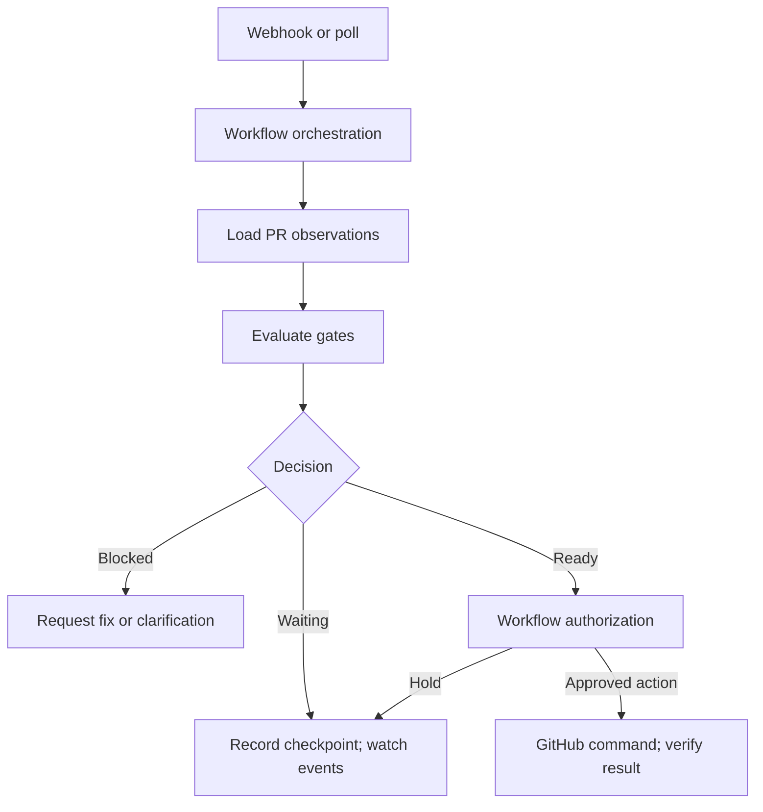

# GitHub Pull Request Management: API Research and DDD Domain Model

**Status:** Research / proposed design (not implemented)  
**Date:** 2026-10-27  
**Target:** `antshc/loop` Python library, reusable by agent workflows  
**Scope:** Read and modify pull requests, comments, reviews, and merge-readiness observations through GitHub APIs.

## Goal and boundaries

Provide a typed, provider-independent Python domain API through which agents can:

- Read PR metadata, title, description, branches, commits, comments, reviews, and review threads.
- Post general PR comments and reply to inline code-review comments.
- Update title/description; close or reopen a PR without merging.
- Read CI check runs and legacy commit statuses.
- Identify required merge gates, outstanding reviews, unresolved conversations, and blockers.
- Return a structured, evidence-backed readiness assessment to the workflow.

**Boundary:** This module manages GitHub PR resources and evaluates observed state. It does not decide *when* an agent should run, own workflow retries/locks/checkpoints, or bypass GitHub protection. These responsibilities belong to the workflow runtime. Merging may be added later as a separately authorized command.

## Key research findings

1. **A PR is also an issue.** General Conversation-tab comments and common issue operations use `/issues/...` endpoints; PR review comments and submitted reviews use `/pulls/...` endpoints. The SDK must not conflate them. [GitHub Pull Requests REST API](https://docs.github.com/en/rest/pulls/pulls) and [Issue Comments REST API](https://docs.github.com/en/rest/issues/comments).
2. **Review comments, review threads, and submitted reviews are distinct.** An inline comment targets a diff location; a review has an approval/change-request state; a thread has a resolution state. GitHub's GraphQL schema exposes `reviewThreads` and `isResolved`. [Review Comments REST API](https://docs.github.com/en/rest/pulls/comments), [Reviews REST API](https://docs.github.com/en/rest/pulls/reviews), [GraphQL Pull Requests](https://docs.github.com/en/graphql/reference/pulls).
3. **Check result != required gate.** A check can fail without blocking merging when optional. Required gates depend on active rulesets and/or classic branch protection, as well as approvals, conversation resolution, deployments, draft status, branch freshness, and queue configuration. [Ruleset rules](https://docs.github.com/en/repositories/configuring-branches-and-merges-in-your-repository/managing-rulesets/available-rules-for-rulesets), [Protected branches](https://docs.github.com/en/repositories/configuring-branches-and-merges-in-your-repository/managing-protected-branches/about-protected-branches).
4. **Checks are evaluated for a commit, not an abstract PR.** Always associate a `CheckReport` with the observed `head_sha`; invalidate the report when that SHA changes. GitHub has both check runs and legacy commit statuses. [Check runs](https://docs.github.com/en/rest/checks/runs), [Commit statuses](https://docs.github.com/en/rest/commits/statuses), [GraphQL StatusCheckRollup](https://docs.github.com/en/graphql/reference/commits).
5. **Closing is not merging.** REST `PATCH /pulls/{number}` with `state: closed` abandons the PR. A merged PR is terminal for reopening. Merging is a separate, more privileged operation. [Pull requests REST API](https://docs.github.com/en/rest/pulls/pulls).
6. **GitHub remains authoritative.** A local decision is advisory; merge status may be blocked by requirements not fully exposed to the integration, and the state can change between reading and writing. [GraphQL PullRequest.mergeStateStatus](https://docs.github.com/en/graphql/reference/pulls).

## GitHub API operations

`{owner}/{repo}` and `{number}` denote the target repository and PR number. For checks, use the **head commit SHA**, not a mutable branch name.

| Capability | API | Notes |
| --- | --- | --- |
| Get/list PRs | `GET /repos/{owner}/{repo}/pulls/{number}`; `GET /repos/{owner}/{repo}/pulls` | PR state, title, body, head/base |
| Update title or description | `PATCH /repos/{owner}/{repo}/pulls/{number}` | Only send intended fields; preserve user content |
| Close/reopen | Same `PATCH`, `state: closed/open` | Not equivalent to merge |
| General comments read/write | `GET/POST /repos/{owner}/{repo}/issues/{number}/comments` | Timeline/Conversation tab |
| Inline review comments | `GET/POST /repos/{owner}/{repo}/pulls/{number}/comments` | Requires diff location for a new inline comment |
| Reply to inline comment | `POST /repos/{owner}/{repo}/pulls/{number}/comments/{comment_id}/replies` | REST reply uses top-level comment ID, not thread node ID |
| Submitted reviews | `GET /repos/{owner}/{repo}/pulls/{number}/reviews` | Review states, bodies, authors |
| Create/submit review | `POST /repos/{owner}/{repo}/pulls/{number}/reviews` | Optional later command; `APPROVE`, `REQUEST_CHANGES`, `COMMENT` |
| Review threads/resolution | GraphQL `reviewThreads`, `resolveReviewThread`, `unresolveReviewThread` | Cursor pagination; inspect `isResolved`, `isOutdated` |
| Check runs | `GET /repos/{owner}/{repo}/commits/{sha}/check-runs` | Status and conclusion for checks |
| Legacy statuses | `GET /repos/{owner}/{repo}/commits/{sha}/status` | Combined state *and* context list |
| Check rollup / review decision / merge status | GraphQL `statusCheckRollup`, `reviewDecision`, `mergeStateStatus` | Efficient read projection, not authoritative policy configuration |
| Active ruleset rules for base branch | `GET /repos/{owner}/{repo}/rules/branches/{branch}` | Applies active repository/organization rulesets; excludes disabled/evaluate mode |
| Classic branch protection | `GET /repos/{owner}/{repo}/branches/{branch}/protection` | Requires Administration read; may be unavailable to an installation |
| Optional future merge | `PUT /repos/{owner}/{repo}/pulls/{number}/merge` or newer merge APIs | Separate capability; validate SHA, restrictions, and queue support |

**Read completeness:** Paginate lists of comments, reviews, threads, checks, and rules. An incomplete page is not an empty list.

## Bounded contexts and aggregate boundaries

The model below is **proposed DDD**, not a direct copy of GitHub's wire schema. GitHub owns persistence; each local aggregate represents an observed resource plus valid command intentions.

| Aggregate root | Entities / properties | Supported behavior | Why separate |
| --- | --- | --- | --- |
| `PullRequest` | Identity, author, title, description, lifecycle state, draft flag, head/base, head SHA, updated time | Change title/body; close; reopen | PR metadata and lifecycle change independently of discussions and CI |
| `PullRequestComment` | Identity, PR identity, author, Markdown body, timestamps | Publish; edit if permitted; associate agent action | Timeline comments are independently created/edited and have their own identity |
| `ReviewThread` | Thread ID, diff location, ordered `ReviewComment` entities, resolved/outdated flags | Reply; resolve/unresolve if permitted | Thread resolution is a separate lifecycle and may affect gates |
| `PullRequestReview` | Review ID, reviewer, state, submitted time, head commit SHA, body, associated comment references | Inspect; optionally submit a pending review | Review decisions differ from both comments and individual threads |

**Supporting read models (not aggregates owned by this library):**

- `CheckReport`: observation for one `CommitSha`; contains `CheckRun` and `CommitStatus` entities, rollup, fetch time, completeness.
- `MergePolicySnapshot`: effective policy observations for one base branch; contains `GateRequirement` values and information about which rule sources were successfully read.
- `ReviewSummary`: GitHub's review decision plus requested reviewers and review observations.
- `MergeReadiness`: immutable evaluation result, source SHA, blockers, warnings, evidence, and observation timestamp.

Do **not** put every comment, review, and check inside the `PullRequest` aggregate. A PR can contain thousands of these resources and GitHub does not provide a transaction across them. Link aggregate roots by identifiers and compose read models when an operation needs the full picture.

## Domain entities

### `PullRequest`

| Field | Type | Notes |
| --- | --- | --- |
| `id` | `PullRequestId` | Repository + PR number; numeric and GraphQL node IDs are distinct |
| `title`, `description` | `str`, `Markdown` | Description is raw Markdown |
| `author` | `Actor` | User/bot identity |
| `state` | `PullRequestState` | `OPEN`, `CLOSED`, `MERGED` |
| `is_draft` | `bool` | Orthogonal to `state` |
| `head`, `base` | `BranchRef` | Head may belong to a fork |
| `head_sha` | `CommitSha` | Version of code under review |
| `mergeability` | `Mergeability` | GitHub mergeable/merge-state observations, including unknown |
| `review_decision` | `ReviewDecision?` | Provider-computed review status; not just the last review |
| `updated_at` | `datetime` | Useful observation stamp; not a guaranteed CAS token |

Lifecycle invariants:

- MUST distinguish closed-unmerged from merged. **Rationale:** merging changes target-branch contents; closing does not.
- MUST NOT reopen a merged PR. **Rationale:** it is terminal in the PR lifecycle.
- MUST NOT treat local mutation as persisted until GitHub confirms and the changed resource is re-read. **Rationale:** GitHub owns authoritative state.
- MUST handle unknown or delayed mergeability without coercing it to `READY`. **Rationale:** GitHub may still be computing status.

### `PullRequestComment`

`id`, `pull_request_id`, `author`, `body`, `created_at`, `updated_at`. It is a general timeline comment, not an inline code review. Supports publication and owner-authorized editing.

### `ReviewThread` / `ReviewComment`

`ReviewThread` stores `id`, `pull_request_id`, `DiffLocation`, `comments`, `is_resolved`, `is_outdated`. Each `ReviewComment` has its own ID, author, body, review association, and reply parent as applicable. `is_outdated` MUST NOT imply `is_resolved`.

### `PullRequestReview`

`id`, `pull_request_id`, `reviewer`, `state`, `body`, `commit_sha`, `submitted_at`; submitted review states include `COMMENTED`, `APPROVED`, `CHANGES_REQUESTED`, `DISMISSED`, while `PENDING` is not yet submitted. The PR-level `reviewDecision` is evaluated separately by GitHub.

## Value objects

| Value object | Value / invariant |
| --- | --- |
| `RepositoryId` | `owner`, `name`; retain owner-qualified identity |
| `PullRequestId` | `RepositoryId`, positive PR number |
| `CommentId`, `ReviewId`, `ReviewThreadId` | Preserve REST numeric IDs and GraphQL node IDs as separate types |
| `Actor` | Stable GitHub actor ID, login and kind (`USER`/`BOT`) |
| `BranchRef` | Repository identity + branch name; fork-safe |
| `CommitSha` | Valid Git object ID, treated as immutable |
| `Markdown` | Raw Markdown text, no silent HTML conversion |
| `DiffLocation` | File path, commit SHA, line/range, `LEFT`/`RIGHT` side |
| `CheckIdentity` | Name/context and source App ID when known; distinguish providers |
| `CheckResult` | `status`, `conclusion`, URL, times, provider identity |
| `GateRequirement` | Required check/review/deployment/conversation/freshness/queue policy and source |
| `GateResult` | `PASSED`, `PENDING`, `FAILED`, `UNKNOWN`, reason and evidence |
| `MergeReadiness` | `READY`, `WAITING`, `BLOCKED`, `UNKNOWN`, blockers, observed SHA |
| `PullRequestRevision` | Head SHA + observed update timestamp; best-effort concurrency signal |

GitHub check runs and commit statuses have different state vocabularies; the adapter maps them into the domain while preserving their raw values. Required check runs can satisfy GitHub protection when their conclusions are `success`, `neutral`, or `skipped`; incomplete, missing or failing required checks do not pass. [GitHub protected branches](https://docs.github.com/en/repositories/configuring-branches-and-merges-in-your-repository/managing-protected-branches/about-protected-branches).

## Domain services

### `MergeGateEvaluator` — pure deterministic domain service

```python
class MergeGateEvaluator:
    def evaluate(
        self,
        pr: PullRequest,
        checks: CheckReport,
        policy: MergePolicySnapshot,
        reviews: ReviewSummary,
        threads: ReviewThreadSummary,
    ) -> MergeReadiness: ...
```

Inputs are already-loaded snapshots. The evaluator MUST NOT perform HTTP operations or start an agent.

Output contains overall decision, evaluated head SHA, individual blockers, warnings and observation completeness. Suggested reason codes:

- `REQUIRED_CHECK_PENDING`, `REQUIRED_CHECK_FAILED`, `REQUIRED_CHECK_MISSING`
- `REVIEW_REQUIRED`, `CHANGES_REQUESTED`, `UNRESOLVED_THREAD`
- `MERGE_CONFLICT`, `BRANCH_OUTDATED`, `DRAFT_PULL_REQUEST`
- `DEPLOYMENT_REQUIRED`, `MERGE_QUEUE_REQUIRED`, `POLICY_UNAVAILABLE`

Rules:

- An **optional** failing check can be a warning, not automatically a merge blocker.
- A required check identity includes its expected source App when configured.
- If `checks.sha != pr.head_sha`, the check report is **stale**, not passing.
- If policy retrieval, thread pagination, or check retrieval is incomplete, the decision cannot be `READY`.
- Check the provider's `mergeStateStatus` / `mergeable` as independent signals. Local readiness does not guarantee that GitHub will permit a merge.

### `PullRequestLifecyclePolicy` — pure domain service

Validates `close`, `reopen` and optionally future `request_merge` lifecycle intentions. It does not perform writes. Closing an already-closed PR can be represented as a no-op, while reopening a merged PR is invalid.

### `CommentDeduplicationPolicy` — pure domain service

Builds deterministic action fingerprints from PR ID, logical event, action type and content identity. Persistence and delivery de-duplication belong to the **workflow action ledger**, not a GitHub aggregate.

### Workflow-owned `AgentActionPolicy`

The workflow must decide whether an agent may edit a human-authored description, post a comment, close a PR, resolve a thread, or merge. Keep this business authorization **outside the reusable GitHub library**, as required by the existing [unified event-driven workflow plan](unified-event-driven-sdlc-workflow.md). The library can report GitHub capabilities/permission failures, but must not invent workflow authority.

## Ports and application service

The domain has no SDK imports. Infrastructure implements Python `Protocol` ports, for example:

```python
class PullRequestRepository(Protocol):
    async def get(self, id: PullRequestId) -> PullRequest: ...
    async def update_description(self, id: PullRequestId, body: Markdown) -> PullRequest: ...
    async def close(self, id: PullRequestId) -> PullRequest: ...
    async def reopen(self, id: PullRequestId) -> PullRequest: ...

class DiscussionRepository(Protocol):
    async def list_comments(self, id: PullRequestId) -> list[PullRequestComment]: ...
    async def create_comment(self, id: PullRequestId, body: Markdown) -> PullRequestComment: ...
    async def list_threads(self, id: PullRequestId) -> list[ReviewThread]: ...
    async def reply_to_thread(self, id: ReviewThreadId, body: Markdown) -> ReviewComment: ...

class ReviewRepository(Protocol):
    async def list_reviews(self, id: PullRequestId) -> list[PullRequestReview]: ...

class CheckReportRepository(Protocol):
    async def get(self, repo: RepositoryId, sha: CommitSha) -> CheckReport: ...

class MergePolicyRepository(Protocol):
    async def get(self, repo: RepositoryId, base: BranchRef) -> MergePolicySnapshot: ...
```

`PullRequestManagementService` is an **application service**, not a domain service. It coordinates the ports and domain evaluator:

1. `inspect(pr_id)` — fetch PR and related observations; report completeness and relevant references.
2. `evaluate_gates(pr_id)` — fetch policy, check results, reviews and threads for the same observed head SHA; return readiness.
3. `comment(pr_id, body)` — post general PR comment and return persisted comment.
4. `reply(thread_id, body)` — locate the correct discussion and post an inline reply.
5. `update_description(pr_id, body)` — verify current state, update only intended content, read back.
6. `close(pr_id)` and `reopen(pr_id)` — validate lifecycle and explicit calling-workflow authority, issue remote action, read back.

**Implementation note:** A REST review-thread reply is keyed by the top-level review-comment ID, whereas the GraphQL thread mutation accepts a thread node ID. The adapter must translate identities or choose the matching API; do not pass one into the other.

## Recommended package separation

```text
src/loop/
  git/                         # Existing local git branches/worktrees/commits
  github/                      # Proposed GitHub-hosted collaboration resources
    pull_requests/
      domain/                  # Aggregates, entities, VOs, pure domain services
      ports/                   # Repository/provider Protocols
      application/             # Use-case orchestration
      infrastructure/          # REST/GraphQL/SDK mapping
    facade.py                  # github.pull_requests entry point

workflows/pr_babysit/          # Existing workflow: polling, state, locks, agents
```

This is a proposed directory layout, not a claim that the files exist. Keep GitHub PR operations separate from the existing `git.branches`, `git.worktrees`, and `git.commits` facade.

## Agent execution flow



Webhook families include `pull_request`, `issue_comment`, `pull_request_review`, `pull_request_review_comment`, `pull_request_review_thread`, `check_run`, and `status`. Use the GitHub delivery ID for event deduplication and ignore or explicitly handle events caused by the bot itself. [Webhook events and payloads](https://docs.github.com/en/webhooks/webhook-events-and-payloads).

## Constraints and failure modes

| Constraint | Rationale |
| --- | --- |
| MUST preserve the distinction among PR timeline comments, review comments, reviews and review threads, even if a unified list would be simpler. | Different APIs, permissions, identities, and semantics |
| MUST associate checks with the observed head SHA; refresh on push, even if reuse would be faster. | Old green checks may no longer describe the code |
| MUST load applicable rulesets **and** classic protection when permitted. | These are separate policy mechanisms |
| MUST represent permission denial/incomplete pagination/unknown mergeability explicitly. | Unknown data is not an accepted gate |
| MUST keep agent authorization, scheduling and retry journal in workflow. | Reusable GitHub domain must not own business orchestration |
| MUST NOT assume a locally re-read `updated_at` makes a description update atomic. | REST PATCH does not provide a general PR-description compare-and-swap guarantee |
| MUST avoid overwriting human description edits. | Re-read and modify a designated agent-managed section when possible; detect concurrent changes |
| MUST deduplicate agent comments and verify ambiguous write outcomes before retries. | A timeout after POST may have created the comment |
| MUST NOT infer that outdated review threads are resolved. | `isOutdated` and `isResolved` are different facts |
| MUST NOT automatically merge, resolve conversations or close human PRs without workflow authority, even if faster/simpler. | These have material external effects |
| MUST honor pagination, rate limits, and backoff. | GitHub imposes both primary and secondary limits |

Use sequential or controlled write operations, inspect `Retry-After`/rate-limit headers and back off on `403`/`429`. [GitHub REST API best practices](https://docs.github.com/en/rest/using-the-rest-api/best-practices-for-using-the-rest-api) and [Rate limits](https://docs.github.com/en/rest/using-the-rest-api/rate-limits-for-the-rest-api).

## Authentication and SDK options

Use a GitHub App installation token for agent automation. Request minimal repository permissions for deployed features:

| Permission | Level | Purpose |
| --- | --- | --- |
| Pull requests | Read/Write | Read PR/reviews and edit PR or review feedback |
| Issues or Pull requests | Write | Create general PR issue comments |
| Checks | Read | Check-run data |
| Commit statuses | Read | Legacy statuses |
| Metadata | Read | Effective ruleset rules for a branch |
| Administration | Read | Classic branch protection read, if available |
| Contents | Write | Only if immediate merge is added later |

Access to classic protection can be unavailable for GitHub App installation integrations; preserve `POLICY_UNAVAILABLE` and use provider merge-state as advisory information. API permissions are endpoint-specific: [App installation authentication](https://docs.github.com/en/apps/creating-github-apps/authenticating-with-a-github-app/authenticating-as-a-github-app-installation), [Rules endpoint](https://docs.github.com/en/rest/repos/rules), [Branch protection](https://docs.github.com/en/rest/branches/branch-protection).

| Repository | Language | Assessment |
| --- | --- | --- |
| [octokit/octokit.js](https://github.com/octokit/octokit.js) | JS/TypeScript | Official GitHub SDK; appropriate for JS adapters |
| [octokit/app.js](https://github.com/octokit/app.js) | JS/TypeScript | App tokens, installation clients and webhooks |
| [octokit/webhooks.js](https://github.com/octokit/webhooks.js) | JS/TypeScript | Webhook parsing/verification |
| [PyGithub/PyGithub](https://github.com/PyGithub/PyGithub) | Python | Established third-party REST API client |
| [yanyongyu/githubkit](https://github.com/yanyongyu/githubkit) | Python | Third-party typed, async/sync REST + GraphQL client; candidate for `loop` |
| [probot/probot](https://github.com/probot/probot) | TypeScript | Event-driven GitHub App patterns |

GitHub lists official Octokit SDKs for JavaScript, Ruby, .NET and Terraform integrations; Python options above are third-party. [Official and third-party API libraries](https://docs.github.com/en/rest/using-the-rest-api/libraries-for-the-rest-api). **Recommendation:** Evaluate `githubkit` for the Python infrastructure adapter, but keep SDK types out of domain contracts.

## Suggested MVP implementation order

1. Define immutable IDs/VOs and `PullRequest` lifecycle model.
2. Implement PR read/update/close/reopen and general comment port.
3. Implement reviews and review-thread reads/replies, including pagination.
4. Implement commit-SHA-bound check/status observations and merge-policy retrieval.
5. Implement and unit-test deterministic `MergeGateEvaluator` with failed/pending/missing/optional checks, approval requirements, outdated branches and incomplete observations.
6. Add application service facade and integration tests with mocked API responses.
7. Connect the existing PR babysitter workflow to the new ports while preserving workflow-owned checkpoints and agent decisions.

**Acceptance target:** An agent can inspect a PR, explain specific blockers, publish/reply to comments, update the description, and close/reopen with confirmed GitHub results. A failing optional check must not automatically block; unavailable policy must never produce `READY`.

## Bottom line

Model GitHub PR metadata, timeline comments, review threads and submitted reviews as **separate aggregates**. Model CI/checks and effective merge rules as **versioned observations**. Evaluate readiness in a pure **domain service**, execute GitHub operations through **application ports**, and leave scheduling, human-intervention policy, retries and action ledgers to the **workflow**. This supports agent reuse without coupling `loop`'s Git library to the PR babysitter.
